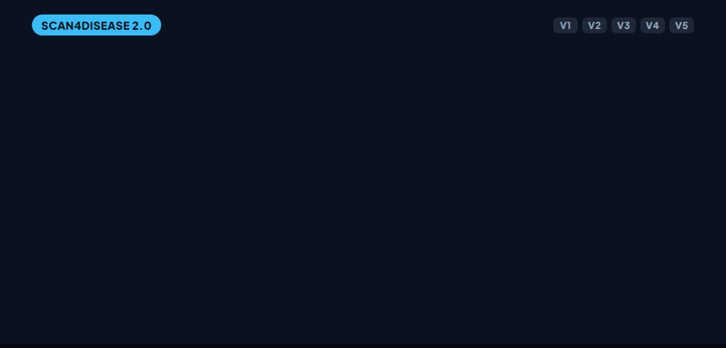
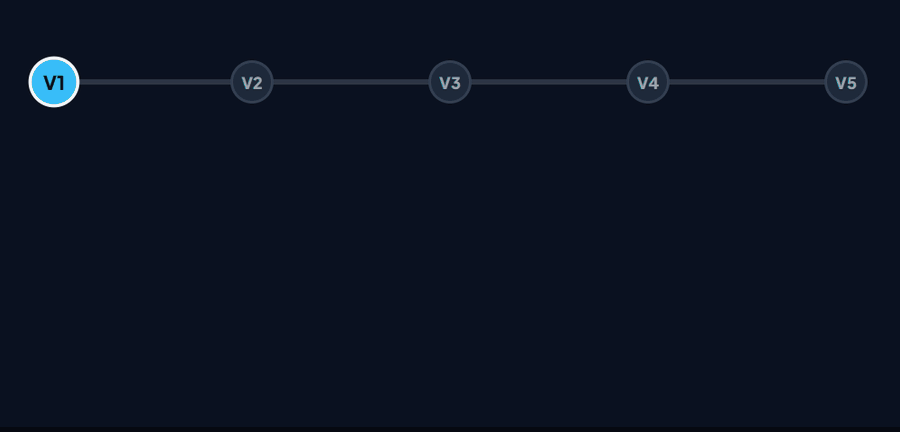
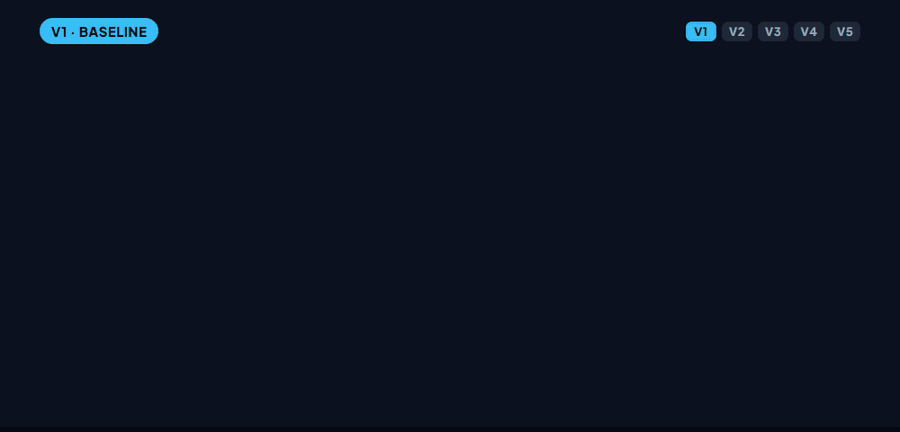
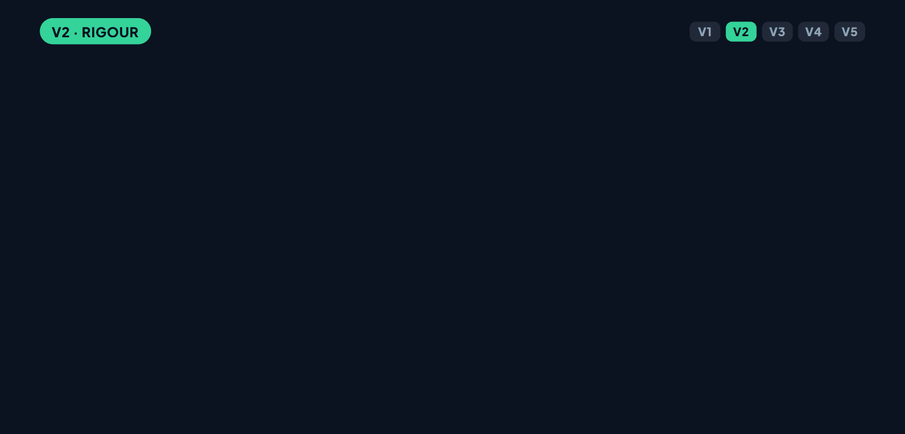
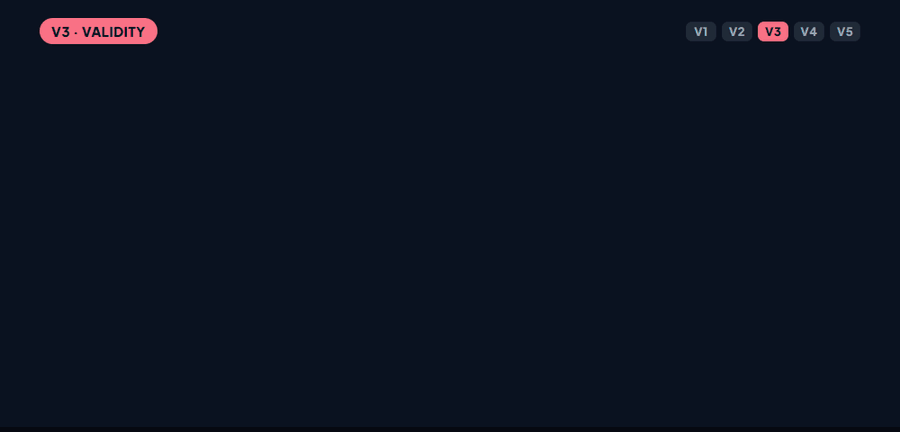
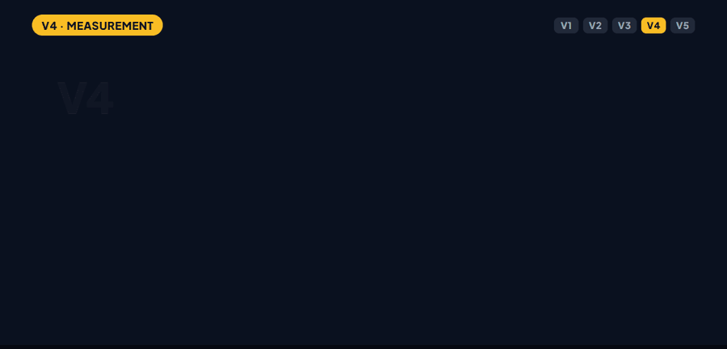
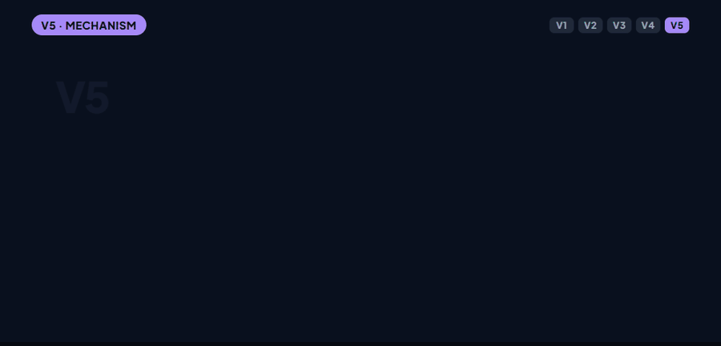
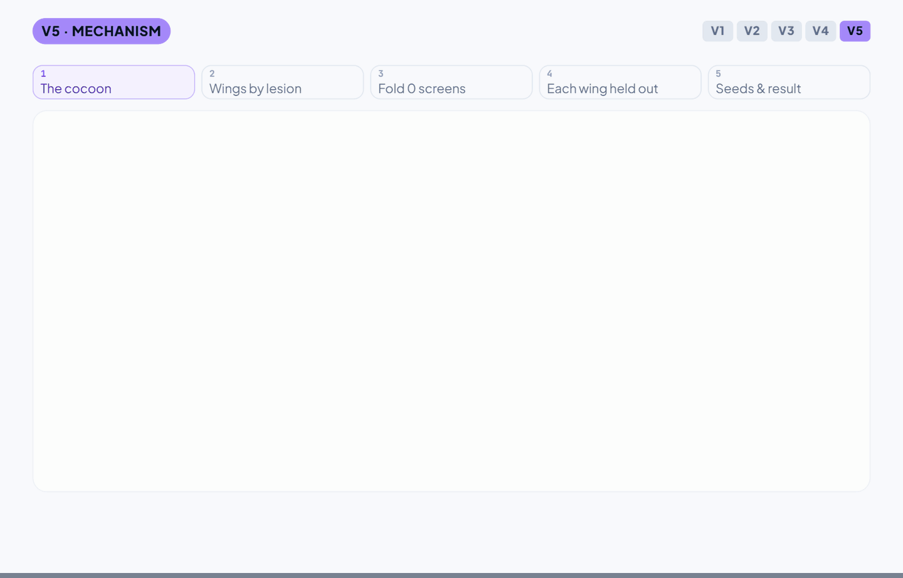
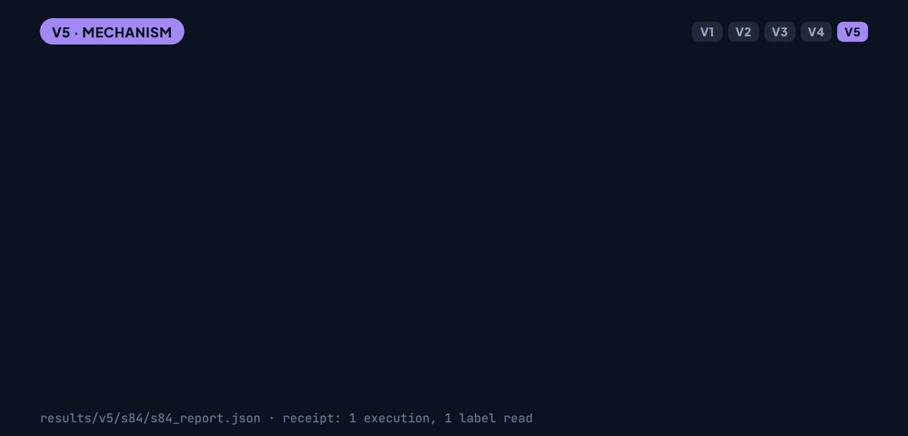
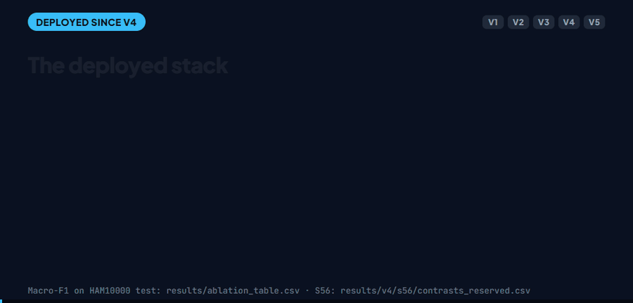

<div align="center">

# Scan4Disease 2.0 · Backend-S4D

### Leak-free, pre-registered research on safe skin-lesion triage in dermoscopy, and on why it keeps failing patients under 40



<p>
  
  
  
  
  
  
</p>

<a href="#v1"></a>
<a href="#v2"></a>
<a href="#v3"></a>
<a href="#v4"></a>
<a href="#v5"></a>
<a href="#v6"></a>

**Team 193 · Project Exhibition · School of Computing Science and Engineering, VIT Bhopal University**

[Programme](#the-programme-at-a-glance) · [What was established](#what-five-versions-established) · [Deployed system](#the-deployed-system) · [Integrity](#research-integrity) · [Repository](#repository-layout) · [Reproduce](#getting-started) · [Team](#team) · **[Navigate the repo →](NAVIGATION.md)**

</div>

---

## The question

Skin-lesion classifiers are usually judged on accuracy, which misleads here: **66.9%** of HAM10000's 10,015 images are benign nevi, so a model that always answers "benign mole" scores about 67% while missing every melanoma. This project asks whether a classifier can be trusted as a **triage tool**: does it send the lesions that need a specialist (melanoma, basal-cell carcinoma, actinic keratosis) to one, for every patient group?

| | |
|---|---|
| **Task** | 7-class dermoscopy diagnosis; escalate {MEL, BCC, AKIEC} |
| **Metrics** | Macro-F1, balanced accuracy, escalation sensitivity, under-40 escalation pAUC. **Never accuracy** |
| **Cohorts** | HAM10000, BCN20000, MSKCC, PAD-UFES-20 (smartphone), ISIC Archive (train-only young data), MILK10k (external, read once) |
| **Central finding** | Under-40 escalation sensitivity of **0.143** (3 of 21 images, from only 10 lesions) against about 0.78 in older bands, with *confident* misses. Five versions narrowed the cause to a **ranking limit in the learned representation** |

---

## The programme at a glance



Each version was started by the question its predecessor left open, and each plan was frozen and hashed before the runs that tested it. The record, session by session, is in [`CHANGELOG.md`](CHANGELOG.md).

<sub>The GIFs on this page are of two kinds: charts and step strips recorded from the project's Review 2 infographic, and big-type scenes whose numbers are read directly from `results/` by [`scripts/readme_media/`](scripts/readme_media/).</sub>

---

<a id="v1"></a>

## V1 · The baseline



- **Only ensembling cleared significance:** the 6-CNN soft vote beats ConvNeXt-Tiny with McNemar χ² 17.20, p = 3.4 × 10⁻⁵ (85 vs 38 discordant cases).
- **The ensemble is under-confident, not over-confident,** which is why the class-wise Dirichlet map beats temperature scaling (soft-vote test ECE 0.1575 → 0.0206).
- **Better calibration cost escalations:** on the TTA stack, Macro-F1 rises 0.7859 → 0.8047 while missed serious cases rise 62 → 78.
- **Under 40, the misses are confident:** abstention refers only 11.1% of them.

<details>
<summary><b>V1 ablation ladder and age bands</b> (HAM10000 test, 1,502 images, 290 escalating cases)</summary>
<br>

Lesion-grouped 1,000× bootstrap CIs. Rungs were **selected on validation**.

| Rung | System | Macro-F1 [95% CI] | Balanced acc. | Escalation sens. | Missed serious |
|---|---|:---:|:---:|:---:|:---:|
| A1 | ResNet-50 | 0.7058 [0.647, 0.750] | 0.7217 | 0.7379 | 76 |
| A2 | **ConvNeXt-Tiny** (best single CNN on val) | 0.7459 [0.693, 0.781] | 0.7792 | 0.7759 | 65 |
| A3 | SwinV2-Tiny | 0.7273 [0.668, 0.777] | 0.7116 | 0.6621 | 98 |
| A4 | Gated metadata fusion | 0.7411 [0.684, 0.787] | 0.7433 | 0.6862 | 91 |
| A5 | **6-CNN uniform soft vote** | 0.7718 [0.720, 0.812] | 0.7923 | 0.7828 | 63 |
| A6 | + 24-view TTA | 0.7859 [0.734, 0.824] | 0.8102 | **0.7862** | **62** |
| A7 | + Dirichlet calibration | **0.8047** [0.757, 0.841] | 0.7939 | 0.7310 | 78 |

MaxViT-Tiny scores 0.7525 on test but 0.7176 on val, so it was not selected.

| | < 40 | 40–59 | ≥ 60 |
|---|:---:|:---:|:---:|
| Escalating share of training images | **4.9%** | 12.8% | 35.5% |
| Test escalation sensitivity | **0.143** (3 / 21; 10 lesions) | 0.786 (55 / 70) | 0.774 (154 / 199) |
| Misses referred by margin abstention | **11.1%** (2 / 18) | 33.3% (5 / 15) | 37.8% (17 / 45) |

The test figure rests on 21 cases. The better-powered OOF estimate is 0.547 (35 / 64).

<sub>Sources: `results/ablation_table.csv`, `results/mcnemar_delong.json`, `results/review2/v1_member_metrics.csv`, `results/age_band_prior.csv`, `research/selective/results/session4_report.md`, `research/stats/results_oof/age_gap_intervals.csv`.</sub>
</details>

---

<a id="v2"></a>

## V2 · Is it the decision threshold?



- **No.** The compression gap spans zero in all three cohorts, so the miss sits upstream of the decision rule.
- **The only GO: coverage is not protection.** Marginal conformal coverage reaches 95.07%, yet false reassurance on serious lesions is 8.64%, above the 4.93% ceiling. Bipartite conformal cuts under-40 false reassurance from 6/29 to 1/29 (Holm p = 0.044).

<details>
<summary><b>V2 numbers</b></summary>
<br>

| Cohort (under 40) | Compression gap C | 95% CI | Escalating |
|---|:---:|:---:|:---:|
| HAM OOF | −0.0312 | [−0.0877, +0.0256] | 64 |
| BCN20000 | +0.0054 | [−0.0058, +0.0137] | 369 |
| PAD-UFES-20 | 0.0000 | [0.0000, +0.0256] | 74 |

<sub>Sources: `results/v2/bootstrap_intervals.json`, `results/v2/final_verdict.json`, `results/v2/frr_by_group.csv`, `results/v2/conformal_subgroup_safety.csv`.</sub>
</details>

---

<a id="v3"></a>

## V3 · Can it be broken?



- **An inflated lead was caught:** V2's probe fell from 0.9930 to 0.7182 on out-of-sample features, below the deployed posterior (0.8096).
- **The endpoint was noisier than the effect:** two models on byte-identical data caught 14/22 and 9/22.
- **Age is load-bearing:** removing it moved Macro-F1 from 0.7421 to 0.6000 and under-40 AUC from 0.8249 to 0.7201.

<details>
<summary><b>V3 hypotheses</b> (zero test reads)</summary>
<br>

| # | Claim | Evidence | Verdict |
|---|---|---|:---:|
| H1 | N2's head result survives out-of-sample features | 0.9930 → 0.7182 | Falsified |
| H2 | A better head recovers the gap | overall −0.0131 | Falsified |
| H3 | The representation is age-entangled | age-band AUC 0.6922 [0.6638, 0.7187] | **Certified** |
| H4 | Pooling archives adds ≥ +0.03 Macro-F1 | −0.0088 [−0.0554, +0.0354] | Falsified |
| H5 | Breadth buys unseen-archive robustness | 0 of 2 zero-shot contrasts | Falsified |
| H6 | Removing age helps under 40 | under-40 AUC −0.1049 | Falsified |

Best condition 0.7869: the 0.80 ceiling was not broken.

<sub>Sources: `results/v3/final_verdict.json`, `results/v3/oos_probe_report.json`, `results/v3/s44_control_and_multiplicity.json`, `results/v3/d2_strong_evaluation.json`.</sub>
</details>

---

<a id="v4"></a>

## V4 · Measure it properly



- **The question became measurable:** "3 of 21" was 10 lesions; a reserved cohort of 4,733 images now holds 104 under-40 escalating lesions.
- **In-domain data is the big lever:** on the same reserved rows, Macro-F1 goes from 0.411 (V1) to 0.603 (pooled control), confounded by corpus and labelled so.
- **It is a ranking limit:** under-40 AUC 0.878 against 0.948 and 0.929. Frozen foundation models do not rank under-40 better, and the pre-declared safety contract meets 0 of 9 terms.
- **One layer survives:** S56 per-age-band abstention is deployed.

<details>
<summary><b>V4 numbers</b></summary>
<br>

| Read | Result |
|---|---|
| Gate A: composite vs V1, reserved (confounded by corpus) | Macro-F1 +0.1798 [+0.1297, +0.2254] |
| Gate B: composite vs control, reserved | outcome 4, "neither": Macro-F1 −0.0121 [−0.0321, +0.0098], under-40 pAUC +0.0089 [−0.0200, +0.0367] |
| S51: PanDerm − ConvNeXt, under-40 pAUC | −0.0363 [−0.0828, +0.0127]; falsifier fired |
| S59: safety contract, reserved | 0 of 9 terms; sensitivity 0.7634 / 0.7040 / 0.6744 vs a 0.855 floor; referral 0.386 vs a 0.25 cap |
| S56: per-band vs global abstention at a 20% budget | under-40 system sensitivity +0.154 [+0.104, +0.216]; under-40 referral 0.232 → 0.454 |

<sub>Sources: `results/v4/power_audit.json`, `results/v4/s54/s54_gate.json`, `results/v4/backbone_probe_deltas.csv`, `results/v4/s59/s59_report.json`, `results/v4/s56/contrasts_reserved.csv`, `results/v4/s64/ceiling.json`, `paper/v4/v4_findings.md`.</sub>
</details>

---

<a id="v5"></a>

## V5 · Dermatologist reasoning



Each module turned a bedside heuristic into code and had to pass a screen and a falsifier written before its result existed. Three survived: **two-step triage heads, melanoma-vs-look-alike ranking, and young biopsy-proven data**, on an ImageNet-22k trunk.

- **A real under-40 gain, below the clinical bar:** +0.0351 [+0.0125, +0.0596], p = 0.003, on all three seeds, against a +0.050 MCID.
- **Most of it came from the modules and young data:** +0.0270 [+0.0045, +0.0488], p = 0.023. The trunk swap alone: +0.0081, p = 0.432.
- **All-age ranking did not move:** +0.0020, 1 of 3 seeds positive.

### How the 12,235 was earned

Every image is scored once, by a model that never saw it or any other photo of the same lesion.



### The external read: MILK10k

One execution, one label read, receipted. Before any stage ran, lesions already in ISIC 2019 were excluded (deviation D6).



- **V5 classifies better than V1 on the outside cohort:** Macro-F1 0.474 vs V1's 0.374, Δ +0.100 [+0.074, +0.127], non-inferior at the −0.02 margin. The gain is relative: absolute Macro-F1 is lower than the 0.7005 measured on development folds.
- **The under-40 primary was not met:** 49/50 vs 47/50 at a matched 0.52 referral, McNemar p = 0.3125. Both systems sit at the ceiling, and only 50 of the planned 71 lesions remained after D6. This is a lack of resolution, not evidence that the systems are equal.
- **The safety contract fails on referral:** sensitivity 0.960 clears the floor (lower bound 0.863), but referral is 0.463 against a 0.25 cap. MILK10k is 81.4% escalating, against 34.8% in the development pool.
- **How MILK10k is used now:** it is spent as a test set. It becomes V6 training data without the 985 linked lesions, and HIBA stays untouched as V6's confirmation cohort.

<details>
<summary><b>V5 numbers</b>: confirmation, decomposition, screens, MILK10k</summary>
<br>

**Three-seed confirmation** (locked composite vs control, held-out folds 1–4): 12,235 images, 7,002 lesions, 65 under-40 escalating lesions, 2,000 hierarchical bootstrap resamples.

| Gate | Δ (composite − control) | 95% CI | p | Result |
|---|:---:|:---:|:---:|:---:|
| **A** · under-40 escalation pAUC | **+0.0351** | [+0.0125, +0.0596] | 0.003 | Not met (MCID +0.050) |
| **B** · Macro-F1 retention | +0.0107 | [−0.0015, +0.0225] | 0.095 | Pass |
| **C** · older-band sensitivity at spec 0.80 | +0.0071 (40–59), −0.0007 (60+) | [−0.0127, +0.0234], [−0.0101, +0.0083] | 0.522, 0.872 | Pass |
| **D** · all-age escalation pAUC | +0.0020 | [−0.0056, +0.0093] | 0.596 | Not met |

**Decomposition** (Q11, deviation D4):

| Contrast | Under-40 pAUC | p | Macro-F1 | p |
|---|:---:|:---:|:---:|:---:|
| Modules + young data (same IN-22k trunk) | +0.0270 [+0.0045, +0.0488] | 0.023 | +0.0025 [−0.0073, +0.0118] | 0.649 |
| IN-22k trunk (same recipe) | +0.0081 [−0.0127, +0.0301] | 0.432 | +0.0082 [−0.0045, +0.0191] | 0.188 |

**MILK10k** (S84; 5,220 eligible, 965 excluded, 4,255 analysed, 4,148 in scope):

| Endpoint | V5 | V1 | Result |
|---|:---:|:---:|:---:|
| Primary: under-40 sensitivity at matched referral | 0.980 (49 / 50) | 0.940 (47 / 50) | Not met, p = 0.3125 |
| Key secondary: sensitivity ≥ 0.855 and referral ≤ 0.25 | 0.960, referral 0.463 | | Not met |
| Global Macro-F1 | 0.474 | 0.374 | Non-inferior, Δ +0.100 [+0.074, +0.127] |
| Escalation AUROC, all ages | 0.831 | 0.782 | Descriptive |
| Under-40 escalation pAUC | 0.747 | 0.767 | Descriptive, V1 leads |

**24-view TTA on the V5 composite** (descriptive, common OOF, folds 1–4): Macro-F1 0.6911 → 0.7005.

<sub>Sources: `results/v5/confirm_s42_s43_s44.json`, `results/v5/q11_decomposition.json`, `results/v5/review2_tables.md`, `results/v5/composite_lock.json`, `results/v5/s84/s84_report.json`, `results/v5/s84_receipt.json`, `results/v5/protocol_deviations.json`, `results/v5/v5_oof_common_matrix.json`.</sub>
</details>

---

## What five versions established

| Moved the numbers | Effect | Source |
|---|---|---|
| Training in domain | Macro-F1 0.411 → 0.603 on the same reserved rows (confounded by corpus) | V4 |
| Ensembling | 0.7459 → 0.7718, McNemar p = 3.4 × 10⁻⁵ | V1 |
| Young data + V5 modules | under-40 pAUC +0.0270 [+0.0045, +0.0488] on the same trunk | V5 |
| Per-band abstention | under-40 system sensitivity +0.154 [+0.104, +0.216], paid for with referral | V4 |

| Ruled out | Evidence | Source |
|---|---|---|
| Decision compression | every interval spans 0 | V2 |
| A removable age shortcut | under-40 AUC −0.1049 when removed | V3 |
| Frozen foundation backbones under 40 | PanDerm −0.0363 [−0.0828, +0.0127] | V4 |
| Hand-built colour, geometry, zoom and prototype modules | failed a screen or a falsifier written in advance | V5 |

---

## The deployed system



| Layer | Status | Evidence |
|---|---|---|
| Soft vote + TTA + Dirichlet | Deployed since V1 | `results/ablation_table.csv` |
| S56 per-band abstention | Deployed (V4) | `results/v4/s56/contrasts_reserved.csv` |
| Age-conditional λ rule, conformal layer | Not deployed: no gain over S56 alone at matched workload (combined policy +0.004 [−0.014, +0.025]) | `results/v4/s59/s59_report.json`, `results/v4/s65/contrasts_reserved.csv` |

---

<a id="v6"></a>

## V6 · Not frozen, no results

The current plan is a **leak-audited, data-maximal ensemble across pretraining families, image-only**, and it has no results yet: every stage is still to run. The anchor is ConvNeXt-Tiny (IN-22k); the candidate members to screen are the same trunk at 384 px, PanDerm-B, DINOv2 ViT-B/14 and SigLIP 2 B/16. A single receipted read of HIBA is the planned confirmation. The plan records in advance that the under-40 gate is unlikely to pass. Plan: [`docs/V6_RUNSHEET.md`](docs/V6_RUNSHEET.md), Part 0.

---

## Research integrity

These rules are enforced in code, not left to convention. Breaking any one of them invalidates an experiment.

1. **Lesion-grouped splits.** Every split groups images by `lesion_id` (10,015 images on 7,470 lesions); `assert_no_leakage()` must pass.
2. **Locked test.** The HAM10000 test split was read under one frozen plan on 4 Sep 2026; `results/test_pass_receipt.json` stands at **2 executions** (two stages of that plan), and `research/testguard.py` locks the split process-wide.
3. **Read-once external cohorts.** `results/v5/s84_receipt.json` records 1 execution and 1 label read of MILK10k.
4. **Nothing hand-entered.** Every number comes from `results/`. Manuscript claims and this README are re-checked against it by audit scripts.
5. **No accuracy for selection.** Model, weight, threshold and temperature choices are made on validation or out-of-fold data, never on test, and never by accuracy.
6. **Pre-registration before data.** Plans are SHA-256-hashed before the runs that test them (`results/v3/analysis_plan_v3.json`, `results/v4/analysis_plan_v4.json`, `results/v5/v5_plan_freeze.json`). Deviations are numbered and logged before the data they concern (`results/v5/protocol_deviations.json`).
7. **Honest intervals.** Exact Clopper–Pearson intervals for small-count proportions, a lesion-grouped bootstrap for everything else, Holm correction inside each declared comparison family (`research/stats/`). An interval that contains the null is reported as *not certified*, never as evidence of absence.

---

## Repository layout

```text
Backend-S4D/
├── ml/                     Core training and evaluation engine
│   ├── preprocessing/      Lesion-grouped splitter, transforms, dataset loaders
│   ├── training/           Two-stage fine-tuning (AdamW, cosine schedule, class-balanced loss)
│   ├── evaluation/         Metrics (Macro-F1, balanced accuracy, escalation sensitivity)
│   ├── explainability/     Grad-CAM
│   └── configs/            Class mapping, training config, frozen split_v1.csv
├── research/               One package per research question
│   ├── ensembling/ tta/ calibration/ selective/ conformal/ agerule/ dca/   V1 phases 1–4
│   ├── stats/ ablation/ external/ xdomain/                                V1 statistics, audits, external cohorts
│   ├── v2/ v3/ v4/ v5/ v6/                                                The post-Review-1 programme
│   ├── review2/            Generator for the Review-2 fact tables
│   └── experiments.csv     Append-only ledger of every run
├── results/                Every number and figure (JSON / CSV / Markdown), per version
├── paper/                  Manuscripts (LaTeX), tables and figures
├── docs/                   Research plans, runsheets and the research log, in time order
├── scripts/                Environment check, dataset download, run launchers, GPU benchmark, README media
├── tests/                  Unit and contract tests (V4 service, V5 modules)
└── CHANGELOG.md            Session-by-session record: what was done, why, and the source of every new number
```

Model checkpoints and the image datasets are **not** in the repository (size and licence); see below.

---

## Getting started

### 1 · Environment

```bash
git clone https://github.com/Rajrup910/Backend-S4D.git
cd Backend-S4D
python -m venv .venv
# Windows: .venv\Scripts\activate     Linux/macOS: source .venv/bin/activate
pip install torch torchvision --index-url https://download.pytorch.org/whl/cu128
pip install -r ml/requirements.txt
python scripts/verify_env.py
```

PyTorch must come from the CUDA 12.8 index: the default PyPI wheels do not support the RTX 50-series (sm_120) GPU this work was run on.

### 2 · Data

Download the archives from their official sources and place them under `data/` (git-ignored): **HAM10000** (Harvard Dataverse), **BCN20000** and **MSKCC** (ISIC Archive), **PAD-UFES-20** (`python scripts/download_pad_ufes.py`). The frozen V1 split is `ml/configs/splits/split_v1.csv`; the V4/V5 five-fold partition is `results/v4/kfold/fold_assignments.csv`.

### 3 · Verify the record

```bash
python -m research.ablation.audit_manuscript      # V1 manuscript claims vs results/
python -m research.v4.audit_v4 --check            # V4 splits, receipts and numerical claims
python -m research.v5.adopt_e1 --verify           # V5 pre-registration hashes
python scripts/readme_media/audit_readme.py       # every number and link on this page vs results/
pytest tests -q                                   # unit and contract tests
```

None of these read the test split.

---

## Documentation

| Read this | For |
|---|---|
| [`NAVIGATION.md`](NAVIGATION.md) | Fast lookups: where each piece of code, result and number lives |
| [`docs/README.md`](docs/README.md) | Every plan, runsheet and log, in the order it was written |
| [`CHANGELOG.md`](CHANGELOG.md) | The full narrative: each session, its decision and the file behind each number |
| [`results/README.md`](results/README.md) | How the V1 result files are generated |
| [`paper/v4/v4_findings.md`](paper/v4/v4_findings.md) | What V4 settled |
| [`results/v5/review2_tables.md`](results/v5/review2_tables.md) | Generated V5 tables (screens, confirmation, decomposition) |
| [`scripts/readme_media/`](scripts/readme_media/) | How the GIFs on this page are built |

---

## Team

| Member | Registration | Responsibility |
|---|---|---|
| **Prateek Chhabra** | 23BAI10169 | Ensembling, TTA and inference |
| **Rajrup Roy Chowdhury** | 23BAI10213 | CNN backbones, calibration, V5 confirmation (corresponding author) |
| **Aditya Srivastava** | 23BAI10303 | Vision transformers and foundation-model probes |
| **Kanak Pravin Sonare** | 23BAI11369 | Multi-cohort data and the zero-leakage shield |
| **Manishka Gupta** | 23BAI11303 | Metadata fusion and the dermatologist decision flow |
| **Uddhav Gupta** | 23BAI10146 | Statistical audits and conformal guarantees |

**Supervisor:** Dr. Paras Jain, Associate Professor, SCSE, VIT Bhopal University.

### Citation

```bibtex
@misc{backend_s4d_2026,
  title  = {Scan4Disease 2.0: Pre-Registered Evaluation of Safe Skin-Lesion Triage and the Under-40 Blind Spot},
  author = {Chhabra, Prateek and Roy Chowdhury, Rajrup and Srivastava, Aditya and
            Sonare, Kanak Pravin and Gupta, Manishka and Gupta, Uddhav},
  year   = {2026},
  howpublished = {\url{https://github.com/Rajrup910/Backend-S4D}},
  note   = {VIT Bhopal University, Team 193}
}
```

<sub>Research software for study purposes. It is not a medical device and must not be used for clinical decisions.</sub>
