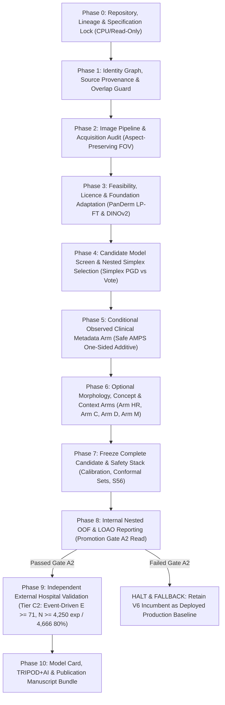

# V7 Final Execution Runsheet & Phased Experimental Protocol

> **Precedence (11 Nov 2026).** `V7_FINAL_MASTER_RESEARCH_PLAN.md` **section 14 controls** wherever this document differs. In particular: the promotion rule is P1-P3 (plan 10.4, 14.3) and Gate A2 is a secondary read; MIDAS is a sealed **retrospective** external biopsy cohort, all ages only, and no prospective or consecutive external series exists (14.5); HIBA and the retired splits are training-only; nothing here is "certified", "frozen" or "validated" until the owner signs Gate 0 and the runs exist; the data gate is audited with stated lower bounds, never leak-free.

> **Audit notice, 10 November 2026.** Counts, power figures and several statements about V6 in this suite were corrected against files on disk. Section 9 of `V7_FINAL_MASTER_RESEARCH_PLAN.md` controls where this runsheet differs, including its additions to Phase 0 (leak disclosure, measured cost, V6-recipe LOAO baseline). No time or memory figure below is measured.

**Program:** Scan4Disease (S4D) / Backend-S4D  
**Document Designation:** Authoritative Phased Execution Runsheet (Phases 0 to 10)  
**Document Authority:** Controls Experimental Sequence, Hardware Profiles, Gates & Stop Rules  
**Target Hardware:** NVIDIA GeForce RTX 5050 Laptop GPU (8.55 GB Dedicated VRAM, Windows WDDM)  
**Python Environment:** `C:\Users\RAJ\Downloads\Capstone\.venv\Scripts\python.exe` (`torch 2.11+cu128`, `--num-workers 2`)  
**Date:** 8 November 2026  
**Execution Status:** FROZEN / ON HOLD (Execution Gated on Explicit Human Owner Approval; Zero Training Executed)

---

## 1. Master Phased Execution Roadmap

The execution of Project Scan4Disease V7 is structured into **11 strictly dependency-ordered, sequential phases (Phases 0 to 10)**. No phase may launch until its predecessor's promotion gate has officially passed, verified against pre-declared thresholds, and emitted a tamper-evident cryptographic receipt.

---

## 2. Exhaustive Phase-by-Phase Protocol Specifications

---

### Phase 0: Repository, Lineage & Specification Lock (CPU / Read-Only)
* **Hypothesis:** Reconciling the historical V1–V6 evidence base, fixing superseded copy-inflated metrics, and freezing code/checkpoint hashes establishes an uncorrupted foundation for V7.
* **Inputs:** All repository files, `results/frozen_artifacts.json`, `results/v6/hiba_receipt.json`, `results/v5/confirm_s42_s43_s44_without_copies.json`, `docs/v7_final_revision/V7_FINAL_MASTER_RESEARCH_PLAN.md`.
* **Controls:** Frozen baseline Git commit `4e6d32b542999d1d3823807791a4149a16f2af25` on branch `v5-confirmation-review2`.
* **Split / Cluster Unit:** System-wide file manifests and repository artifacts.
* **Endpoint:** SHA-256 match rate across all historical receipts and model artifacts ($100.0\%$).
* **Analysis:** Execute `python scripts/verify_frozen_hashes.py` to compare on-disk bytes against frozen ledgers.
* **Pre-Registration:** Locked in `.relay/HANDOFF.md` and `CHANGELOG.md`.
* **Output Path:** `results/v7/phase0_baseline_hashes.json`.
* **Cost Basis / Hardware:** CPU only; $\approx 45\text{ seconds}$; 0.0 GB GPU VRAM.
* **Stop Rule:** If any SHA-256 digest in `results/frozen_artifacts.json` or `results/v6/hiba_receipt.json` fails to match on-disk bytes, halt pipeline immediately.
* **Evidence State:** `DESIGNED`.
* **Owner Approval Gate (Gate 0):** Owner signs off on baseline verification and authorises Phase 1.

---

### Phase 1: Identity Graph, Source Provenance & Overlap Guard
* **Hypothesis:** A formal two-list identity structure (confirmed same-lesion groups vs. non-transitive at-risk patient links) eliminates cross-split data leakage without causing false-positive lesion over-merging.
* **Inputs:** Development archives (HAM10000, BCN20000, MSKCC; $N = 15,294$ images) + External benchmarks (HIBA, ISIC 2020, PAD-UFES-20; $N \approx 27,000$ images).
* **Controls:** Legacy duplicate lists (`results/v5/confirm_s42_s43_s44_without_copies.json`).
* **Split / Cluster Unit:** Distinct entities: `canonical_image_id`, `lesion_cluster_id`, `patient_cluster_id`, `split_group_id`, `at_risk_link_id`.
* **Endpoint:** Synthetic plant detection recall ($100.0\%$) and cross-split leak count ($0$).
* **Analysis:**
  1. *Confirmed Groups (High Precision):* Indivisible split clusters formed strictly by exact byte SHA-256, normalized archive lesion IDs, or calibrated multi-detector verification.
  2. *At-Risk Links (High Recall, Non-Transitive):* Pairs with deep embedding similarity ($d_{\text{cos}} \le 0.08$ on DINOv2) or shared patient IDs trigger training-side purges, but **never merge lesion components transitively**.
  3. *Synthetic Duplicates Plant Test:* Inject 200 synthetic duplicates (photometrically perturbed, rotated) into `research/data/overlap_guard.py`.
* **Pre-Registration:** Two-list protocol defined in `V7_DATA_PLAN.md`.
* **Output Path:** `ml/data/v7/master_v7.csv`, `results/v7/overlap_guard_receipt.json`, `results/v7/identity_graph_summary.json`.
* **Cost Basis / Hardware:** RTX 5050 GPU for DINOv2 feature extraction; peak VRAM $3.40\text{ GB}$; runtime $\approx 45\text{ minutes}$.
* **Stop Rule:** If synthetic duplicate recall $< 100.0\%$ ($< 200/200$) or any cross-split duplicate is detected, halt pipeline. Quarantined components exceeding 15 images must be reviewed manually (never auto-cut).
* **Evidence State:** `DESIGNED`.
* **Owner Approval Gate (Gate 1):** Owner signs off on `master_v7.csv` manifest and overlap guard audit.

---

### Phase 2: Image Pipeline & Acquisition Audit (Aspect-Preserving FOV)
* **Hypothesis:** Replacing `transforms.CenterCrop(224)` with Aspect-Preserving Reflection Padding Resize eliminates the $34.37\%$ horizontal FOV truncation on HAM10000 ($600\times 450$) images without introducing synthetic boundary artifacts.
* **Inputs:** `ml/data/v7/master_v7.csv` across development folds 1–4 ($N = 12,235$ images (7,002 lesions, 6,989 lesion groups)).
* **Controls:** Legacy V6 preprocessing pipeline (`transforms.Resize(256) + transforms.CenterCrop(224)`).
* **Split / Cluster Unit:** Lesion cluster (`lesion_cluster_id`).
* **Endpoint:** Valid source pixel coverage ratio ($\equiv 1.000$) and dataloader batch latency ($\le 45\text{ ms/batch}$).
* **Analysis:**
  1. Measure image dimensions, aspect ratios, bit depth, and compression artifacts by archive.
  2. Implement Aspect-Preserving Reflection Padding Resize in `ml/preprocessing/v7_transforms.py`: for $W > H$, reflect-pad top and bottom by $\lfloor (W-H)/2 \rfloor$ and $\lceil (W-H)/2 \rceil$ to square before bilinearly resizing to target resolution ($384 \times 384$ px for ConvNeXt/PanDerm, $392 \times 392$ px for DINOv2-Reg).
  3. Validate valid-source-pixel mask to ensure zero anatomical border amputation.
  4. Explicitly mark crops as **pixel-scale crops**, not micrometre crops, unless source physical lens calibration is verified.
* **Pre-Registration:** FOV protocol specified in `V7_IMAGE_INPUT_RESOLUTION_AND_CROPPING_PROTOCOL.md`.
* **Output Path:** `ml/preprocessing/v7_transforms.py`, `results/v7/image_pipeline_audit.json`.
* **Cost Basis / Hardware:** CPU + dataloader profiling; peak RAM $\le 6.5\text{ GB}$; runtime $\approx 20\text{ minutes}$.
* **Stop Rule:** If reflection padding produces edge ringing or dataloader latency exceeds $45\text{ ms/batch}$, re-tune padding buffers.
* **Evidence State:** `DESIGNED`.
* **Owner Approval Gate (Gate 2):** Owner approves transform pipeline parity and verified FOV preservation.

---

### Phase 3: Feasibility, Licence & Foundation Adaptation Experiments
* **Hypothesis:** Kumar et al. (ICLR 2022) two-stage Linear Probing then Fine-Tuning (LP-FT) with recalibrated LLRD ($\gamma = 0.80$, base LR $2.5 \times 10^{-4}$) resolves PanDerm lower-trunk optimization arrest (expanding Block 0 LR to $1.72 \times 10^{-5}$, a $24.2\times$ increase over V6) without representation collapse.
* **Inputs:** Clean pretrained checkpoints:
  - PanDerm ViT-B/16 (`be1e0fb108b3bc58721cb5195f136c948160799438f222acf1fd142230ac1ff1`).
  - DINOv2-Reg ViT-B/14 (`dinov2_vitb14_reg4_pretrain.pth`).
* **Controls:** Frozen V6 PanDerm checkpoint (`research/v6/panderm_b.pt`, where lower blocks moved $< 1.4\%$).
* **Split / Cluster Unit:** 5-fold grouped development splits (`split_group_id`) across Folds 1–4.
* **Endpoint:** Process diagnostics (Block 0 weight displacement $\frac{\|\theta_t - \theta_0\|}{\|\theta_0\|} \ge 5.0\%$, linear $\text{CKA} \ge 0.70$) and clinical non-inferiority against V6 PanDerm on held-out validation.
* **Analysis:**
  1. *Adaptation Ladder:*
     - Arm 3A (Frozen Linear Probe): 5 epochs, LR $1.0 \times 10^{-3}$.
     - Arm 3B (Top-Block Fine-Tuning): 10 epochs, fine-tune Blocks 10–11 only.
     - Arm 3C (Two-Stage LP-FT — Primary Candidate): Stage 1 linear probe (5 epochs) $\to$ Stage 2 full fine-tune with $\gamma=0.80$, base LR $2.5 \times 10^{-4}$ (15 epochs).
     - Arm 3D (Direct Full Fine-Tuning): 20 epochs, constant LLRD $\gamma=0.80$.
     - Arm 3E (LoRA Comparator): Rank-16 LoRA adapter on query/value projections.
  2. *Licence Quarantine:* Fine-tuned PanDerm weights are maintained strictly private under CC BY-NC-ND 4.0 research terms; no public redistribution permitted.
* **Pre-Registration:** Tuning recipe defined in `V7_PANDERM_AND_FOUNDATION_MODEL_TUNING_PROTOCOL.md`.
* **Output Path:** `ml/checkpoints/v7/panderm_lpft_f*.pt`, `results/v7/panderm_adaptation_audit.json`.
* **Cost Basis / Hardware (RTX 5050 8.55 GB):**
  - Standardized effective batch 32 ($B_{\text{micro}} = 8, S_{\text{accum}} = 4$). PyTorch gradient checkpointing enabled; AMP FP16.
  - Peak allocated VRAM: PanDerm $5.15\text{ GB}$; DINOv2-Reg $5.38\text{ GB}$ (headroom $\ge 3.17\text{ GB}$).
  - Compute budget: $\approx 3.6\text{ hours}$ per fold $\times 4$ folds = $\mathbf{14.4\text{ GPU hours}}$ per model.
* **Stop Rule:** If Block 0 parameter displacement remains $< 2.0\%$ or linear CKA drops $< 0.70$, halt training. If held-out validation Macro-F1 is statistically inferior to V6 PanDerm ($\Delta \text{Macro-F1} < -0.020$), reject LP-FT arm.
* **Evidence State:** `DESIGNED`.
* **Owner Approval Gate (Gate 3):** Owner inspects displacement audit, licence compliance, and validates candidate checkpoints.

---

### Phase 4: Candidate Model Screen & Ensemble Selection (Nested Simplex PGD)
* **Hypothesis:** Ensembling diverse foundation models (ConvNeXt texture prior + PanDerm MIM + DINOv2 registers) via simplex PGD ($\mathbf{w} \in \Delta^{M-1}$) fitted strictly within inner folds provides higher out-of-domain transportability than any single model or unconstrained stacker.
* **Inputs:** Common-row out-of-fold prediction matrices across all $N = 12,235$ images (7,002 lesions, 6,989 lesion groups) for candidates:
  - ConvNeXt-Tiny 384 px (`anchor384_h7`)
  - PanDerm-Base 384 px LP-FT (`panderm_b384_lpft`)
  - DINOv2-Reg 392 px (`dinov2_reg392_h7`)
  - MaxViT-Tiny 384 px (`maxvit_tiny_384`) [Optional Screen]
  - Legacy CNNs (ConvNeXt-S, EfficientNet-B0/B3, DenseNet-121, ResNet-50) [Optional Screen]
* **Controls:** Deployed `V6_REFERENCE` uniform soft vote (Macro-F1 $0.7433$ OOF).
* **Split / Cluster Unit:** Outer 5-fold cross-validation $\times$ Inner 4-fold cross-fitting ($5 \times 4$ nested CV).
* **Endpoint:** Held-out outer OOF Macro-F1, balanced accuracy, and under-40 escalation pAUC (`pauc_u40`).
* **Analysis:**
  1. Fit simplex weights $\mathbf{w} \in \Delta^{M-1}$ via Projected Gradient Descent (PGD) on inner folds to minimize cross-entropy loss.
  2. Compare nested simplex model against arithmetic uniform soft voting.
  3. Audit candidate complementarity: compute pairwise error correlation $\rho$, Yule's $Q$, double-fault rate, and only-candidate-correct counts.
  4. Candidate Admission Gate (Gate M-VAL for MaxViT / Legacy CNNs): Marginal addition must demonstrate $\Delta \text{Macro-F1} \ge +0.0050$ (lower 95% CI bound $> 0$) and optimal simplex weight $w^* \ge 0.05$. Otherwise, candidate is pruned.
* **Pre-Registration:** Stacking and selection protocol defined in `V7_FINAL_MASTER_RESEARCH_PLAN.md`.
* **Output Path:** `results/v7/candidate_selection_matrix.json`, `results/v7/simplex_weights_nested.json`.
* **Cost Basis / Hardware:** CPU / lightweight GPU matrix optimization; runtime $\approx 1.5\text{ hours}$.
* **Stop Rule:** If simplex PGD fails to achieve non-inferiority against uniform soft voting ($\Delta \text{Macro-F1} < -0.0050$), revert ensemble to uniform arithmetic voting.
* **Evidence State:** `DESIGNED`.
* **Owner Approval Gate (Gate 4):** Owner reviews common OOF matrix, approves candidate selection, and locks `V7_CANDIDATE_CORE`.

---

### Phase 5: Conditional Observed Clinical Metadata Arm (Safe AMPS)
* **Hypothesis:** Integrating observed EHR clinical metadata (age, sex/gender, anatomical site) via a one-sided additive escalation update ($s_{\text{final}}^{\text{esc}} \ge s_{\text{vision}}^{\text{esc}}$) improves clinical referral specificity without de-escalating visual malignancy suspicion.
* **Inputs:** Verified EHR metadata from `ml/data/v7/master_v7.csv` + `V7_CANDIDATE_CORE` vision logits.
* **Controls:** `V7_CANDIDATE_CORE` vision-only baseline ($\Delta z_{\text{meta}} \equiv 0$).
* **Split / Cluster Unit:** Outer grouped folds ($N = 12,235$ images (7,002 lesions, 6,989 lesion groups)).
* **Endpoint:** Under-40 escalation sensitivity, false reassurance rate, and older-age specificity.
* **Analysis:**
  1. Age precision handling: preserve raw metadata precision (`exact`, `approximate`, `interval`, `band`, `unknown`). Do not feed approximate 5-year bins into continuous functions as exact ages.
  2. Dirichlet-smoothed empirical Bayes log-odds with shrinkage $\lambda_{\text{meta}} \in [0, 1]$ tuned on inner folds.
  3. Safe One-Sided Additive Escalation:
     $$s_{\text{final}}^{\text{esc}} = s_{\text{vision}}^{\text{esc}} + \max\left( 0.0, \, \Delta s_{\text{meta}}^{\text{esc}} \right)$$
     guaranteeing zero clinical de-escalation of suspicious lesions ($s_{\text{final}}^{\text{esc}} \ge s_{\text{vision}}^{\text{esc}}$ for every case).
  4. Deterministic missingness neutrality: missing metadata yields $\Delta s_{\text{meta}} \equiv 0 \implies s_{\text{final}} \equiv s_{\text{vision}}$.
* **Pre-Registration:** Metadata protocol defined in `V7_METADATA_PROVENANCE_AND_RECONSTRUCTION.md`.
* **Output Path:** `results/v7/amps_metadata_fusion_report.json`, `ml/fusion/v7_amps.py`.
* **Cost Basis / Hardware:** CPU tabular fusion; runtime $\approx 20\text{ minutes}$.
* **Stop Rule:** If the metadata arm causes a single false-negative de-escalation of a histopathologically confirmed young melanoma or degrades under-40 sensitivity ($\Delta \text{Sens}_{<40} < 0.000$), **prune the metadata arm immediately** and revert to vision-only `V7_CANDIDATE_CORE`.
* **Evidence State:** `DESIGNED`.
* **Owner Approval Gate (Gate 5):** Owner inspects no-de-escalation proof and approves metadata arm integration.

---

### Phase 6: Optional Morphology, Concept & Context Arms (Independently Gated)
* **Hypothesis:** Modular extensions (native high-resolution margin features, concept-guided LUPI, and patient-relative outlier context) provide incremental discriminability when evaluated individually against the Core Trunk.
* **Inputs:** `V7_CANDIDATE_CORE` + relevant specialized inputs:
  - *Arm HR:* Native pixel-scale perimeter margin crops ($\le 9.6\text{ mm}$ equivalent FOV).
  - *Arm C (LUPI):* Teacher modulated via MONET / expert dermoscopic annotations (strictly excluding contaminated DermFM/DermLIP models); student trained via corrected BM-KD margin loss $[\Delta_T(x) - \Delta_S(x) - \gamma_{\text{buffer}}]_+^2$.
  - *Arm D (Context):* Multi-lesion patient galleries ($N_k \ge 3$) on ISIC 2020 with Ledoit-Wolf outlier scoring.
* **Controls:** `V7_CANDIDATE_CORE` (+ `V7_OPTIONAL_METADATA` if approved in Phase 5).
* **Split / Cluster Unit:** Patient cluster (`patient_cluster_id`) and lesion cluster (`lesion_cluster_id`).
* **Endpoint:** Paired incremental Macro-F1 delta ($\Delta \text{Macro-F1} \ge +0.0050$) and under-40 ranking gain ($\Delta \text{pAUC}_{\text{raw}} \ge +0.010$).
* **Analysis:**
  1. Evaluate each arm **independently** against the Core Trunk (never as a combined monolithic bundle).
  2. Gate C Admission: Paired bootstrap on held-out young melanomas confirms $\Delta \text{pAUC}_{0.20} \ge +0.030$ and Demographic Shortcut Index $\text{DSI} < 0.15$.
  3. Gate D Admission: Evaluated on ISIC 2020 multi-lesion encounters; single-lesion presentation bypass ($w(N_k) \equiv 0$ for $N_k \le 2$) must exhibit zero harm on single lesions ($\Delta \text{Macro-F1} \ge -0.0020$).
* **Pre-Registration:** Protocols defined in master plan Section 4.
* **Output Path:** `results/v7/conditional_arms_ablation_report.json`.
* **Cost Basis / Hardware:** RTX 5050 GPU training; $\approx 18.0\text{ GPU hours}$ total.
* **Stop Rule:** Any conditional arm failing its individual pre-registered gate is **pruned immediately**. Only arms passing their gates are considered for the final fusion stack.
* **Evidence State:** `DESIGNED`.
* **Owner Approval Gate (Gate 6):** Owner reviews independent ablation results and approves which conditional arms advance.

---

### Phase 7: Freeze Complete Candidate & Safety Stack
* **Hypothesis:** Decoupling probability calibration, conformal prediction, and operational selective abstention from classification ranking guarantees robust clinical deployment without altering underlying model discriminability.
* **Inputs:** Locked V7 model ensemble predictions from winning arms.
* **Controls:** Uncalibrated raw probabilities and fixed $0.50$ threshold.
* **Split / Cluster Unit:** Inner calibration folds ($N \approx 3,000$ calibration lesions per fold).
* **Endpoint:** Expected Calibration Error ($\text{ECE} \le 0.035$), group-conditional coverage ($\ge 90.0\%$), and selective referral workload ($R = 0.20$).
* **Analysis:**
  1. Multiclass Dirichlet calibration refit strictly inside cross-fitting folds.
  2. Adaptive Mondrian Conformal Prediction (AMCP) partitioned by class and age band. Strata with $N < 30$ calibration samples automatically display an `[UNCERTIFIED_SUBGROUP]` regulatory disclaimer and apply conservative pooled quantiles.
  3. S56 Selective Abstention Policy locked at a pre-declared 20% clinical workload referral budget ($R = 0.20$).
  4. Cryptographic Freeze: Generate SHA-256 digests of all frozen candidate checkpoints, calibration parameters, and decision policy files.
* **Pre-Registration:** Calibration protocol defined in `V7_STATISTICAL_PREREGISTRATION_AND_SAFETY_PLAN.md`.
* **Output Path:** `results/v7/safety_stack_lock.json`, `results/v7/frozen_candidate_manifest.sha256`.
* **Cost Basis / Hardware:** CPU calibration fitting; runtime $\approx 30\text{ minutes}$.
* **Stop Rule:** If calibrated ECE exceeds $0.050$ or referral rate deviates from $20\% \pm 1\%$, re-tune calibration regularizers.
* **Evidence State:** `DESIGNED`.
* **Owner Approval Gate (Gate 7):** Owner signs off on cryptographic freeze manifest before any confirmatory gate reads occur.

---

### Phase 8: Internal Nested OOF & LOAO Reporting (Promotion Gate A2 Read)
* **Hypothesis:** The complete V7 candidate system achieves statistically significant superiority in under-40 melanoma ranking ($\Delta \text{pAUC}_{\text{McClish}} \ge +0.050$) and non-inferiority in all-age Macro-F1 ($\Delta \text{Macro-F1} \ge -0.015$) over `V6_REFERENCE`.
* **Inputs:** Outer held-out predictions from nested 5-fold cross-validation ($N = 12,235$ images (7,002 lesions, 6,989 lesion groups); 65 under-40 escalating lesion groups (48 melanoma, 15 BCC, 2 AKIEC; 158 images)) + Leave-One-Archive-Out (LOAO) predictions across BCN20000, HAM10000, and MSKCC.
* **Controls:** `V6_REFERENCE` incumbent baseline (OOF Macro-F1 $0.7433$, pAUC under-40 $0.8329$).
* **Split / Cluster Unit:** Lesion cluster (`lesion_cluster_id`) and patient cluster (`patient_cluster_id`).
* **Endpoint:** Primary Gate A2: $\Delta \text{pAUC}_{\text{McClish}} \ge +0.050 \iff \Delta \text{pAUC}_{\text{raw}} \ge 0.0180$ at $\text{FPR} \le 0.20$.
* **Analysis:**
  1. Evaluate primary endpoint via lesion-group cluster bootstrap (patient clusters only where a verified patient id exists) ($B = 2,000$ resamples) on lesion-averaged prediction vectors $\bar{\mathbf{p}}_{ij}$.
  2. Multiplicity control: Holm-Bonferroni step-down on Family 1 ($H_{1A}$ ranking $p \le 0.0167$; $H_{1B}$ Macro-F1 $p \le 0.025$; $H_{1C}$ older-age sensitivity retention $p \le 0.05$).
  3. Report LOAO transportability per archive independently (reporting Macro-F1, balanced accuracy, and worst-archive performance).
* **Pre-Registration:** Gate A2 criteria pre-registered in master plan Section 7.
* **Output Path:** `results/v7/gate_a2_confirmatory_read.json`, `results/v7/loao_transportability_report.json`.
* **Cost Basis / Hardware:** CPU clustered bootstrap; runtime $\approx 2.5\text{ hours}$.
* **Stop / Failure Rule (The Fallback Mandate):**
  If Gate A2 fails ($\Delta \text{pAUC}_{\text{McClish}} < +0.050$ or lower 95% CI bound $\le 0$):
  $$\mathbf{HALT\ PIPELINE.\ V6\ REMAINS\ THE\ OFFICIALLY\ DEPLOYED\ INCUMBENT.}$$
  V7 will be archived as an experimental research cycle in the manuscript, with all negative findings fully disclosed. No post-hoc metric relaxation or threshold tuning is permitted.
* **Evidence State:** `DESIGNED`.
* **Owner Approval Gate (Gate 8):** Owner and clinical leads inspect Gate A2 read receipt and decide on promotion to external validation.

---

### Phase 9: Independent External Hospital Validation (Tier C2)
* **Hypothesis:** The promoted V7 system demonstrates transportability to an untouched external hospital dermoscopy cohort ($E \ge 71$ young escalating events; event-driven accrual with $N \ge 4,250$ expected [51.5% yield], $N \ge 4,666$ for 80% assurance) without clinical degradation.
* **Inputs:** Cryptographically sealed Tier C2 external cohort manifest (`results/v7/locked_external_cohort_manifest.sha256`).
* **Controls:** `V6_REFERENCE` evaluated on the identical external cohort; retrospective HIBA benchmark ($N=1,199$).
* **Split / Cluster Unit:** External consecutive presentation lesions.
* **Endpoint:** External escalation sensitivity at matched 20% referral budget and McClish pAUC ($\text{FPR} \le 0.20$).
* **Analysis:**
  1. Execute a **single receipted read** via `scripts/run_v7_external_confirmation.py --locked-receipt`.
  2. Zero hyperparameter tuning, threshold shifting, or model selection permitted on external data.
  3. Report sensitivity and False Reassurance Rate strictly with exact Clopper-Pearson 95% intervals.
  4. Compare achieved external referral rate against the frozen development threshold.
* **Pre-Registration:** External protocol pre-registered in `V7_DOMAIN_GENERALISATION_AND_VALIDATION_PROTOCOL.md`.
* **Output Path:** `results/v7/external_hospital/confirmation_report.json`, `results/v7/external_hospital_receipt.json`.
* **Cost Basis / Hardware:** GPU inference on RTX 5050; runtime $\approx 3.5\text{ hours}$.
* **Stop Rule:** If cryptographic receipt fails or data tampering flags trigger, external validation is invalidated.
* **Evidence State:** `DESIGNED`.
* **Owner Approval Gate (Gate 9):** Owner and external clinical hospital partners unblind results and verify execution receipt.

---

### Phase 10: Model Card, TRIPOD+AI & Manuscript Bundle
* **Hypothesis:** Complete transparent disclosure of all model cards, negative findings, data limitations, and TRIPOD+AI items establishes reproducible scientific evidence for publication in IEEE TMI / Lancet Digital Health.
* **Inputs:** All frozen artifacts, receipts, ablation reports, and source code.
* **Controls:** N/A (Documentation & regulatory package).
* **Split / Cluster Unit:** Full project repository.
* **Endpoint:** 100% compliance with TRIPOD+AI and CLAIM guidelines.
* **Analysis:**
  1. Compile comprehensive model cards for `V6_REFERENCE` and promoted V7 models (documenting CC BY-NC-ND 4.0 licence boundaries for PanDerm).
  2. Generate reproducible manuscript LaTeX figures and tables.
  3. Package code, frozen manifests, and receipts into a tamper-evident audit repository.
* **Pre-Registration:** Manuscript plan pre-registered in master plan.
* **Output Path:** `paper/manuscript.tex`, `results/v7/tripod_ai_checklist.json`, `results/v7/v7_model_card.json`.
* **Cost Basis / Hardware:** CPU document compilation; $< 10\text{ minutes}$.
* **Stop Rule:** If any claim in the manuscript fails automated verification against raw result JSONs (`python scripts/audit_manuscript.py`), halt publication bundle.
* **Evidence State:** `DESIGNED`.
* **Owner Approval Gate (Gate 10):** Final owner, senior author, and legal sign-off for manuscript submission.

---

*Certified as the Authoritative Phased Execution Runsheet for Project Scan4Disease V7.*
