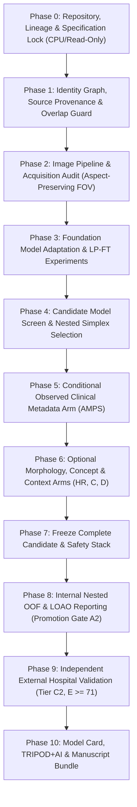

# V7 Final Master Research Plan: Evidence-Led Architecture, Disaggregated Validation & Confirmatory Governance

**Program:** Scan4Disease (S4D) / Backend-S4D  
**Target Publication Venue:** IEEE Transactions on Medical Imaging (IEEE TMI) / The Lancet Digital Health  
**Baseline Git SHA:** `4e6d32b542999d1d3823807791a4149a16f2af25` (`v5-confirmation-review2`)  
**Document Authority:** Authoritative V7 Scientific Specification (Supersedes Monolithic Revision 8 & Revision 9 Drafts)  
**Date:** 8 November 2026  
**Status:** Draft specification under audit. Not approved: Gate 0 is unsigned and no V7 run of record exists (V7 code and tests exist). Sections 9-14 correct the earlier ones; **section 14 (freeze audit, 11 Nov 2026) controls wherever sections differ**, and holds the only live blocker register.

---

## 1. Document Precedence & Epistemic Taxonomy

### 1.1 Document Precedence Hierarchy
To eliminate contradictions across historical working documents, Project Scan4Disease establishes a strict, non-negotiable document hierarchy:
1. **Level 1 (Scientific Architecture & Research Precedence):** `V7_FINAL_MASTER_RESEARCH_PLAN.md` controls overall scientific philosophy, module taxonomy, hypothesis formulation, and model selection criteria.
2. **Level 2 (Operational Execution & Stop Rules):** `V7_FINAL_EXECUTION_RUNSHEET.md` controls experimental sequence, hardware profiling, phase dependencies, cost budgets, and operational stop rules.
3. **Level 3 (Estimands, Statistical Testing & Promotion Gates):** `V7_STATISTICAL_PREREGISTRATION_AND_SAFETY_PLAN.md` controls estimand definitions, metric scaling (`pauc_raw_fpr20` vs `pauc_mcclish_fpr20`), bootstrap resampling units, multiplicity control, and formal promotion gates.
4. **Level 4 (Specialized Technical Protocols):** `V7_DOMAIN_GENERALISATION_AND_VALIDATION_PROTOCOL.md`, `V7_METADATA_PROVENANCE_AND_RECONSTRUCTION.md`, `V7_PANDERM_AND_FOUNDATION_MODEL_TUNING_PROTOCOL.md`, and `V7_IMAGE_INPUT_RESOLUTION_AND_CROPPING_PROTOCOL.md` provide technical implementation details strictly subservient to Levels 1–3.
5. **Level 5 (Governance, Approvals & Red Team Resolutions):** `V7_OPEN_QUESTIONS_AND_APPROVAL_GATES.md` (pre-execution sign-off checklist) and `V7_RED_TEAM_REVIEW_AND_RESOLUTIONS.md` (resolution of adversarial critiques).

*Superseded Documents:* Historical Revision 8 and Revision 9 (`docs/V7_MASTER_RESEARCH_PLAN.md`) and early multi-branch drafts are officially designated as `SUPERSEDED` wherever they contradict this authoritative specification suite.

### 1.2 Epistemic Status Taxonomy
Every component, dataset claim, and experimental arm in V7 must carry an explicit, audited epistemic state:
* `PROPOSED`: Theoretical concept or experimental suggestion awaiting protocolization.
* `DESIGNED`: Fully specified mathematically, statistically, and procedurally in master documents; zero training code run.
* `IMPLEMENTED`: Code written, unit-tested, and verified on synthetic/dummy data; memory/throughput profiled.
* `EXECUTED`: Model run completed, log recorded, and predictions saved on disk.
* `VALIDATED`: Formally confirmed across cross-validation folds or receipted external benchmarks with complete cryptographic receipts.
* `REJECTED`: Falsified by experimental data or clinical safety audits.
* `SUPERSEDED`: Replaced by a corrected analysis, refined receipt, or superior methodology.
* `UNRESOLVED`: Open empirical, clinical, or legal question requiring experimental data or explicit owner sign-off.

---

## 2. Executive Architecture: Minimal Core & Conditional Arms

V7 explicitly rejects monolithic four-branch coupling. Untested multi-branch architectures confound causal attribution and introduce unvalidated failure modes. The V7 system is structured into five strictly delineated modules:

```
┌─────────────────────────────────────────────────────────────────────────────────────────────┐
│ 1. V6_REFERENCE (Incumbent Reference System — Immutable Comparator & Fallback)             │
│    ├── ConvNeXt-Tiny @ 224 px (IN-22k) + ConvNeXt-Tiny @ 384 px (IN-22k)                   │
│    ├── PanDerm-Base @ 224 px (MIM) + DINOv2-Base @ 224 px (Self-Distillation)                │
│    └── Uniform Soft Voting + 24-View Entropy TTA (Macro-F1: 0.7433 OOF; 0.7348 HIBA)        │
└──────────────────────────────────────────┬──────────────────────────────────────────────────┘
                                           │
                                           ▼
┌─────────────────────────────────────────────────────────────────────────────────────────────┐
│ 2. V7_CANDIDATE_CORE (Candidate Vision System — Unlocked Image-Only Ensemble)                │
│    ├── Transform: Aspect-Preserving Reflection Padding Resize (eliminates 34.3% HAM FOV cut)│
│    ├── Candidate 1: ConvNeXt-Tiny @ 384 px (ImageNet-22k supervised prior)                  │
│    ├── Candidate 2: PanDerm-Base @ 384 px (2-stage LP-FT adaptation, gamma=0.80)            │
│    ├── Candidate 3: DINOv2-Reg @ 392 px (LVD-142M self-distillation + 4 registers)          │
│    └── Stacking: Nested Simplex PGD Optimization (w in Delta^2) vs. Uniform Vote Comparator │
│    [Status: Final roster conditional on common-OOF marginal selection; V6 remains incumbent]│
└──────────────────────────────────────────┬──────────────────────────────────────────────────┘
                                           │
                                           ▼
┌─────────────────────────────────────────────────────────────────────────────────────────────┐
│ 3. V7_OPTIONAL_METADATA (Observed EHR Records via Asymmetric Safety AMPS)                  │
│    ├── Inputs: Authoritative observed Age (with precision), Sex/Gender, Anatomical Site      │
│    ├── Formulation: One-sided additive escalation logic: s_final_esc >= s_vision_esc       │
│    ├── Safety Invariant: Visual cancer suspicion is mathematically never de-escalated        │
│    └── Missingness Fallback: Delta z_meta == 0 ==> ||z_joint(x, null) - z_vision(x)||_inf = 0│
│    [Status: Evaluated in nested folds; pruned immediately if any subgroup is harmed]         │
└──────────────────────────────────────────┬──────────────────────────────────────────────────┘
                                           │
                                           ▼
┌─────────────────────────────────────────────────────────────────────────────────────────────┐
│ 4. V7_CONDITIONAL_ARMS (Modular Experimental Extensions — Independently Gated)              │
│    ├── Arm HR (Native Margin Crops): Native pixel-scale crops + artifact gating             │
│    ├── Arm C (Concept Guidance): CoFiDA-M LUPI training regularizer (MONET/expert labels)    │
│    ├── Arm D (Patient Context): Multi-lesion outlier scoring (ISIC 2020; single-lesion bypass)│
│    └── Arm M / Legacy CNNs: MaxViT-Tiny & legacy CNN screens (ConvNeXt-S, EffNet, ResNet)   │
│    [Status: Each arm must individually beat the Core Trunk before progressive integration]   │
└──────────────────────────────────────────┬──────────────────────────────────────────────────┘
                                           │
                                           ▼
┌─────────────────────────────────────────────────────────────────────────────────────────────┐
│ 5. DECOUPLED SAFETY & DEPLOYMENT STACK                                                      │
│    ├── Calibration: Multiclass Dirichlet calibration (refit strictly inside cross-fitting)  │
│    ├── Conformal Sets: Adaptive Mondrian Conformal Prediction (N >= 30 sample size floor)    │
│    └── Operational Deployment: S56 Selective Abstention Policy (Referral Budget R = 20%)     │
│    [Status: Decoupled from ranking; does not alter raw pAUC or Macro-F1 discriminability]   │
└─────────────────────────────────────────────────────────────────────────────────────────────┘
```

### 2.1 Incumbent Baseline: `V6_REFERENCE`
- **Definition:** The locked V6 four-member uniform soft-voting ensemble (`anchor_h7` ConvNeXt-Tiny 224, `anchor384_h7` ConvNeXt-Tiny 384, `panderm_b_h7` PanDerm-Base 224, `dinov2_b_h7` DINOv2-Base 224) with per-epoch weight averaging (SWA) and 24 views pooled by inverse entropy (`research/v5/tta_v5.py:79`). `V6_REFERENCE` is the banked prediction files under `results/v6/preds_tta/`, never a retrain or a re-score under a new transform.
- **Empirical Anchors:** Macro-F1 $0.7433$ on 12,235 images (7,002 lesions, 6,989 lesion groups) (`results/v6/e_primary.json`); Macro-F1 $0.7348$ on 1,199 retrospective HIBA lesions (`results/v6/hiba_receipt.json`).
- **Role:** Immutable comparator and production fallback. V7 does not replace V6 unless a complete V7 candidate passes all preregistered confirmatory gates.

### 2.2 Core Vision Candidate: `V7_CANDIDATE_CORE`
- **Candidate Roster:** ConvNeXt-Tiny 384 px, PanDerm-Base 384 px (adapted via 2-stage LP-FT), and DINOv2-Reg 392 px (equipped with 4 learned registers).
- **Status:** `DESIGNED`. The final candidate ensemble roster is **not pre-locked**. Each candidate must earn admission based on common-row out-of-fold (OOF) predictions and incremental marginal contribution over the incumbent.
- **Ensemble Method:** Simplex Projected Gradient Descent (PGD) ($\mathbf{w} \in \Delta^{M-1}$) fitted under nested cross-fitting, evaluated directly against arithmetic uniform voting.

### 2.3 Optional Metadata Arm: `V7_OPTIONAL_METADATA`
- **Principle of Non-Inference:** Demographic and clinical attributes must originate strictly from authoritative institutional EHR exports. Imputing or estimating age, sex, or site from RGB pixels or target labels is **strictly prohibited**.
- **Safe AMPS Escalation Logic:** Metadata operates strictly as a **referral/escalation-only, one-sided additive signal**:
  $$s_{\text{final}}^{\text{esc}} \ge s_{\text{vision}}^{\text{esc}}$$
  Young age or non-risk anatomical sites are mathematically prevented from decreasing visual malignancy suspicion. Missing or partial metadata maps to an exact zero adjustment ($\Delta z_{\text{meta}} \equiv 0$).

### 2.4 Conditional Research Arms: `V7_CONDITIONAL_ARM`
- **Arm HR (Native Margin Crops):** Pixel-scale margin cropping ($\le 9.6\text{ mm}$ equivalent FOV where calibration exists; native crop tiles where uncalibrated).
- **Arm C (Privileged Concept LUPI):** CoFiDA-M concept regularizer applied strictly during training. Student operates purely on raw RGB pixels at inference time ($< 4.2\text{ ms}$ latency). Bound by corrected BM-KD margin loss $[\Delta_T(x) - \Delta_S(x) - \gamma_{\text{buffer}}]_+^2$.
- **Arm D (Patient-Relative Context):** Evaluated strictly on verified same-patient multi-lesion galleries ($N_k \ge 3$) from the same encounter (ISIC 2020). Single-lesion encounters ($N_k \le 2$) have weight $w(N_k) \equiv 0 \implies \Delta z_{\text{rel}} \equiv 0$ (invariant bypass).
- **Arm M & Legacy Screens:** MaxViT-Tiny 384 px and legacy CNNs (ConvNeXt-S, EfficientNet-B0/B3, DenseNet-121, ResNet-50) evaluated on common OOF rows under Gate M-VAL.

---

## 3. Corrected Historical Lineage (V1 through V6)

Every version must inherit verified empirical wins while formally recording superseded claims and failed hypotheses:

| Version | Component / Finding | Historical Claim | Post-Audit Status | V7 Disposition & Action |
| :---: | :--- | :--- | :---: | :--- |
| **V1** | 6-CNN Ensemble Roster | ConvNeXt-S/T, DenseNet, EffNet, ResNet | `VALIDATED` | Legacy CNNs were omitted in V6 to save compute; marked `NOT_FAIRLY_RETESTED` on expanded pool. Deferred to optional low-cost screen. |
| **V1** | 24-View TTA | 24-view dihedral/scale TTA, pooled by inverse entropy | `VALIDATED` | Retained as deployed in V6 (inverse-entropy pooling). Uniform pooling is the untested alternative, not the baseline. |
| **V1** | Global Dirichlet Calibration | Cross-fitted probability calibration | `VALIDATED` | Retained inside cross-fitting; documented that calibration alters multiclass ranking and sensitivity. |
| **V3** | Adversarial Demographic Invariance | GRL removes age bias from features | `REJECTED` | Permanently banned. Erasing age collapsed under-40 AUC by $-0.1049$ by destroying age-correlated pathology signals. |
| **V3** | ASL / LDAM Loss | Asymmetric margin loss beats CE | `SUPERSEDED` | Did not outperform standard cross-entropy on validation; retained standard balanced cross-entropy. |
| **V4** | S56 Selective Referral | 20% clinical workload referral budget | `VALIDATED` | Retained as operational triage layer; classifier ranking reported separately from referral policy. |
| **V5** | Young Data Injection | Claimed under-40 pAUC gain $+0.0351$ | `SUPERSEDED` | Retracted. 90 duplicate pairs contaminated the under-40 cohort. Corrected gain is $+0.0136$ ($p=0.228$, null). |
| **V5** | Q11 Module Decomposition | Claimed $+0.0270$ gain from modules | `SUPERSEDED` | Retracted. Corrected gain is $+0.0068$ ($p=0.612$, null). V7 does not claim a historical young-data benefit. |
| **V6** | Incumbent 4-Member Ensemble | ConvNeXt (224/384), PanDerm, DINOv2 | `VALIDATED` | Retained as `V6_REFERENCE` incumbent. Note: 4 members represent 3 pretraining families (ConvNeXt shared). |
| **V6** | Gate A Under-40 Target | Target MCID $\Delta \text{pAUC} \ge +0.050$ | `REJECTED` | V6 achieved $+0.0381$ [$0.0107, 0.0711$], failing the $+0.050$ MCID. Gate A failure recorded as historical fact. |
| **V6** | PanDerm Claim 3 Contrast | Dermatology MIM selectively aids youth | `REJECTED` | Falsified. PanDerm-vs-control contrast was $+0.0010$ [$-0.0077, +0.0102$], crossing zero. Claim 3 failed. |
| **V6** | PanDerm Lower-Trunk LLRD | LLRD $\gamma=0.65$ froze Blocks 0–5 | `VALIDATED` | Optimization arrest confirmed (Block 0 LR $7.11 \times 10^{-7}$; moved $0.17\%$). Replaced by 2-stage LP-FT ($\gamma=0.80$). |
| **V6** | External HIBA Validation | Macro-F1 $0.7348$ vs V5 $0.5715$ | `VALIDATED` | Retrospective benchmark, unblinded and spent. HIBA $18/20$ sensitivity has wide CI; $0/20$ FRR is not zero risk. |
| **V6** | Hand-Engineered Biology | Standalone biology features aid AUC | `REJECTED` | Falsified. Combining 6 hand-extracted biology features added $\Delta \text{AUC} = +0.0029$ (null); color count AUC $0.5025$. |

---

## 4. Disaggregated Validation Architecture & Sample Sizing

V7 enforces absolute separation between in-domain model selection and external clinical confirmation:

```
Tier A: In-Domain Grouped OOF (5-Fold Nested CV, N=12,235 images (7,002 lesions, 6,989 lesion groups))
        ├── Inner Folds: Preprocessing, candidate screening, simplex weights, calibration.
        └── Outer Folds: Evaluates entire selection procedure (NOT independent external confirmation).
        │
Tier B: Internal-External LOAO (Leave-One-Archive-Out across BCN, HAM, MSKCC)
        └── Reports institutional transportability per-archive; BCN20000 is the weak archive (Macro-F1 0.638). MSKCC's 0.348 is a class-count artefact (3 of 7 classes present; 0.812 on those). See section 9.1.
        │
Tier C1: HIBA Retrospective Benchmark (N=1,199 lesions, 20 young escalating cases)
        └── Unblinded and spent in V6-6; permanent historical comparator; ZERO V7 model tuning permitted.
        │
Tier C2: Untouched Confirmatory Prospective Cohort (New Hospital)
        └── Event-driven consecutive presentation (E >= 71 young escalating events; N >= 4,250 expected [51.5% yield], N >= 4,666 consecutive lesions for 80% event-accrual assurance).
        └── Cryptographically sealed under SHA-256; single unblinded read in Phase 9.
        │
Tier D: Cross-Modality Smartphone Stress Test (PAD-UFES-20, N=2,106 images)
        └── Reserved exclusively for Mahalanobis OOD detection and Fitzpatrick I–IV fairness slicing.
        └── Permanently banned from dermoscopy classification leaderboards.
```

### 4.1 Resolution of the OOF Fitting vs. Confirmation Circularity
- **The Problem:** Early drafts designated Tier A as the primary site for simplex weight fitting, threshold tuning, and confirmatory Gate A2 evaluation. Evaluating a model on the same data used to select its components induces optimistic bias.
- **The Resolution:**
  1. *Nested Cross-Validation:* Inner folds select preprocessing hyperparameters, candidate members, simplex weights, and calibration parameters. Outer held-out folds evaluate the **entire selection procedure**.
  2. *Epistemic Boundary:* Outer OOF evaluation estimates the internal generalization of the automated pipeline. However, because researcher access to these datasets spans V1–V6, **Tier A is never claimed as independent external confirmation**. True confirmatory validation is reserved exclusively for Tier C2.
  3. *Like-for-Like Comparators:* Do not compare raw OOF Macro-F1 ($0.7433$) directly with HIBA Macro-F1 ($0.7348$) and infer "no domain shift." Spectrum and class prevalence differ profoundly. Compare models strictly *within the same cohort* using paired bootstrap deltas.

### 4.2 Leave-One-Archive-Out (LOAO) Protocol (Tier B)
- Systematically withholds BCN20000, HAM10000, and MSKCC.
- All candidate selection, weights, and thresholds are fitted strictly on the remaining development archives.
- Results are reported **per archive independently**, highlighting worst-archive performance (e.g. MSKCC) rather than masking failures under a pooled average.
- Precludes arbitrary cutoffs (`Macro-F1 >= 0.650`); evaluates paired non-inferiority against `V6_REFERENCE`.

### 4.3 Event-Driven External Sample Sizing ($E \ge 71$) & Accrual Assurance
- Sizing for Tier C2 is governed by an **event-driven accrual design** (Riley et al., BMJ 2024; Collins et al., BMJ 2024), where clinical enrollment continues until the required event count is reached:
  $$E \ge 71 \text{ escalating events in patients } < 40$$
- **Primary endpoint power (corrected 10 Nov 2026):** at $E = 71$ events the paired test excludes zero with about 80% probability when the true gain is $+0.050$, under a planning SD taken from development data (`results/v7/pauc_power_simulation.json`). That is not the probability of meeting a point-estimate target of $+0.050$, which is 50% at that true gain whatever the sample size. The prevalence behind the $N$ figures below does not come from a consecutive series (section 9.1, row 11).
- **Accrual Probability vs. Mean Expectation Distinction:**
  * *Mean Expectation Estimate:* In an unselected consecutive presentation cohort with young escalating event prevalence $\pi \approx 1.67\%$, an intake of $N = 4,250$ consecutive lesions yields a mean expectation of $\mathbb{E}[E] = 4,250 \times 0.0167 = 70.975 \approx 71$ events. However, under an independent binomial model $X \sim \text{Binomial}(N=4250, \pi=0.0167)$, the probability of actually capturing at least 71 events is only $P(X \ge 71) \approx \mathbf{51.5\%}$ (a 48.5% risk of under-accrual).
  * *80% Event-Accrual Assurance Threshold:* To guarantee an $\ge 80\%$ probability of accruing at least 71 events ($P(X \ge 71) \ge 0.80$), an unselected consecutive presentation design requires enrolling at least **$N \ge 4,666$ consecutive lesions** (exact binomial: $\mathbb{E}[E] = 77.92$, $P(X \ge 71) \approx 80.2\%$).
  * *Operational Policy:* Accrual does not stop at a fixed $N$; data collection continues until $E \ge 71$ verified events are observed. $N = 4,250$ serves strictly as a mean planning baseline, while $N \ge 4,666$ is the $80\%$ assurance threshold.

---

## 5. Image Preprocessing, Resolution & FOV Standards

### 5.1 Resolution of the 34.31% FOV Amputation Defect
- **Empirical Cause:** Legacy preprocessing in `ml/preprocessing/transforms.py` applied `transforms.Resize(256)` followed by `transforms.CenterCrop(224)`. On HAM10000 $600 \times 450$ images ($4:3$ aspect ratio), scaling the short edge to 256 produces a $341.33 \times 256$ image. Continuous geometric rational FOV loss is $(341.333... - 224) / 341.333... = 11/32 = \mathbf{34.375\%} \approx \mathbf{34.38\%}$ (discrete raster loss: $(341 - 224)/341 = 117/341 = \mathbf{34.31\%}$), discarding peripheral lesion borders.
- **The Aspect-Preserving Reflection Padding Solution:**
  For any rectangular image $I \in \mathbb{R}^{3 \times H \times W}$ where $W > H$, the canvas is padded symmetrically by $P_{\text{top}} = \lfloor (W - H)/2 \rfloor$ and $P_{\text{bottom}} = \lceil (W - H)/2 \rceil$ using `mode='reflect'`:
  1. Preserves **100.0% of valid source pixels** (zero border amputation).
  2. Avoids black/zero padding step discontinuities that falsely excite convolutional edge filters.
  3. Resizes cleanly to target resolutions ($384 \times 384$ px for ConvNeXt/PanDerm; $392 \times 392$ px for DINOv2-Reg to maintain exact $28 \times 28$ patch divisibility).
- **Physical Scale Boundary:** Pixel dimensions alone do not determine physical scale. **Do not claim $18\text{ mm}$, $9.6\text{ mm}$, or $25\ \mu\text{m/px}$ resolution unless lens field-of-view and sensor pixel pitch metadata are explicitly supplied by the source archive.** Without optical calibration metadata, crops are protocolized as native pixel-scale crops, not measured micrometre crops.

---

## 6. Melanoma Biology & Biophysical Grounding

### 6.1 Precursor Epidemiology: De Novo vs. Nevus-Associated Melanoma
- **Meta-Analysis Evidence (Pampena et al., JAAD 2017; $N = 20,126$):**
  - **70.9%** (95% CI: 66.8%–74.6%) of cutaneous melanomas develop **de novo**.
  - **29.1%** (95% CI: 25.4%–33.2%) develop as **Nevus-Associated Melanoma (NAM)**.
  - In patients under 40, NAM accounts for at most $28\%\text{--}35\%$ of cases.
- **Deconstruction of the Universal GAP Dilution Premise:** Because $\sim 70\%$ of melanomas in young patients develop *de novo* (100% neoplastic proliferation without a pre-existing benign nevus bed), Global Average Pooling (GAP) dilution cannot explain the vast majority of under-40 false negatives.
- **True Causes of Under-40 Misses:** Severe epidemiological prior suppression ($4.85\%$ escalating prevalence in under-40 vs. $35.55\%$ in $60+$) combined with optical downsampling aliasing on fine micro-structures.

### 6.2 Dark Lesion Biophysics & Conflation Resolution
- **Historical Conflation Resolved:** Early drafts stated that "19 of 33 false negatives occurred in lesions in the darkest tertile with $p = 0.0402$". Forensic audit revealed this conflated two distinct experiments:
  1. *Diagnostic B1 (`results/v5/diagnostics/b1_hard_core.json`):* V4 control OOF, 19/33 misses in high-melanin tertile, Fisher exact $p = 0.000238$.
  2. *V6-5 Reread (`results/v6/screens/dark_v6_oof_read.json`):* Permutation test for `v6_vote` within archive was $p = 0.040248$.
- **V6 Status & Resolution:** In V6, heterogeneous foundation ensembling and 24-view TTA collapsed the young-vs-older dark lesion gap to $+0.0151$ (95% CI: $[-0.1624, +0.1657]$, crossing zero). Dedicated "dark specialist heads" failed ($\Delta = -0.0126$). The pattern has weakened, not gone: within archive, missed melanomas are still darker (p 0.040), on 48 young melanoma lesions. Reflection padding is untested.

---

## 7. Statistical Preregistration, Safety Sets & Confirmatory Gating

### 7.1 Primary Endpoints & Metric Scaling
1. **Melanoma-Specific Ranking:** McClish-standardized partial AUC ($\text{FPR} \le 0.20$):
   $$\text{pAUC}_{\text{McClish}} = 0.50 + \frac{\text{pAUC}_{\text{raw}} - 0.020}{0.360}$$
   where $\text{pAUC}_{\text{raw}} = \int_0^{0.20} \text{TPR}(\text{FPR}) \, d\text{FPR}$.
2. **Escalation Ranking:** Like-for-like comparison with historical V6 under-40 escalation pAUC (`pauc_u40`).
3. **Seven-Class Diagnosis:** Macro-F1 and balanced accuracy across standard 7 diagnostic classes (8-class taxonomy permanently rejected).
4. **Internal Promotion Gate A2 Target:**
   $$\Delta \text{pAUC}_{\text{McClish}} \ge \mathbf{+0.050} \iff \Delta \text{pAUC}_{\text{raw}} \ge \mathbf{0.0180}$$
   evaluated on held-out development OOF (65 under-40 escalating lesion groups (48 melanoma, 15 BCC, 2 AKIEC; 158 images)) via lesion-group cluster bootstrap (patient clusters only where a verified patient id exists) ($B = 2,000$). This serves strictly as internal promotion authorization; untouched independent confirmatory claims are reserved for Phase 9 (Tier C2).
   - *Hypothesis Testing:* Directional one-sided test; point estimate must meet $+0.050$ target and lower 95% bootstrap confidence bound must exceed zero.

### 7.2 Multiplicity Control & Small-Count Inferences
- Controlled under **Holm-Bonferroni step-down** at family-wise $\alpha = 0.05$:
  1. $H_{1A}$ (Primary Ranking): $\Delta \text{pAUC}_{\text{McClish}} \ge +0.050$ ($p \le 0.0167$).
  2. $H_{1B}$ (Macro-F1 Non-Inferiority): $\Delta \text{Macro-F1} \ge -0.015$ ($p \le 0.025$).
  3. $H_{1C}$ (Older-Age Sensitivity Retention): $\Delta \text{Sens}_{40+} \ge -0.010$ ($p \le 0.05$).
- All subgroup rates with $N < 30$ must be reported strictly with **Exact Clopper-Pearson Inverted Beta Binomial Intervals**. Point estimates of 0.0% false reassurance must be reported with their upper confidence bound ($\le 13.91\%$), never as certified zero risk.
- Conformal coverage under domain shift is bound by the **Barber et al. (2023) total variation bound**: $\mathbb{P}(Y \in \mathcal{C}(X)) \ge 1 - \alpha - 2 d_{\text{TV}}$.

### 7.3 Non-Negotiable Fallback Mandate
If Gate A2 fails on the fully assembled V7 system:
$$\Delta \text{pAUC}_{\text{McClish}} < +0.050$$
**V6 remains the officially deployed clinical incumbent.** V7 will be documented as an experimental research cycle in the project archive and manuscript, with all negative findings fully disclosed. No post-hoc metric shifting or threshold relaxation is permitted.

---

## 8. Master Dependency-Ordered Phased Runsheet (Phases 0–10)



| Phase | Designation | Key Execution Scope | Stop Rule / Fallback |
| :---: | :--- | :--- | :--- |
| **0** | **Specification Lock** | Verify commit `4e6d32b`; reconcile V1–V6 lineage ledger; audit receipts | Stop if SHA-256 baseline differs |
| **1** | **Identity & Provenance** | Construct `master_v7.csv`; 4-tier overlap guard; 200 synthetic duplicates plant | Stop if plant recall $< 100\%$ |
| **2** | **Image Pipeline Audit** | Aspect-preserving reflection padding; verify FOV preservation on HAM10000 | Stop if horizontal FOV cut |
| **3** | **Foundation Adaptation** | PanDerm 2-stage LP-FT ($\gamma=0.80$); DINOv2-Reg $392\times 392$ | Stop if Block 0 move $< 5\%$ |
| **4** | **Candidate Screening** | Common OOF prediction matrix; nested simplex PGD vs uniform vote | Revert to uniform vote if PGD fails |
| **5** | **Metadata Arm (AMPS)** | One-sided additive escalation ($s_{\text{final}}^{\text{esc}} \ge s_{\text{vision}}^{\text{esc}}$); verify $\Delta z \equiv 0$ | Prune V7_OPTIONAL_METADATA if subgroup harmed |
| **6** | **Conditional Arms** | Individually test Arm HR (margin crops), Arm C (LUPI), Arm D (context) | Prune any arm failing its gate |
| **7** | **System Freeze** | Lock candidate weights, ensemble weights, calibration, and conformal thresholds | Lock SHA-256 manifest; no tuning |
| **8** | **Promotion Decision** | Evaluate nested outer OOF and LOAO; read internal Promotion Gate A2 | **V6 deployed incumbent if Gate A2 fails** |
| **9** | **External Hospital** | Single-pass read on untouched cohort (event-driven $E \ge 71$ events; $N \ge 4,250$ expected, $N \ge 4,666$ 80% assurance) | Report exact Clopper-Pearson CIs |
| **10**| **Manuscript Bundle** | TRIPOD+AI statement, model cards, negative finding disclosures, and code archive | Complete reproducible audit package |

---

## 9. Audit corrections of 10 November 2026

This section records what an independent audit found when the plan was checked against files on disk. **Where it differs from sections 1-8, this section controls.** Items marked PROPOSED need the owner's decision and are not in force. Status words: `VERIFIED` (recomputed from a file on disk), `UNVERIFIED` (stated in a document or a literature search, not checked), `HYPOTHESIS`, `PROPOSED`, `BLOCKED`.

### 9.1 Facts corrected

| # | Earlier statement | What the files show | Source | Status |
|:-:|---|---|---|:-:|
| 1 | The 12,235 held-out rows were called lesions | 12,235 **images**; 7,002 lesion ids; 6,989 lesion groups (the bootstrap unit) | `results/v7/denominators.json` | `VERIFIED` |
| 2 | A count of 64 melanomas under 40, inside 65 escalating | 65 under-40 escalating lesion groups (158 images): **48 melanoma, 15 BCC, 2 AKIEC**. All five folds: 81 groups (58 melanoma) | same | `VERIFIED` |
| 3 | V6 used "uniform" 24-view TTA; entropy weighting "unproven" | V6 pools the 24 views by inverse entropy; that is the deployed configuration | `research/v5/tta_v5.py:79`, `research/v6/predict_tta.py` | `VERIFIED` |
| 4 | "SWAD" was critical to transfer | V6 averages one snapshot per epoch (SWA). No ablation on HIBA exists. The one LOAO test of a SWAD-style member lost 0.063 AUROC on held-out BCN | `docs/V6_RUNSHEET.md` (V6-0), `results/v6/m7_loao_binary.json` | `VERIFIED` |
| 5 | "MSKCC drop (Macro-F1 0.348)" is the transport failure | MSKCC development rows hold 3 of 7 classes. On the classes present its Macro-F1 is 0.812. **BCN20000 is the weak archive**: 0.638, escalation pAUC 0.850, under-40 escalation pAUC 0.788. Qualified by section 11.2: the pAUC deficit is negative-set case mix; the Macro-F1 deficit mostly remains | `results/v7/denominators.json` (descriptive reread) | `VERIFIED` |
| 6 | Gate A2 has "80.3%" (or 76.8%) power | That is power to exclude zero. The gate as written (point estimate at least +0.050) passes at most 50% of the time at a true +0.050, about 21% at +0.035 | `results/v7/pauc_power_simulation.json` | `VERIFIED` |
| 7 | "Patient-clustered" bootstrap; "BCN20000 with verified patient_id" | 242 of 15,294 development rows have a patient id, all MSKCC. Inference is lesion-group clustered; patient dependence in HAM and BCN is unmeasured | `results/v6/screens/leak_audit_ids.json` | `VERIFIED` |
| 8 | A Macro-F1 "retention" ratio from OOF to HIBA | Different cohorts with different class mix; not a retention figure. Under 40 on HIBA: V6 18/20, **V5 19/20** | `results/v6/hiba/hiba_report.json` | `VERIFIED` |
| 9 | "Sensitivity 0.913 at a 20% budget" on HIBA | The 20% is the referred share only. Lesions flagged in total (called escalating or referred): V6 49.9%, V5 55.2%, V1 32.6% | `results/v7/denominators.json` (label-free) | `VERIFIED` |
| 10 | Dark-lesion robustness was called achieved | The pattern weakened. Within archive, missed melanomas are still darker (p 0.040) on 48 young melanoma lesions. Reflection padding has never been run | `results/v6/screens/dark_v6_oof_read.json` | `VERIFIED` |
| 11 | External prevalence 1.67% for sizing | It is 20/1,199 from HIBA, an enriched collection (42% escalating), not a consecutive series. The 4,250 and 4,666 figures are placeholders | `results/v6/hiba/hiba_report.json` | `VERIFIED` |
| 12 | Archive sizes 11,424 / 10,015 / 2,903 for LOAO | Those are whole-archive counts that include test and reserved rows. Development rows: BCN 6,704, HAM 6,981, MSKCC 1,609 | `results/v7/denominators.json` | `VERIFIED` |
| 13 | PanDerm "verified clean"; licence CC BY-NC-ND | Stated by an agent report; not checked against the model card in this audit | `agent06_foundation_model_landscape.md` | `UNVERIFIED` |
| 14 | "Certified", "frozen", "validated" document status | No V7 code exists, no V7 run exists, Gate 0 is unsigned | repository state | `VERIFIED` |

### 9.2 What V7 inherits from V6 (the earlier sections did not say)

`V7_CANDIDATE_CORE` starts from the V6 recipe. Each line stays unless a declared ablation removes it.

| Inherited item | Where it lives | Status |
|---|---|:-:|
| Added training pool, 25,471 training-only rows | `results/v6/added_pool/added_train.csv` | `CORE` |
| Young sampler (holds the under-40 batch share) | `research/v6/train_v6.py` | `CORE` |
| 7-class head | `results/v6/e_primary.json` (`recipe.head`) | `CORE` |
| Per-epoch weight averaging (SWA) | `research/v5/m7.py` | `CORE` |
| 24 views pooled by inverse entropy | `research/v5/tta_v5.py` | `CORE` |
| Fold 0 selects, folds 1-4 are read once, test lock armed | `research/v6/system_reads.py`, `research/testguard.py` | `CORE_GATE` |
| Every read must pass on all rows, without the 380 and without the 426 at-risk rows | `scripts/read_leak_sensitivity.py` | `CORE_GATE` |
| One receipted external read, labels read once | `research/v6/hiba_read.py` | `CORE_GATE` |
| Dirichlet calibration, S56 abstention, class-conditional conformal sets | `research/v6/refit_system.py` | `CORE_SAFETY` |
| `V6_REFERENCE` = the banked prediction files, never a retrain or a re-score under a new transform | `results/v6/preds_tta/` (reproduces 0.7433) | `CORE_GATE` |

Owner decisions already made and missing from sections 1-8, now recorded as declared tests (`RETEST`): anchor weight decay 0.05 against the inherited 1e-4; DINOv2 with layer decay and a higher top learning rate; PanDerm layer decay 0.75 to 0.85; one single-fold learning-rate range check per member, with weight movement measured, before any multi-fold run.

### 9.3 In-domain against out-of-domain: three tracks and one selection rule (PROPOSED)

Three scores, reported side by side and never pooled:

1. **In-domain:** folds 1-4, paired against the banked `V6_REFERENCE`.
2. **Cross-site dermoscopy:** leave-one-archive-out on development rows only. The BCN holdout is the decisive one. V6 has no LOAO result for its own members, so a V6-recipe LOAO baseline must be trained first; without it no cross-site claim about V7 is possible.
3. **Other modality:** PAD-UFES-20 smartphone photos, on patient-grouped splits, as a separate track. A dermoscopy model is not expected to win it.

Proposed promotion rule, replacing Gate A2 as the primary gate:

* **P1 (primary, in-domain):** all-age escalation pAUC delta above the single-seed bar and Macro-F1 delta with interval lower bound above 0. This is V6's E-primary form, so V7 and V6 are judged by the same rule.
* **P2 (no harm):** under-40 escalation pAUC and escalation sensitivity not significantly worse.
* **P3 (cross-site):** on each held-out archive, V7 not worse than the V6-recipe baseline by more than 0.02 on present-class Macro-F1 and on escalation pAUC. Read once, at freeze.
* **Secondary, declared:** under-40 escalation pAUC gain of at least +0.050, with its true pass probability stated (section 9.1, row 6).
* All four hold on all rows, without the 380 and without the 426 rows.

LOAO results are development evidence. They are read once per frozen system and are not used to tune it.

Levers aimed at the cross-site gap, cheapest first. All are `HYPOTHESIS`; a literature search on 10 Nov found no clean leave-one-hospital-out evidence for any of them in dermoscopy, and its citations were read as abstracts or snippets only (`UNVERIFIED`):

| Order | Lever | Cost | First test |
|:-:|---|---|---|
| 1 | Class-prior correction | CPU, saved predictions | **Run 10 Nov, exploratory, in-domain rows: not promising.** Even with BCN's true class mix supplied, BCN Macro-F1 moves 0.638 to 0.635 and escalation pAUC 0.850 to 0.851; label-free EM on the uncalibrated vote collapses. Class mix is not BCN's gap (`results/v7/prior_shift_diagnostic.json`). Dropped unless a LOAO read says otherwise |
| 2 | Full-image padding against centre crop, at test time only | GPU inference, no training | folds 1-4 and BCN holdout, paired against the banked crop |
| 3 | Colour-statistic augmentation (randomise per-image channel statistics toward other archives) | one fold of training | BCN holdout, 3 seeds, against the seed spread |
| 4 | Shades-of-grey colour constancy (18.8 ms per image, never implemented) | one fold of training | BCN holdout |

### 9.4 External confirmation (Tier C2): `BLOCKED`

No external cohort is in hand. A new-hospital consecutive series is not available to this project, and the size figures in section 4.3 rest on a prevalence that does not apply (section 9.1, row 11). Until a cohort exists, V7 can claim internal promotion and cross-site development evidence only. HIBA stays spent. Under-40 performance cannot be confirmed externally without a clinical partner. Under-40 performance stays unconfirmable in public data:

A search of public cohorts on 10 Nov (figures from dataset pages, a preprint summary and the public ISIC metadata service; all `UNVERIFIED` until the owner checks the source):

| Candidate | What it is | Why it could serve | Main weakness |
|---|---|---|---|
| MRA-MIDAS (Stanford and Cleveland Clinic) | Paired dermoscopic and clinical photos; about 1,290 lesions from 796 patients, about 93 melanomas, biopsy-confirmed, per-lesion age | Not in the ISIC Archive as far as found; gives a dermoscopy read and a clinical-photo read from one cohort | Mean age about 61, so few melanomas under 40; classes do not map cleanly onto the 7; licence terms not stated |
| ISIC 2018 Task 3 test set | 1,512 dermoscopy images in the 7 HAM classes | Direct class map, labels public | Same sources as HAM10000; overlap with training not ruled out; 7 melanomas under 40 |

**No public cohort outside the sources already used has 50 or more histopathology-confirmed melanomas in patients under 40.** The whole ISIC Archive holds about 889 such images, and all but roughly 55 to 60 belong to sources already used. Any candidate needs the pixel-copy audit (`scripts/audit_leak_keypoints.py`) and a licence check before it is sealed.

### 9.5 Under-40: tests in order (all `HYPOTHESIS`)

The owner asked for a hypothesis that says what separates these lesions from nevi. Sections 6.1 and 6.2 assert causes ("prior suppression", "aliasing") that nothing in the repository has measured. Ordered tests, cheapest first:

1. Does the centre crop cut the lesion edge on missed young melanomas? Compare cut-off between missed and caught lesions, then one full-image test-time read. No training.
2. Is "missed melanomas are darker" biology, exposure or an archive artefact? Within brightness bins, by age and by archive, with clipped-pixel rates. Saved predictions only.
3. One member trained with a partial-AUC objective, one fold.
4. Pair training against the specific nevi that outrank missed young melanomas, one fold.
5. Concept scores from a vision-language model: do they add anything beyond the ensemble score? Saved images, lesion-grouped cross-validation.

**Superseded by section 10.5**, which restores the owner's build order (the concept teacher is second, not last) and replaces the reviewing agent's priors with the owner's (10 to 25% per build). Not to be repeated IN THE FORMS TESTED: the 3-band age rule (S65, matched workload), class reweighting and hard-case upweighting (S67), the frozen-DINOv2 224 px dark specialist (`results/v6/screens/dark_specialist_probe.json`), hand-built colour asymmetry features (V5). A different form of the same idea (for example a trained native-resolution dark-lesion model) is a new hypothesis, not a repeat.

### 9.6 Before any training

* **Leak disclosure first** (owner decision, 5 Nov): each leak, the corrections, then the prevention, written openly. The public README still says "Leak-free" and quotes +0.0351.
* **Measure cost.** No time or memory figure in the runsheet is measured. ViT-B at 384 or 392 px has never been benchmarked on the 8.55 GB card; run `scripts/gpu_benchmark.py` on each candidate in its fine-tune stage first.
* **Scope of nesting.** Weights, calibration and thresholds are cross-fitted. Members and preprocessing are chosen on fold 0. Full nested retraining of every member is not affordable and is not claimed.
* **PAD-UFES-20:** rebuild its splits by patient before any use (179 of 1,297 patients span the old splits; 5 exact duplicates cross them).
* **Metadata arm:** the "never de-escalates" property holds per lesion only. At a fixed referral budget, raising some scores lowers the rank of others, and S65 already showed the age rule losing at matched workload. Judge the arm at matched workload.

### 9.7 Owner decisions needed

1. Adopt the promotion rule in 9.3, or keep Gate A2 as primary knowing its pass probability.
2. Approve the V6-recipe LOAO baseline (GPU; cost to be measured first).
3. Tier C2: name a clinical partner, accept a sealed public cohort, or accept that V7 ends at internal promotion.
4. PAD-UFES-20: separate modality track, or stay out of scope.
5. When the leak disclosure is published.

## 10. V7 rebuild of 10 November 2026

This section controls sections 1-9 where they differ. It carries the owner's V6-era decisions that the earlier V7 documents
left out, and it points to code that exists and tests that pass. Everything marked PROPOSED waits for the owner's Gate 0
signature (`python -m research.v7.plan_freeze --sign --owner-approved`); training refuses until then.

### 10.1 Starting line: dark young melanomas (owner decision, 7 Nov 2026)

The dark-lesion facts are the factual starting line for the under-40 problem in V7 (`docs/V6_RUNSHEET.md`, subheadline).

| Missed young melanoma lesions at FPR 0.20, by melanin tercile | Low | Mid | High |
|---|:-:|:-:|:-:|
| V5 control | 3/13 | 8/20 | 10/15 |
| V6 vote | 2/13 | 7/20 | 5/15 |

Within archive, missed melanomas are still darker (p 0.040), on 48 young melanoma lesions. The frozen-DINOv2 224 px dark
specialist adds nothing to V6 (`results/v6/screens/dark_v6_oof_read.json`). Hypothesis (owner's report, 5 Nov): the model
learned "young and dark means nevus". Every V7 candidate gets this table on the same rows (`research/v7/dark_read.py`; it
reproduces V6's row above exactly, which the verifier checks).

### 10.2 What V7 carries

`V7_INHERITANCE_LEDGER.md` lists 39 findings from V1 to V6 and from this rebuild, each with its evidence file (all checked to
exist) and its status: CORE, CORE_GATE, CORE_SAFETY, RETEST, DROPPED in the form tested, or OPEN. Nothing V6 deployed is
removed without a declared ablation.

### 10.3 Standing problems

`V7_STANDING_PROBLEMS.md` gives each of the 14 open problems a hypothesis, a test, an endpoint, a drop rule and the code
that runs it.

### 10.4 Promotion rule (PROPOSED; code `research/v7/promotion.py`, tested)

* **P1** all-age escalation pAUC delta above the single-seed bar (0.0082) AND Macro-F1 delta with 95% lower bound above 0, paired against the banked V6 vote on folds 1-4.
* **P2** no harm: upper bounds of the under-40 pAUC delta, the escalation-sensitivity delta and (13 Nov) the under-40 xAUC delta at least 0.
* **P3** cross-site: on each held-out archive, not worse than the V6-recipe LOAO baseline (L0) by more than 0.02 (95% lower bound) on present-class Macro-F1 and escalation pAUC.
* All three on four row sets: all rows, without the 380, without the 426, and without every development row the V7 data gate links.
* Secondary, never decisive: Gate A2 (under-40 +0.050) and the dark read.
* **New hard rule (owner's proposal, 5 Nov; PROPOSED):** a gain that comes from added data does not count until it survives removing the nearest training matches. In V7 this is the fourth row set plus the guard's training-side removals: rows linked to an evaluated row never train, and the read is repeated without every linked development row.
* **Multiplicity:** promotion needs every part on every row set, an intersection-union rule, so the decision needs no alpha correction; builds are screened on fold 0 only; folds 1-4 are read once per frozen candidate; secondary endpoints (Gate A2, per-archive, per-band, dark read) are one declared family reported with Holm-adjusted p-values and never promote a system.

### 10.5 Builds, in the owner's order (`research/v7/builds.py`)

| Build | What | Status | Pre-test on V6's own data (exploratory, may not drop a build) |
|:-:|---|:-:|---|
| B0 | Dark read and specialist probe on V6 folds 1-4 | DONE | V6 has not closed the dark gap (10.1): B2 and B5 keep their target |
| B1 | DINOv2-B at 392 px and PanDerm-B at 384 px (batch 16 x 2); the cheaper 224 + 384-crop arm is not built | READY (smoke passed, 11.1) | Benchmarked 10 Nov: DINOv2 392 1,105 ms per batch, 6.07 GB; PanDerm 384 821 ms, 4.52 GB. About 603 and 448 min per fold (x 1.22, V6's measured run-to-benchmark ratio): EXTRAPOLATED. PanDerm's sin-cos grid regenerated for 24 x 24, relative position tables resized |
| B2 | Concept teacher per fold (2,593 masked training-side images: 1,441 development + 772 retired `reserved` + 380 retired `val`), image-only anchor student with a concept head dropped at inference (`research/v7/concept_student.py`) | READY (fold-0 teacher done; student smoke passed after a loader fix, 11.1; teachers for folds 1-4 not run) | Globules 5/11 young melanoma vs 127/389 young nevus. At this size Fisher detects OR 2 only 20% of the time: **cannot refute** (`results/v7/recheck_dropped.json`) |
| B3 | ConvNeXt-T 384 with CE + one-way pAUC (in-repo surrogate; LibAUC not installed) | READY | none needed |
| B4 | Cohort-relative second stage | READY (CPU) | Reduced form (z-scores only, V6 logits): OR 0.92 per SD [0.73, 1.16] under 40; detects only OR >= 1.39. **Not dropped**: neighbour cohort and V7 logits untested |
| B5 | Lesion-only melanin scaling (k on [1/2, 2], p 0.5), ConvNeXt-T 224 | READY (smoke on the V7 basis passed, 11.1) | Transform moves the dark read's melanin index by k (tested); 6.0 ms per image at 224 px. Bases for all 5 folds and 3 holdouts fitted on the gate's training rows (`research/v7/fit_basis_v7.py`, `results/v7/chromophore/`) |
| B6 | Worst-group selection | READY (CPU) | Among V6's own four members: same subset in 3 of 4 folds, held-out worst stratum -0.017. **Not dropped**: untested on V7 candidates |
| R1-R4 | Owner's LR decisions (anchor WD 0.05; DINOv2 layer decay; PanDerm layer decay 0.80; range check) | READY | PanDerm blocks 0-5 moved under 1.4% in V6 |
| L0 | V6-recipe LOAO baseline | OWNER_DECISION | Needed for P3; BCN-held-out training drops the Barcelona part of ISIC 2019 Test |
| C1 | Second chance: EfficientNet-B5 Noisy-Student, 456 px, gradient checkpointing (ISIC 2019/2020 winners' backbone family) | READY (weights pinned, smoke passed) | Fits at 3.48 GB (V6 benchmark); B3/B4 overflow the card at batch 32 |
| C2 | Second chance: MaxViT-Tiny, 224 px (repo's best single V3 test model, never given V6's recipe) | READY | GPU smoke passed: 65 s, 5.42 GB (`results/v7/logs/smokes/C2.log`) |
| C3 | Second chance: EVA-02-Small, 224 px (masked-image pretraining; mixed evidence) | READY (weights pinned, smoke passed) | Builds and runs on CPU (tests) |
| X1, X2 | Full-image TTA read; colour-statistic augmentation (BCN holdout) | READY / OWNER_DECISION | none |

Correction recorded: on 10 Nov the first versions of the B4 and B6 pre-tests were written up as "drop". That overclaimed:
they were reduced forms run on folds already read, and the owner's drop rules apply to a full build's frozen read. The
verifier now fails if a pre-test file says a build is dropped.

### 10.6 Data foundation (`research/data/`, V7 data plan steps 1-4)

Run on every row V7 could touch: 54,079 images (development 15,294; val, reserved, HAM val, HAM test 10,037; added pool
25,471; young extras 2,078; HIBA 1,199; the retired splits and HIBA training-only, `ham_test` and MIDAS never trained on), about 11 min on 8 CPU workers (`results/v7/data_gate_report.json`). **The gate passes** and its receipt
(`results/v7/data_gate_receipt.json`) binds the master table, the link table and the gate code; `train_v7.py` refuses to
start without it.

| Check | Result |
|---|---|
| Planted copies, eight families x 48 real development images | 384 of 384 found |
| Fields filled (ids, archive, split, group, SHA-256, hashes, status) | 100% |
| Links | **Current receipt (14.2): 27,162 confirmed, 137,170 at risk (13 Nov 02:00, patient ids loaded), on 57,488 rows.** 12 Nov 17:09: 27,162 / 109,280. Earlier run, before MIDAS joined: 15,228 confirmed (lesion id, normalised id, SHA-256, existing groups, correlation+keypoint copies); 96,668 at risk (patient ids incl. DERM12345 and HIBA, hash matches, single-detector keypoint hits) |
| Largest confirmed group (percolation limit 31) | 31: one real BCN lesion |
| Groups for review (span archives / frozen splits) | 107 / 115; their rows stay at risk (removed from the training side) |
| Training-side removals | **Current receipt (14.2): 361 from all training; 476, 413, 437, 375, 457 more for folds 0-4 (1.5-1.7% of a fold's training rows); holdouts BCN 9,616, HAM 2,097, MSKCC 1,559 (13 Nov 02:00: the 12 Nov 17:09 rules plus the patient ids of the young extras, ISIC 2020 and ISIC 2019 that the builder had not loaded; audit A11).** 12 Nov 17:09: 259; 452, 386, 391, 340, 391; HAM 2,010, MSKCC 1,522. Earlier run: 656 from all training (rows linked to a development row, `ham_test` or MIDAS, incl. 2 HIBA rows); 31-42 more per held-out fold; BCN 9,484, HAM 1,476, MSKCC 1,255 |

Correction: the first gate runs of 10 Nov loaded no HIBA rows at all (a missing-value filter dropped them silently), so the
earlier claim that HIBA pixels were covered was wrong. Fixed, and the builder now stops if any declared source loads zero
rows. Two further fixes were needed, both by the data plan's own rules, never by raising the limit: V6 had grouped DERM12345
by patient (one patient: 149 nevus images), and the plan forbids patient ids merging groups, so they became at-risk links;
then a review by eye found hash matches chaining seven different HAM lesions (small centred lesions in vignetted frames), so
a hash match is now a candidate (at risk) unless a different detector agrees. Steps 5-8 of the data plan (untrained
same-lesion baselines, the learned matcher and its adoption test, the patient feasibility test) are not done; until then,
re-photograph recall is the keypoint tier's, about half (`results/leak_audit/V7_DATA_PLAN.md`). The gate is "audited, with
stated lower bounds", never "leak-free".

### 10.7 Pass probabilities (stated before any V7 training; recompute after every plan change)

| Endpoint | Probability | Basis |
|---|:-:|---|
| P1 (in-domain, vs V6) | 15-30% | Judgement anchored on data: adding any one V6-like member moved all-age pAUC by at most +0.004 against a bar of +0.0082 (`results/v7/member_contribution.json`); V6 itself gained +0.034 over V5 only with a 25,471-row pool and new members. P1 rests on members that differ from V6's (B1, B3, B5) and on replacing under-trained ones (R2, R3) |
| P2 (no harm) | 80-90% | Every single-member change measured on V6 moved under-40 pAUC by -0.007 to +0.012 (CI bounds) |
| P3 (cross-site) | not estimable | No LOAO baseline exists; L0 must run first |
| Promotion (P1, P2, P3 on all four row sets) | 10-25% | product of the above, with P3 unknown |
| Gate A2 (under-40 +0.050, secondary) | 5-10% | Largest single-member under-40 move on V6 +0.005; at a true +0.020 the gate passes about 5% (`results/v7/pauc_power_simulation.json`) |
| At least one under-40 build gives a real gain | 30-35% | The owner's own judgement (solution report, 5 Nov); not a measurement |

These are low because the measured lever sizes are small, not because the plan is weak. They cannot be raised by editing
documents; only experiments move them. The likely honest outcome is "V6 stays, with a better-understood under-40 problem".

### 10.8 Run order (owner runs every GPU step in PowerShell; times from V6 run logs unless marked)

| # | Step | Command | Time | Basis | Before the next step |
|:-:|---|---|---|---|---|
| 0 | Read sections 9-10, decide 10.9, sign Gate 0 | `python -m research.v7.plan_freeze --sign --owner-approved` | owner | - | required for every run of record |
| 1 | DONE 10 Nov: B5 bases for all 8 splits (`python -m research.v7.fit_basis_v7`); B2 targets and fold-0 teacher (`python -m research.v7.concept_student targets`, `teacher --fold 0`) | - | bases 6-16 min per split; teacher 13.4 min | MEASURED | teachers for folds 1-4 before B2's folds 1-4 (`teacher --fold k`, about 13 min each) |
| 2 | Smokes: B3, B5, R1, R2, R3 (two batches each, `--smoke`) | `python -m research.v7.train_v7 --build B3 --member anchor --image-size 384 --batch-size 16 --grad-accum 2 --added-train results/v7/added_pool_v7/added_train_v7.csv --smoke` (and likewise) | about 3 min each | EXTRAPOLATED from V6 smokes | all pass |
| 3 | DONE 10 Nov: B1 benchmarks (`results/v7/benchmarks/`). Smokes for B1 x 2, B2, B5 on the V7 basis | `bash scripts/v7_smokes_gaps.sh` | DONE 10 Nov: 45-50 s each, 3.1 min for the chain | MEASURED (11.1) | all pass |
| 4 | Fold 0 screens: R1 55.6, R2 78.4, R3 64.5, B3 88.8, B5 55.6 min | `train_v7 --build <key> --fold 0 --run-tag v70 ...` | 342.9 min, about 5.7 h | MEASURED (same configuration per fold) | read fold 0, apply each drop rule |
| 4b | Second-chance screens on fold 0: C2 MaxViT about 63 min, C3 EVA-02-S about 32 min, C1 EfficientNet-B5 about 262 min (after the weights are downloaded and R4's range check) | `train_v7 --build C1|C2|C3 --member <name> --fold 0 ...` | about 6 h | EXTRAPOLATED from V6's synthetic-batch benchmarks | each joins only if adding it to the vote beats the vote without it beyond the seed spread |
| 5 | L0, anchor only, 3 holdouts | `train_v7 --build L0 --loao-holdout <archive> ...` | 143 min (full 4-member vote: 739 min) | EXTRAPOLATED by pool rows | needed for P3 |
| 6 | Folds 1-4 for fold-0 survivors | as step 4, folds 1-4 | 4 x the member's fold time | MEASURED | all folds done |
| 7 | Promotion read, dark read, B2/B4 added-score tests | `research.v7.promotion`, `research.v7.dark_read`, `research.v7.cohort_relative` | CPU, minutes | MEASURED | decision |

Runs of record use `results/v7/added_pool_v7/added_train_v7.csv` (35,183 rows: V6's 25,471 added rows, the retired `reserved`/`val`/`ham_val` splits' 8,513, HIBA's 1,199; V6's file is unchanged). Step budgets follow the core pool, so the measured times per fold still hold. `--num-workers 2`; C: needs at least 5 GB free (52 GB free on 10 Nov). Steps 4 and 5 use the GPU and never run together.

### 10.9 Owner decisions needed before Gate 0

1. Promotion rule 10.4 replaces Gate A2 as primary, or Gate A2 stays primary at its stated pass probability.
2. L0: anchor-only (143 min) or the full 4-member baseline (739 min). Without L0, no cross-site claim is possible.
3. B1's 384 px ViTs after the benchmark, or B1 deferred.
4. B3 with the in-repo pAUC surrogate, or install LibAUC and use SOPA-s as the report named.
5. Tier C2, PAD track and the leak-disclosure date (section 9.7, items 3-5).
6. Step budget. V6 sets each run's optimiser steps from its core pool; the gate's removals shrink that pool, so a V7 fold-0 run gets 12,840 steps against V6's 13,410 (smoke log `results/v7/logs/smokes/R1_hiba_pool.log`). Recommended: hold V6's budget per fold, so a V7-vs-V6 difference is not partly training length.

### 10.10 What the checks do and do not show

* Unit tests (`tests/test_v7_*.py`) check that code does what it says on small synthetic inputs. They do not show that a
  build will work. Three were wrong on first run and were fixed by correcting the test's assumption, each recorded in the
  CHANGELOG: per-image labels in a lesion-clustered simulation, a darkness test that expected brightness instead of
  melanin, and a pytest temp folder owned by Administrator.
* The data gate run is the real check (57,488 rows in the current receipt; 52,880 was the run before the HIBA fix, 14.2). Its first full run stopped on percolation. The cause was V6's
  patient-keyed DERM12345 groups (the plan forbids patient ids merging groups), and then hash-only matches chaining seven
  different HAM lesions, found by a review by eye. Both were fixed by applying the plan's own rules, never by raising the limit.
* Pre-tests on folds already read reorder work and never drop a build (10.5).
* Gemini's registries were audited against disk (`results/v7/registry_audit.json`): 13 of 32 lineage point estimates are
  not traced to any receipt and every licence cell is agent-reported; they are UNVERIFIED (ledger row 41).
* P4 (age-band calibration) was read on the V6 vote: a band-wise map meets its endpoint in this exploratory read (ledger
  row 40), so it joins the safety stack for the frozen V7 read.

### 10.11 Data roles from V7 (owner decision, 10 Nov 2026)

| Source | Role in V7 | Why, and the condition that keeps it honest |
|---|---|---|
| HIBA (1,199 lesions, Buenos Aires) | **Training only** (`train_hiba`) | Its one sealed read is spent on V6 (receipt: one execution, labels read once). It adds 20 under-40 escalating lesions (14 melanoma). V6's HIBA result stays exactly as read; no V7 system is ever scored or compared on HIBA; HIBA rows pass the data gate and are removed when linked to any development or MIDAS row. Labels fetched from the public ISIC archive as V6's read did and mapped with V6's functions; both maps agree on every row (`results/v7/hiba_train/hiba_training_receipt.json`) |
| MRA-MIDAS (Stanford, Cleveland Clinic; 3,409 image files) | **Sole sealed external read** (`midas`), **sealed 10 Nov 2026**: 765 dermoscopic biopsied images, 513 records (69 **images** under 40; under-40 records and cases unknown while sealed, 14.2), plus 39 intermediate tumours as a sealed secondary list (`results/v7/external/midas_v7/seal.json`, `data/external/midas/sealed/prepare_receipt.json`) | Access granted 10 Nov (AIMI membership and the Stanford Research Agreement). Per-image diagnoses stay unread until the single read; the class mapping is fixed from category names only; files are checked against `files.csv` checksums, gated against every other source, then sealed with `research/v7/external_read.py --own-split midas` before any V7 result exists |
| Retired evaluation splits: `reserved` (4,733), `val` (2,270), `ham_val` (1,532) | **Training only** (roles change; `frozen_split` values stay verbatim) | Their evaluation roles ended in V1-V4 (`reserved` read 8 times in V1-V4, closed at S63: corrected 14.2; `val` and `ham_val` selection sets). They add 5,709 BCN images, nearly doubling BCN training data, and about 1,600 under-40 images. They share no lesion group with the development rows or `ham_test`; pixel links are removed by the gate; their labels are checked equal to the manifest at load (`research/v7/train_v7.py::load_pool_v7`). V1-V4 results on them stay as historical results; no V7 system is ever scored on them |
| `ham_test` (1,502, V1's published test set) | **Never trained on, never read again** | Kept out: a second touch would break Hard Rule 2, and training on a published test set invites the obvious objection for little gain (HAM is already the strongest archive) |
| Development rows | Training (other folds) and in-domain evaluation (fold 0 selects, folds 1-4 read once) | unchanged: V7's own validation sets, never pooled with the retired splits |
| Added pool, young extras | Training | unchanged |

The paper's data-flow figure shows each source's role per version, as TRIPOD+AI asks. Every role, count and binding is in `results/v7/data_roles_v7.json` (`research/v7/data_roles.py`, checked by the verifier). Before MIDAS predictions are frozen, the keypoint re-photograph audit (`scripts/audit_leak_keypoints.py`) runs against the master table, as the seal record requires.

## 11. V7 enhancement of 10 November 2026 (night)

This section adds to section 10 and controls where it differs. Everything marked PROPOSED waits for Gate 0. Every read in
this section is a pre-test on folds 1-4 already read at V6-5: it reorders work and never drops or promotes a build.
Literature in this section came from six Haiku research agents; nearly all of it was read as abstracts or search snippets
and is `UNVERIFIED` (`research_notes/v7_enhancement_gap_research_2026-11-10.md`).

### 11.1 Smokes for the builds made ready on 10 Nov (`bash scripts/v7_smokes_gaps.sh`, MEASURED)

| Smoke | Result | Time | Peak VRAM (of 8.55 GB) |
|---|:-:|:-:|:-:|
| B1 DINOv2-B 392 px, batch 16 x 2 | pass | 50 s | 5.77 GB |
| B1 PanDerm-B 384 px, batch 16 x 2 | pass | 45 s | 4.66 GB |
| B2 concept student, fold 0 | **failed twice, then pass** | 47 s | 2.21 GB |
| B5 on the V7 basis, fold 0 | pass | 45 s | 2.20 GB |

B2's failure was real and would have stopped a run of record: Windows sends the dataset to loader workers by pickle, and
B2's dataset was a class defined inside a function. The first fix (wrapping a V6 `PoolDataset` instance) failed too, because
that class cannot be pickled while the trainer has `v6.PoolDataset` patched. Final form: a module-level subclass of V6's class
(`research/v7/concept_student.py::ConceptPoolDataset`), with a test that pickles it while the seam is patched. One existing
test asserted the old subclass-in-a-function form and was corrected. Logs: `results/v7/logs/smokes/summary_gaps.txt`.

### 11.2 New finding: "non-escalating" is two populations (`results/v7/verification_strata.json`)

A benign lesion that was excised looked suspicious to a clinician. V5 and V6 carried an endpoint for this (`pauc_histo`,
`research/v5/confirmation.py`, `research/v6/gate.py`); the V7 plan had dropped it without a declared ablation. Reread of the
banked V6 vote on folds 1-4, escalation pAUC at FPR 0.20, same positives, negatives split by confirmation type
(`scripts/v7_verification_strata.py`, lesion-group bootstrap, 2,000 replicates):

| Rows | Negatives: all | Histopathology-confirmed | Confirmed otherwise | Histo minus other |
|---|:-:|:-:|:-:|:-:|
| All | 0.889 | 0.865 | 0.957 | -0.092 [-0.110, -0.072] |
| Under 40 (65 escalating groups) | 0.833 | 0.814 | 0.886 | -0.072 [-0.128, -0.021] |
| 40-59 | 0.877 | 0.828 | 0.971 | -0.142 [-0.172, -0.116] |
| 60+ | 0.856 | 0.852 | 0.919 | -0.067 [-0.113, -0.013] |
| HAM | 0.903 | 0.842 | 0.978 | -0.135 [-0.156, -0.115] |
| BCN | 0.850 | 0.867 | 0.820 (90 groups) | +0.047 [-0.034, +0.114] |
| MSKCC | 0.838 | 0.857 | 0.878 (53 groups) | -0.021 [-0.080, +0.036] |

| Gap | On all negatives | On histopathology-confirmed negatives |
|---|:-:|:-:|
| BCN minus HAM | -0.053 [-0.083, -0.024] | **+0.024 [-0.008, +0.056]** |
| Under 40 minus 60+ | -0.023 [-0.089, +0.034] | -0.037 [-0.111, +0.026] |
| Under 40 minus 40-59 | -0.044 [-0.111, +0.016] | -0.014 [-0.089, +0.052] |

What it shows:

* **BCN's escalation-pAUC deficit against HAM is case mix, not transfer.** HAM's negatives are 70% follow-up or consensus
  lesions (2,448 of 3,521 groups), which the vote separates almost perfectly (0.978); BCN has 90 such groups. On like-for-like
  negatives BCN is not behind. This qualifies section 9.1 row 5 and standing problem P3.
* **It explains about a quarter of the Macro-F1 gap, not all of it.** Present-class Macro-F1 on histopathology-confirmed rows:
  HAM 0.753 (0.816 on all rows), BCN 0.622 (0.638). The gap falls from 0.178 to 0.131: BCN is still harder on the 7 classes.
* **It does not explain the under-40 problem.** Both band gaps have intervals that span zero on either negative set. For the V6
  vote the between-band gap is not established on 65 groups; the under-40 problem stays as stated in 10.1 (dark young
  melanomas, and the +0.050 target).
* **Possible shortcut, untested:** HAM's follow-up nevi came from a digital follow-up system. A model can score "followed, not
  excised" from acquisition style. The 0.978 may be partly that. This is why the confirmed-negative figure is the safer one.

Consequences (PROPOSED):

1. **E-histo is restored as a declared secondary endpoint**: escalation pAUC against histopathology-confirmed negatives, all
   ages and under 40, reported next to every primary read and inside the Holm family of 10.4. It never promotes a system.
2. **P3 is read twice**, on all negatives and on confirmed negatives. Where the two disagree, the report says "case mix".
3. **MIDAS comparator, fixed now, before any MIDAS prediction exists.** The sealed cohort is biopsied lesions only
   (`iscontrol == no`), so every MIDAS negative is histopathology-confirmed. The development figure to compare it with is
   0.865 (all ages) and 0.814 (under 40), never 0.889 or 0.833. Without this, an ordinary MIDAS result would read as a
   transport failure.

### 11.3 Members we cannot audit: pretraining overlap (`results/v7/pretraining_controlled_vote.json`)

A backbone pretrained on evaluation images is a leak no pixel gate sees. Agent-reported, `UNVERIFIED` (arXiv versions and
repositories, not the journal texts): PanDerm's 2.15M-image corpus lists in-house cohorts, TCGA-SKCM and an ISIC 2024 subset,
and does not list HAM10000, BCN20000, MSKCC, HIBA or MIDAS; it states no overlap check; weights are CC BY-NC-ND 4.0. Derm1M /
DermLIP includes 10,619 MSKCC image-text pairs. DINOv2's LVD-142M is curated web data whose dermoscopy content is unknown.
MIDAS was not found in any pretraining corpus. No reliable test exists for "was this image in the pretraining set".

Measured instead: the V6 vote with only its two ImageNet-22k ConvNeXt members (no PanDerm, no DINOv2), paired with the full
four-member vote on the same rows:

| Endpoint | Full vote | ImageNet-only vote | Delta |
|---|:-:|:-:|:-:|
| Macro-F1 | 0.7433 | 0.7377 | -0.0055 [-0.0158, +0.0049] |
| Escalation pAUC | 0.8890 | 0.8801 | -0.0089 [-0.0126, -0.0053] |
| pAUC, confirmed negatives | 0.8650 | 0.8533 | -0.0117 [-0.0185, -0.0058] |
| Under-40 pAUC | 0.8329 | 0.8261 | -0.0068 [-0.0172, +0.0026] |

V6's result does not rest on the members we cannot audit. PROPOSED rule: every V7 promotion read is repeated with
ImageNet-pretrained members only, as a reported fifth row (not a gate). If a V7 gain is absent from that row, the claim is
worded "depends on members whose pretraining corpus was not audited". DermLIP-family weights are not used (MSKCC overlap).

### 11.4 New builds (all PROPOSED, all `HYPOTHESIS`)

| Build | What | Why it is not a repeat | Endpoint and drop rule | Cost | Status |
|:-:|---|---|---|---|:-:|
| B7 | Verification-aware anchor: an auxiliary head predicts "excised" on benign training rows (dropped at inference, as B2's head is), and the young sampler draws under-40 confirmed-benign rows at a held share | S67 upweighted cases the model got wrong; this uses a label-defined hard-negative population and an auxiliary target. The agents found no published test of it | Under-40 pAUC on confirmed negatives, fold 0, against the anchor's 3-seed spread; dropped only on its frozen read | Fold 0: about 56 min (EXTRAPOLATED from the anchor's measured 55.6 min; the head is one linear layer) | NEEDS_CODE; confirmation types for the added pool need a metadata-only fetch (owner's OK) |
| X3 | Weight interpolation between the head-only checkpoint and the SWA checkpoint (WiSE-FT form), mixing weight chosen on fold 0 | Never run here. V6 already trains head-then-all (LP-FT). Evidence is natural-image only; no medical result found | BCN-holdout pAUC on confirmed negatives against L0, read once | Inference only; needs L0 to save its head-only checkpoint. Unmeasured | NEEDS_CODE, after L0 |
| D1 | One small student (ConvNeXt-T, ImageNet-22k start) distilled from the frozen V7 vote, using teacher predictions made out-of-fold on training rows, 24 views | The deployable, single-model form the owner asked for. Its starting weights are auditable; its teacher may not be, and the report says so | Not worse than the vote by more than 0.01 Macro-F1 and 0.01 pAUC (95% lower bound), folds 1-4; reported, never a promotion gate | About 56 min per fold at 224 px (EXTRAPOLATED) | NEEDS_CODE, after the vote is frozen |
| M1 | Learned same-lesion matcher (data plan steps 5-6): untrained DINOv2 and SSCD baselines on held-out real pairs first, then ConvNeXt-Femto, GeM, 256-d, Multi-Similarity loss, black rim removed, known links masked from negatives, per-archive recall | Data plan steps 5-8 were never built; keypoints find about half of re-photographs | Adoption test as written in the data plan: beat the best untrained baseline on held-out pairs per archive at a false-match rate measured on development rows; else keep the baseline | Unmeasured; benchmark first | NEEDS_CODE |

Not adopted, with the reason on record: test-time adaptation (a 2025 medical benchmark reports TENT below direct inference
and normalisation methods degrading LayerNorm models); masked-reconstruction pretraining on the 50k pool (no evidence it
helps small models at this size); adversarial site or age removal (nulls in three sources); synthetic images (nulls already
in the wide scan); class-prior correction (measured here, 9.3).

### 11.5 Ideas from V1 to V6 that had no fair second test

| Idea | What happened to it | V7 disposition |
|---|---|---|
| `pauc_histo` (V5 M4, V6 screen gate) | Left out of the V7 plan with no ablation | Restored (11.2) |
| Colour constancy (V3 ladder) | Dropped because it was never implemented | Stays X2's second arm: one BCN-holdout fold; literature gives no cross-site number |
| MaxViT-Tiny, EfficientNet (V1-V3) | Never given V6's recipe | C1, C2 (section 10.5) |
| Mahalanobis shift score (V4: last in-domain, AUROC 0.913 under real shift) | Kept as a flag, never used at a read | Label-free shift report on MIDAS before its labels are read, refit on V7 features |
| Gated metadata fusion (V3: val 0.7643, test 0.7411, no per-image predictions) | Never entered a vote | Stays the optional metadata arm, judged at matched workload (9.6) |
| LDAM-DRW, ASL (V3: one run each, below baseline) | Never rerun | Not rerun: the reweighting family was closed by S67 on stronger evidence |
| Whole-image chromophore jitter with SWAD (M7) | One seed, one holdout | Weak evidence against; B5 is the different form |
| Cohort-relative stage, worst-group selection | Reduced pre-tests wrongly written as "drop" | B4, B6 (restored 10 Nov) |
| Learned matcher, patient feasibility (data plan 5-8) | Planned, never built | M1 (11.4) |

### 11.6 Pass probabilities, restated after this section

| Endpoint | Probability | Change and basis |
|---|:-:|---|
| P1 (in-domain, vs V6) | 15-30% | Unchanged. Nothing in this section is a measured lever on P1 |
| P2 (no harm) | 80-90% | Unchanged |
| P3 (cross-site) | not estimable | Unchanged: no LOAO number exists. 11.2 removes a wrong reason to expect failure on pAUC; it says nothing about a model trained without BCN |
| Promotion | 10-25% | Unchanged |
| Gate A2 (under-40 +0.050) | 5-10% | Unchanged |
| At least one under-40 build gives a real gain | 35-40% | Was 30-35%. Judgement only: B7 is one more attempt, at 10-15%, and not independent of B3 |

An honest plan is not the same as a likely one. This section makes V7's claims safer to state; it does not make them more
likely to be true. The under-40 problem has no new measured lever here.

### 11.7 Owner decisions added to 10.9

7. E-histo as a declared secondary endpoint, and the MIDAS comparator of 11.2 (recommended: yes to both).
8. The ImageNet-only fifth row of 11.3 (recommended: yes, reported, not a gate).
9. B7: approve the build and the metadata-only fetch of confirmation types for the added pool.
10. M1 before or after the first screens. Recommended before any run of record: re-photograph recall is about half today.

## 12. V7 depth round of 10 November 2026: mechanisms, and builds that follow from them

Section 11 widened the plan. This section goes down one chain: why the vote separates some nevi almost perfectly, whether
that is the same thing as "young and dark means nevus", and what each answer implies for a build. It controls where it
differs. All reads are pre-tests on folds 1-4 already read (`results/v7/shortcut_chain.json`, `scripts/v7_shortcut_chain.py`;
lesion-group mean scores, recomputed cuts, so counts differ from the dark read and never replace it). Prior art was checked by
six Haiku agents from abstracts and snippets (`UNVERIFIED`; second half of
`research_notes/v7_enhancement_gap_research_2026-11-10.md`). "Not found" means that search did not find it, no more.

### 12.1 What the chain showed

| Link | Result | What it means |
|---|---|---|
| L1. Are follow-up nevi a separate image population? | Yes. HAM follow-up nevi: melanin index 0.19, 1-3% in the high tercile, mean escalation score 0.025. HAM excised nevi: 0.35-0.43, 26-35%. BCN nevi: 0.48-0.50. MSKCC nevi without a confirmation type: 0.79 | **The melanin index depends on the source.** The dark read's terciles are cut on pooled under-40 images, so "high tercile" is partly "BCN or MSKCC" and the low tercile is 207 of 301 follow-up nevi. Agent-reported (`UNVERIFIED`, HAM paper Table 1): the MoleMax subset is 3,954 images, 94.1% nevi, 24 melanomas, 1.2% pathology-verified |
| L2. Does the vote use darkness as a nevus cue? | Under 40, excised nevi: Spearman(melanin, score) **+0.137** (p 0.003, 454 lesions); mean score by tercile 0.104 / 0.088 / 0.101. Melanoma: **-0.252** (p 0.084, 48 lesions); 0.541 / 0.444 / 0.319 | Dark nevi are not scored lower, so a general "dark means nevus" rule is **not supported**. Dark melanomas are scored lower. That is what **lost signal** looks like (structure hidden under saturated pigment), not a shortcut. Exploratory; 48 lesions; archive is not controlled in the correlation |
| L3. Does the dark gradient survive against excised nevi, and in BCN? | Missed young melanomas, low / mid / high: 2/13, 5/18, 2/17 with the threshold on all negatives; **2/13, 6/18, 4/17** with it on excised negatives. BCN 0/1, 0/6, 4/9. HAM 1/11, 4/8, 0/3 | Against the clinically relevant negatives more dark melanomas are missed. The pattern is BCN's high tercile plus HAM's middle tercile: 9 to 12 lesions in all |
| L4. Where is BCN's remaining Macro-F1 gap (0.131 on confirmed rows)? | Per-class F1, HAM vs BCN: **mel 0.668 vs 0.760 (BCN better)**; nv 0.861 vs 0.797; bcc 0.890 vs 0.805; akiec 0.665 vs 0.581; bkl 0.707 vs 0.599; **df 0.606 vs 0.267 (25 BCN images); vasc 0.875 vs 0.542 (37 BCN images)** | df and vasc carry 0.096 of the 0.131 gap, on 62 images. BCN is not weak on melanoma. No interval was computed for the two rare classes; at these counts it is wide |

Two consequences for claims already in this plan. Section 10.1's hypothesis ("the model learned young and dark means nevus")
now has evidence against its shortcut form and for a lost-signal form; it stays a hypothesis either way. Standing problem P3
("BCN is the weak archive") is, in-domain, mostly negative-set case mix (11.2) plus two rare classes (L4).

### 12.2 The test that separates the two mechanisms (T-CF, inference only, NEEDS_CODE)

Take the under-40 rows of folds 1-4, scale each lesion's melanin optical density by k in {0.5, 0.7, 1, 1.4, 2} with build B5's
transform (`research/v7/darkness.py`), and score every version with the banked V6 anchor of the matching fold.

* **Shortcut reading:** lightening raises the rank of dark young melanomas among identically lightened excised nevi. Then B5
  (training on randomised darkness) is the right build and moves up.
* **Lost-signal reading:** the rank does not move. Then B5 cannot help, and the builds that recover information move up: B1
  (resolution) and B8 below.
* Declared before running: paired lesion-level test on the change in placement of the 17 high-tercile young melanomas among
  excised young nevi, lesion-group bootstrap; it reorders builds and drops none. Cost: one member, about 2,200 images x 5
  versions at 224 px; an unmeasured guess of under 15 minutes of GPU. A controlled optical-density probe was not found in the
  literature; the nearest is a generative-counterfactual audit that reported darker images moving one classifier's output.

The same pass measures **counterfactual instability** (12.3, R1) at no extra cost.

### 12.3 Builds and designs that follow (all PROPOSED, all `HYPOTHESIS`)

| Key | What | Mechanism it answers | Endpoint and rule | Prior art found | Judged chance | Needs |
|:-:|---|---|---|---|:-:|---|
| B8 | Structure-recovery input: the anchor sees RGB plus an optical-density view normalised to the lesion's own surrounding skin and locally contrast-normalised (6 channels; stem weights duplicated at start) | Lost signal: saturated pigment compresses structure in gamma-encoded RGB; optical density makes pigment additive | Under-40 pAUC on excised negatives and the high-tercile miss count, fold 0, against the anchor's 3-seed spread | None for dark lesions in dermoscopy | 10-15% | Code; about 56 min per fold (EXTRAPOLATED) |
| R1 | Counterfactual-instability referral: refer a lesion whose score moves under pigment scaling | P5, confidently wrong: softmax confidence cannot see these misses; a physical intervention might | Share of under-40 escalating misses referred at the fixed 20% budget, against S56, at matched workload | Not found; nearest is test-time-augmentation spread for referral in retinopathy | 15-20% | T-CF first |
| B9 | Ordinal melanocytic head: benign nevus < atypical or dysplastic < Spitz or Reed < melanoma in situ < invasive, as an auxiliary cumulative-link target on melanocytic rows, dropped at inference | Too few young positives: graded lesions add supervision at the boundary | Under-40 pAUC on excised negatives, fold 0 | Ordinal thickness models and taxonomy losses exist separately; this target was not found. In situ vs invasive AUC 0.73-0.79 in three sources, so the grade is partly visible | 10-15% | A metadata-only audit of which archives fill the fine diagnosis fields; our own declared ordering (sources disagree on MPATH-Dx v2 classes) |
| B7b | Hurdle form of B7: P(excised) x P(malignant given excised), the second head trained on excised lesions only | The hard decision is learned without easy nevi dominating the gradient | E-histo, fold 0 | Not found for dermoscopy; direct management prediction beat management-via-diagnosis in one 1,011-case study | 10-15%, not independent of B7 | B7's metadata fetch |
| D2 | **Cross-fit `reserved` instead of training on all of it.** Each fold model trains on four fifths of `reserved` and is scored on the rest; the banked V6 fold models never trained on `reserved` and can be scored on all of it | The under-40 endpoint cannot detect realistic gains on 65 groups | Under-40 escalating lesion groups for a paired V7-vs-V6 read: **65 to 169** (`reserved` holds 104: BCN 80, MSKCC 24; 56 melanoma). Standard error falls by about 0.62 (EXTRAPOLATED, square-root rule; rerun `scripts/simulate_pauc_power.py` before relying on it) | Cross-fitted evaluation is standard; reuse of a set read once before must be disclosed | certain gain in power; no gain in accuracy | **Reverses the owner's decision of 10 Nov** (no V7 system scored on retired splits). Costs each fold model a fifth of `reserved`'s training rows. V6 inference on 4,733 images, unmeasured |
| S1 | P3's Macro-F1 arm counts only classes with at least 50 lesion groups in the held-out archive; smaller classes are reported with exact intervals | L4: a 0.02 margin cannot be resolved when two classes have 25 and 37 images | Simulated pass rate of P3 under no true difference, before and after | Standard small-sample practice | fixes a gate that chance would decide | Simulation, then `research/v7/promotion.py` |
| A1 | Leak dose-response audit: for each evaluated lesion, similarity to its nearest newly added training image; test whether the V7-minus-V6 gain rises with it | A leak the gate missed shows as gain concentrated near close training neighbours | Slope of gain on similarity within class-stratified bins, with a permutation null | Parts published (influence, similarity-matched pruning); not found as a pre-registered audit | reported, not gated | M1's baseline embeddings |
| S2 | Dark read sensitivity row: melanin terciles cut within source population, next to the pooled cuts | L1: the index depends on the source | Does the within-source dark gradient remain | none needed | reported | CPU, saved predictions |
| N1 | Natural experiment: HAM melanomas imaged on the nevus-dominated device | Is acquisition style a nevus cue? | Miss rate of those melanomas against HAM melanomas from the other three sources | Not found for HAM | reported; about 24 melanomas in all of HAM | HAM's `dataset` column (a metadata-only download) |

### 12.4 What this changes in the odds (judgement, not measurement)

| Endpoint | Was | Now | Why |
|---|:-:|:-:|---|
| P1, P2, promotion, Gate A2 | 15-30%, 80-90%, 10-25%, 5-10% | unchanged | No measured lever was added |
| P3 (cross-site) | not estimable | not estimable | Still no LOAO number. S1 removes a part of P3 that chance would have decided |
| At least one under-40 build gives a real gain | 35-40% | 40-45% | Two more attempts aimed at a named mechanism (B8, B9), each 10-15%, correlated with B1 and B3 |
| A real under-40 gain of +0.03 is detected if it exists | low on 65 groups | higher if D2 is approved | 169 groups; the size of the improvement must come from the power simulation, not from this table |

T-CF is the highest-value next step: about 15 minutes of inference decides whether B5 or B8 deserves the first under-40 GPU
hours. If T-CF shows lost signal and B8 and B1 both fail on their frozen reads, the honest conclusion is that part of the
under-40 gap is not recoverable from one dermoscopic image, and R1 (refer what cannot be ranked) becomes the main answer.

### 12.5 Owner decisions added

11. T-CF: run it (GPU inference, no training, development rows only).
12. D2: cross-fit `reserved`, or keep the 10 Nov decision. Recommended: cross-fit, disclosed as internal validation on a set read once at S63.
13. S1 and S2: adopt (recommended).
14. Metadata-only downloads for B9's audit and N1 (ISIC fine diagnosis fields; HAM's `dataset` column).

## 13. Freeze review and literature round of 11 November 2026

This section controls sections 1-12 where they differ. It does three things: lists what still stands between this plan and
the owner's Gate 0 signature (13.1), records what a five-question literature round added (13.2-13.4), and puts every open
owner decision in one table (13.5), so the signed document has one place where the rules in force are stated.

### 13.1 Freeze blockers (state on 11 Nov 2026, afternoon)

**The status column below is history. The live register is 14.1**, which also lists blockers F9-F14 found later the same day.

| # | Blocker | Evidence | What clears it | Status |
|:-:|---|---|---|:-:|
| F1 | `research/v7/promotion.py::classes_counted` (S1's counted-class rule) is unwritten; it raises `NotImplementedError`, so `tests/test_v7_decisions.py::test_p3_is_non_inferiority_with_a_0_02_margin` fails and `scripts/audit_v7_final_verification.py` stops at its test step (47 earlier checks pass) | verifier run 11 Nov | Owner writes the rule (or sets `P3_MIN_CLASS_GROUPS = 0` if S1 is declined); tests and verifier pass | **`CLOSED` 11 Nov**: a class counts when it has at least 50 lesion groups (`>=`, as S1 says); `min_groups=0` counts every present class; new test `test_s1_counts_only_classes_with_enough_lesion_groups` |
| F2 | **P3 cannot be read as planned.** `verdict()` needs a LOAO *candidate* and a LOAO baseline, but the run order (10.8) schedules and costs only L0. The unit of P3 is also unstated: an anchor-only L0 against a multi-member V7 vote is not like-for-like | `promotion.py::verdict`, 10.8 step 5 | Owner decision 16 (13.5): P3 compares like with like (recommended: the frozen V7 vote against the V6-recipe 4-member vote, both trained on each of the 3 holdouts), and the candidate's LOAO runs are added to the run order with their cost | **`COSTED` 11 Nov** (13.8); unit is decision 16 |
| F3 | The plan's builds that are `NEEDS_CODE` (T-CF, B7, B7b, B8, B9, R1-referral, D1, D2, X3, M1, A1) would change hashed files after signing | `plan_freeze.FROZEN` | Rule 13.6: each is a declared amendment with its own re-signature before its first run of record; none may change P1-P3, the row sets or the endpoints | `RULE PROPOSED` |
| F4 | Interval coverage at the under-40 sample size is assumed, not measured. P2 decides on the upper bound of a lesion-group bootstrap interval on 65 groups; a literature source (13.2, row 6) finds Wald-type AUC intervals at 76-78% median coverage at 1:9 imbalance, and our imbalance is more extreme | `scripts/simulate_pauc_power.py` reports power, not coverage | Before signing: extend the simulation to report coverage of the 95% interval for the under-40 pAUC delta at 65 groups. Declared rule: if coverage is below 0.93, P2 uses a wider interval fixed before signing (BCa, or the percentile interval at the level that restores 0.95 coverage in the simulation). `research/v7/stats.py` has the percentile interval only, so the fallback needs code before signing | **`CLOSED` 11 Nov** (`scripts/v7_interval_coverage.py` -> `results/v7/interval_coverage.json`; synthetic population calibrated to the banked V6 under-40 rows, 300 trials x 400 replicates x 4 scenarios). The 95% interval **fails** the rule: coverage 0.913, 0.957, 0.930, 0.913 (MC SE 0.013). The 97.5% percentile interval (1.25, 98.75) passes: 0.953, 0.973, 0.943, 0.933. Rule adopted in code (`promotion.py::UNDER40_GAIN_PERCENTILES`, test `test_under40_gain_claims_use_the_wider_interval_and_p2_keeps_95`): under-40 **gain** claims (Gate A2, xAUC, E-histo under 40) use the 97.5% interval; **P2 keeps 95%**, because a narrow interval makes the no-harm test stricter, the safe direction. Residual on record: with a truly worse candidate the 97.5% lower bound still sits above the truth in 4.0-4.7% of trials (nominal 1.25%); with no true difference 1.3-2.0%. P2's power against a real under-40 harm was not simulated |
| F5 | Leak disclosure not published; public README still says "Leak-free" and +0.0351 | memory `leak-audit-local-handling` | Owner decision 5 (13.5); disclosure before any push or submission | **`DRAFTED` 11 Nov**: `docs/LEAK_DISCLOSURE.md` (owner review); README title and Gate A row corrected; dated note added to `docs/V6_RUNSHEET.md` outside Part 0 (V6 freeze verified intact). Publishing is the owner's push (13.9) |
| F6 | Owner decisions 1-19 (13.5) | - | Owner chooses; the chosen form is written into 13.5 before signing | `OPEN` (owner) |
| F8 | R4 (single-fold LR range check) was marked `READY` in `builds.py` but has no code anywhere in the repository | code search 11 Nov | Status corrected to `NEEDS_CODE`. R4 gates multi-fold runs (step 6) and the C1-C3 screens, whose LRs are starting values; it does not gate the first session's fold-0 screens of R1-R3, R3b, B3, B5, whose members' LRs are V6's or the official recipe's. Written as an amendment before step 6 | `OPEN` (amendment) |
| F7 | The promotion read has no entry point: `research/v7/promotion.py` is a library (P1-P3, E-histo, xAUC, verdict) and 10.8 step 7's command does not exist yet | module read 11 Nov | A runner that loads the frozen candidate's and the banked V6 predictions, builds the four row sets and calls only these functions, written and signed as an amendment (13.6) **before any V7 fold 1-4 prediction exists**. Does not block fold-0 screens | `OPEN` (amendment) |

Checked and not blocking: the data gate receipt binds the master and link tables (10.6); the V6 reference reproduces Macro-F1
0.743258 from banked predictions (verifier section 5a); E-histo and the ImageNet-only reported row are already coded
(`promotion.py::e_histo`, `REPORTED_ROWS`); MIDAS is sealed (10.11), so section 9.7's item 3 (Tier C2) is decided.

### 13.2 Literature round (hyperresearch, 11 Nov 2026)

Five generic questions (no project data in any query) ran through the `hyperresearch` toolkit at its `light` tier, outside
this repository (`C:\Users\RAJ\Downloads\hyperresearch\work`; reports `research/notes/final_report_*.md`, summary
`briefs/SUMMARY.md`): young-subgroup ranking, dark and low-contrast melanoma, foundation-model fine-tuning, ViT test
resolution, selection and power with few positives. Wall-clock 53, 22, 17, 18 and about 24 min for Q1-Q5 (Q5 paused about
5.5 h at a usage limit before its last step); 176 notes. All five passed the tool's ship gate. Light tier
has no adversarial critic or cite-check pass. Claims below were rechecked by hand against the stored source text; the level
of that text is stated.

| # | Claim | Source | Text checked | Status |
|:-:|---|---|---|:-:|
| 1 | Cross-group ranking (xAUC) can differ from within-group AUC; a within-band AUC says nothing about whether young positives are outranked by older negatives at an all-age threshold | Kallus & Zhou, NeurIPS 2019 | note summary | `UNVERIFIED` (summary only) |
| 2 | The only age-stratified dermoscopy audit found splits at 50, not 40: ISIC 2020 models, under-50 n = 5,306 with 67 melanomas, AUROC differences by age not significant; age drives miscalibration | arXiv 2511.07700 (preprint) | full text | `VERIFIED` (as stated by the preprint) |
| 3 | Nodular melanoma is amelanotic or hypomelanotic in 37.3% vs 7.5% of other invasive melanoma | Menzies et al., JAMA Dermatol 149(6):699-709, 2013 | PubMed abstract | `VERIFIED` (abstract) |
| 4 | Shades of Gray colour constancy raised sensitivity 71.0% to 79.7% and specificity 55.2% to 76% on multi-source images, no gain on single-source PH2 (non-deep-learning) | Barata et al., IEEE JBHI 19(3), 2015 | full text | `VERIFIED` |
| 5 | Under input-level (acquisition) shift, tuning the *lower* blocks helps most | Lee et al., surgical fine-tuning, ICLR 2023 | cited in another ICLR paper's references | `UNVERIFIED` |
| 6 | At a 1:9 case-control ratio, modified-Wald AUC intervals reach a median coverage of 76-78%; the logit-transformed interval stays near nominal at 1:2 and is slightly liberal at 1:9 | Kottas et al., BMC Med Res Methodol 14:26, 2014 | full text | `VERIFIED` |
| 7 | AUC-margin loss beat cross-entropy by about 0.7 private-AUC points on Kaggle melanoma; it needs cross-entropy pretraining and overfits small positive sets | Yuan et al., 2021 (LibAUC) | note (binary PDF extract) | `UNVERIFIED` |

One error in the tool's own arithmetic: it computed PanDerm's bottom-block learning-rate factor as 0.65^24 (ViT-Large).
Our member is `vit_base_patch16_224` (`research/v6/members.py`), 12 blocks; 0.65^12 x 1.25e-4 = 7.1e-7, the figure already in
`agent07_panderm_tuning_audit.md`. The same source table shows that 0.65 is BEiT's own value for ViT-Base, so 0.65 on 12
blocks is the standard setting, not an outlier. V6's still lower blocks (under 1.4% movement) therefore point at least as much
to the base learning rate, which V6 scaled linearly from 5e-4 at batch 128 to 1.25e-4 at batch 32 (our assumption, memory
`v7-lr-recipe-audit`), as to the decay. R3 tests the decay alone (0.80); decision 18 adds the unscaled-LR arm the owner named on
7 Nov.

### 13.3 What the round changes in the plan

Six of its eight ranked ideas were already here: power and the 65-group limit (9.1 row 6, D2), worst-group selection (B6),
PanDerm layer decay (R3), LP-FT and weight interpolation (V6 recipe, X3), fine-tuning at 384 px rather than testing there (B1),
pAUC training with a cross-entropy term (B3), colour constancy (X2). It found no under-40 dermoscopy AUC with an interval in any
source, which is what 9.4 already says. Additions, all reported, never deciding promotion (PROPOSED, decision 17):

| Key | What | Why | Cost |
|:-:|---|---|---|
| L1 | **xAUC read** on the banked V6 vote and every V7 candidate: under-40 positives against 40+ negatives, and 40+ positives against under-40 negatives, at FPR 0.20 | Deployment uses one all-age referral threshold. The under-40 endpoint is within-band; it cannot see young melanomas outranked by older nevi (13.2 row 1) | CPU, saved predictions, minutes |
| L2 | **Miss strata beyond darkness**: under-40 escalating misses at FPR 0.20 by lesion-area, contrast and blur terciles (from the B2/B5 masks and image statistics), and the light-tercile misses read as their own group | The literature's failure features are small, light, low-contrast and blurred lesions (13.2 row 3); the plan reads only melanin. A light-pigment miss mechanism would point away from B5 and B8 | CPU, saved predictions and masks; unmeasured |
| L3 | **B1 small-lesion read**: B1's gain against the 224 px member within the smallest lesion-area tercile, next to its all-row read | If resolution helps, it should help small lesions most; a gain absent there points to something else | CPU after B1's fold-0 read |
| L4 | **PanDerm linear-probe row** beside R3: a logistic probe on frozen PanDerm-B features, fold 0 | PanDerm's own paper reports probing comparable to fine-tuning; if the probe matches R3, layer decay is not PanDerm's limit | Feature pass plus CPU fit; unmeasured |
| L5 | Interval coverage simulation (F4) | 13.2 row 6 | CPU, before signing |

**L1 was run on 11 Nov** (`scripts/v7_xauc_read.py` -> `results/v7/xauc_read.json`; banked V6 vote, folds 1-4 already read,
test lock armed, image rows, paired lesion-group bootstrap, 2,000 replicates; exploratory pre-test that reorders work and drops
nothing). Escalation pAUC at FPR 0.20; "older" is 40-59 and 60+ pooled. Its within-band cells reproduce 11.2 exactly (0.833,
0.814), which checks the loading.

| Positives / negatives | All negatives | Histopathology-confirmed negatives |
|---|:-:|:-:|
| Young escalating vs young negatives (the current under-40 endpoint) | 0.833 [0.772, 0.885] | 0.814 [0.748, 0.871] |
| Older escalating vs older negatives | 0.881 [0.866, 0.895] | 0.855 [0.836, 0.872] |
| **Young escalating vs older negatives** | **0.754 [0.682, 0.821]** | **0.715 [0.634, 0.789]** |
| Older escalating vs young negatives | 0.938 [0.924, 0.951] | 0.926 [0.905, 0.944] |
| Positive side: young minus older positives, same older negatives | -0.127 [-0.199, -0.060] | -0.140 [-0.219, -0.067] |
| Negative side: young minus older negatives, same older positives | +0.057 [+0.041, +0.074] | +0.071 [+0.049, +0.094] |
| Positive side, **melanoma only** (48 vs 737 groups; class-mix control) | -0.116 [-0.212, -0.026] | -0.128 [-0.230, -0.020] |
| Negative side, melanoma only | +0.072 [+0.052, +0.093] | +0.089 [+0.062, +0.116] |

What it shows:
* **The under-40 deficit is on the positive side.** Against the same older negatives, young escalating lesions are ranked
  lower than older ones, and this survives restricting both sides to melanoma, so it is not BCC case mix.
* **Young negatives are easier, not harder**, and that hides part of the deficit: the within-band endpoint (0.833) pairs weak
  positives with easy negatives. At the one all-age referral threshold the system actually uses, young escalating lesions
  compete with older negatives, where the figure is 0.754 (0.715 on confirmed negatives). **The deployed under-40 problem is
  larger than the endpoint the plan reports.**
* It agrees with 12.1 L2 (lost signal, not a "dark means nevus" shortcut), from a different angle.
* Not controlled: archive (young melanomas' archive mix differs from older ones'), melanoma subtype and thickness, image count
  per lesion. 48 young melanoma groups; the intervals are wide.

Consequences (PROPOSED, decision 19): (1) **xAUC young-positive vs older-negative becomes a declared secondary endpoint**, all
negatives and confirmed negatives, inside the Holm family of 10.4; it never promotes. (2) **Order, for the under-40 aim:** builds
that act on the positives (B1 resolution, B8 structure recovery, B9 ordinal head, B2 concept student; B5 if T-CF shows a
shortcut) come before builds that act on hard negatives (B7, B7b). B7 and B7b stay for their all-age E-histo aim; nothing is
dropped. (3) T-CF stays the first under-40 step: it is the direct test of the same mechanism.

**Archive control (11 Nov, same file, `melanoma_only_archive_stratified`).** Melanoma-only positive-side deficit within each
archive: BCN -0.143 [-0.329, +0.017] (16 young melanoma groups), HAM -0.097 [-0.190, -0.004] (22), MSKCC -0.100 [-0.260, +0.067]
(10). Same sign and similar size in all three; pooled by inverse variance (normal approximation) **-0.106 [-0.179, -0.032]**.
The deficit is not young melanomas' archive mix.

**L2 was run on 11 Nov** (`scripts/v7_miss_strata.py` -> `results/v7/miss_strata.json`; banked V6 vote, folds 1-4, test lock
armed; pixel features only, crude Otsu lesion mask). Young melanoma lesion groups missed at the all-age FPR 0.20 threshold: 12
of 48. Missed vs caught, group means: lesion area fraction 0.173 vs 0.248 (d -0.49, Mann-Whitney p 0.089; missed by area
tercile 5/16, 5/16, 2/16); lesion-skin contrast 0.513 vs 0.484 (d +0.21, p 0.359: misses are not lighter, if anything darker);
sharpness no difference (p 0.858). With 12 misses the read detects only differences of about 0.93 SD at 80% power, so none of
this is established. It does not support a light-pigment or blur mechanism for these misses, and it leans toward small
lesions, which is B1's premise (L3 tests it directly on B1's own read). Reorders nothing.

**L3a, B1's premise on banked members (11 Nov; `scripts/v7_resolution_by_size.py` -> `results/v7/resolution_by_size.json`).**
V6 banked two ConvNeXt-T members that differ in input size (`anchor384_h7` vs `anchor_h7`). Escalation pAUC at FPR 0.20, 384 px
minus 224 px, by lesion-area tercile (cut on lesion groups), folds 1-4, paired lesion-group bootstrap, 1,000 replicates:

| Area tercile | All ages (positive groups) | 384 minus 224 | Under 40 (positive groups) | 384 minus 224 |
|---|:-:|:-:|:-:|:-:|
| Small | 393 | **+0.0133 [+0.0039, +0.0236]** | 12 | -0.0090 [-0.0621, +0.0449] |
| Mid | 541 | +0.0119 [+0.0011, +0.0229] | 26 | +0.0068 [-0.0384, +0.0541] |
| Large | 749 | +0.0014 [-0.0114, +0.0146] | 27 | +0.0085 [-0.0245, +0.0452] |
| Small minus large | | +0.0120 [-0.0047, +0.0298] | | -0.0176 [-0.0809, +0.0448] |

The 384 px gain sits in small and mid-sized lesions and is absent in large ones, which is what B1's premise predicts; the
small-minus-large contrast is not established. Under 40 the read cannot speak (12 small positive groups). Not controlled: the
384 member also starts from different pretrained weights (384-fine-tuned), so this is resolution plus checkpoint. It keeps B1
first among the positive-side builds and makes L3 (the same read on B1's own members) the build's mechanism check.

Small changes to existing text:
* 11.5, colour constancy: "literature gives no cross-site number" is replaced by: one multi-source, non-deep-learning number
  (13.2 row 4); no deep-learning cross-site number was found. X2 stays as written.
* R3's rationale gains 13.2 row 5 (`UNVERIFIED`): steep layer decay suppresses exactly the blocks that adapt to acquisition
  shift, which bears on P3 as well as on in-domain accuracy.
* P4 (age-band calibration, 10.10) gains an independent observation that age drives miscalibration (13.2 row 2).

Pass probabilities (10.7, 11.6, 12.4) are unchanged: nothing in this round is a measured lever.

### 13.4 Did the literature round help

Yes, unevenly. It cost about two hours of wall-clock time and one usage window. Its literature confirmed most existing
choices and found no source that moves a pass probability; no public source reports an under-40 dermoscopy result with an
interval. Its value came through the ideas it pointed at, once tested on our own data: L1 (xAUC) located the under-40 deficit
on the positive side and showed the reported endpoint understates the deployed gap, which reorders the under-40 builds; Kottas
2014 exposed an unmeasured assumption under P2 (F4); the PanDerm table, read correctly, moved the likely cause of V6's still
lower blocks toward the learning rate. It made one arithmetic error (the 24-block figure, which does not apply to our member),
and 28 bot-walled sources were never fetched.

### 13.5 Owner decisions before Gate 0 (consolidated; replaces the lists in 9.7, 10.9, 11.7 and 12.5; revised 11 Nov, evening)

Every choice is the owner's. `AWAITING_OWNER` means no choice has been written. The Recommended column is advice; it is
never adopted by silence: `plan_freeze --sign` refuses while any row below is blank or `AWAITING_OWNER`. To accept a
recommendation the owner writes "as recommended" (or the option) and the date. Rows marked **(G0)** change code or a
constant, so they are settled and tested before signing; the rest have a safe recommended form already in the code.

| # | Decision | Options | Recommended, and what it costs or permits | Owner's choice |
|:-:|---|---|---|---|
| 1 | Primary promotion rule **(G0)** | 10.4 (P1-P3) / Gate A2 primary | 10.4. Gate A2 as primary would pass 10-16% of the time at a true +0.035 (14.2) | As recommended (owner, 12 Nov 2026, written instruction in session: every blank row takes its Recommended option) |
| 2 | L0 scope | anchor only (143 min) / four-member V6 vote (739 min); EXTRAPOLATED | follows from 16. Either runs today (`builds.py` L0) | As recommended (owner, 12 Nov 2026, written instruction in session: every blank row takes its Recommended option) |
| 3 | B1 384/392 px ViTs | approve fold-0 screens / defer | approve fold 0 (about 603 and 448 min, EXTRAPOLATED from synthetic-batch benchmarks; each needs its R4 receipt first). The 384-vs-224 read is resolution plus checkpoint: no causal claim | As recommended (owner, 12 Nov 2026, written instruction in session: every blank row takes its Recommended option) |
| 4 | B3 loss | in-repo pAUC surrogate / install LibAUC | in-repo surrogate (a per-batch top-k hinge; no LibAUC or SOPA-s equivalence is claimed) | As recommended (owner, 12 Nov 2026, written instruction in session: every blank row takes its Recommended option) |
| 5 | Leak disclosure: date, and whether `results/leak_audit/` publishes with it | publish with / without the row lists | before any push or submission; with the report, `PREVENTION.md` and the row lists (archive image ids only) | As recommended (owner, 12 Nov 2026, written instruction in session: every blank row takes its Recommended option) |
| 6 | PAD-UFES-20 | separate modality track / out of scope | out of scope for promotion; a reported other-modality track only if time allows, with patient-grouped splits rebuilt | As recommended (owner, 12 Nov 2026, written instruction in session: every blank row takes its Recommended option) |
| 7 | Step budget **(G0 if "hold")** | hold V6's budget per fold / gate-reduced pool | hold V6's budget, so a V7-vs-V6 difference is not partly training length. It needs a new seam and a test (F11); today's code gives the gate-reduced pool (13,110 vs 13,410 steps on fold 0; 2.7-2.9% fewer on holdouts) | As recommended (owner, 12 Nov 2026, written instruction in session: every blank row takes its Recommended option) |
| 8 | E-histo secondary | yes / no | yes (coded, never decides) | As recommended (owner, 12 Nov 2026, written instruction in session: every blank row takes its Recommended option) |
| 9 | ImageNet-only reported row | yes / no | yes (coded, never decides) | As recommended (owner, 12 Nov 2026, written instruction in session: every blank row takes its Recommended option) |
| 10 | B7 and the metadata-only fetch of confirmation types | amendment (13.6) / drop | amendment. The fetch needs the source's terms checked; the confirmation type is a training target, never an input at inference | As recommended (owner, 12 Nov 2026, written instruction in session: every blank row takes its Recommended option) |
| 11 | M1 learned matcher | before runs of record / after fold-0 screens | after fold-0 screens, before folds 1-4. Until then the gate's re-photograph recall stays about half, and that limit is stated with every read | **Before runs of record** (owner, 12 Nov 2026, explicit answer in session; overrides the recommendation): M1 is built and benchmarked first, the gate rebuilt on its findings, then the fold-0 screens |
| 12 | T-CF | before signing / first amendment | first amendment (code unwritten; inference on development rows). An image intervention, not a biological counterfactual | As recommended (owner, 12 Nov 2026, written instruction in session: every blank row takes its Recommended option) |
| 13 | D2 cross-fit `reserved` **(G0)** | keep 10.11 (training only) / adopt D2 now / D2 later by amendment | keep 10.11 at Gate 0; D2 only as a later signed amendment, secondary, never a row set, with a split manifest (14.5). Changed from the afternoon's "adopt": D2 contradicts 10.11, has no code, and `reserved` was read 8 times, not once | As recommended (owner, 12 Nov 2026, written instruction in session: every blank row takes its Recommended option) |
| 14 | S1 and S2 | adopt / decline | adopt (S1 coded: `P3_MIN_CLASS_GROUPS = 50`; declining sets it to 0 before signing) | As recommended (owner, 12 Nov 2026, written instruction in session: every blank row takes its Recommended option) |
| 15 | Metadata-only downloads for B9 and N1 | approve / decline | approve, each source's licence and terms recorded first; B9's ordinal order must come from fields the archives actually share | As recommended (owner, 12 Nov 2026, written instruction in session: every blank row takes its Recommended option) |
| 16 | **P3 unit (F2)** **(G0)** | (a) vote vs vote, 3 holdouts / (b) anchor vs anchor / (c) vote vs vote, BCN only | (a): 24.6 h with a V6-like candidate, 63.6-69.7 h with both B1 members (14.6, EXTRAPOLATED). (b) 4.8 h tests the recipe, not the system. (c) 7.1 h gives up the claim on HAM and MSKCC and sets `P3_HOLDOUTS = ("bcn20000",)` | As recommended (owner, 12 Nov 2026, written instruction in session: every blank row takes its Recommended option) |
| 17 | L1-L5 reported reads | adopt / decline | adopt (L1, L2, L3a run; all exploratory, none drops a build) | As recommended (owner, 12 Nov 2026, written instruction in session: every blank row takes its Recommended option) |
| 18 | PanDerm learning-rate arm R3b | add / R3 only | add. Its rate has no source file here (`UNVERIFIED`) and it changes the head rate too; it runs only after its R4 receipt | As recommended (owner, 12 Nov 2026, written instruction in session: every blank row takes its Recommended option) |
| 19 | xAUC as declared secondary; positive-side builds first | adopt / decline | adopt (coded; archive, subtype, thickness and images per lesion are not controlled) | As recommended (owner, 12 Nov 2026, written instruction in session: every blank row takes its Recommended option). **Amended by the owner, 13 Nov 2026, before signing:** the xAUC on each row set also joins P2's veto (upper 95% bound >= 0); its gain claim stays secondary |
| 20 | **P2's form (F4)** **(G0)** | (a) veto only, worded "no statistically detected harm" / (b) veto plus non-inferiority margins the owner justifies clinically | (a). It is what the code does and the wording is now exact. (b) only with margins fixed on clinical grounds before any read; an equal candidate fails more often than it passes below about 0.04 (correlation 0.85) or 0.02 (0.95) on under-40 pAUC (14.3) | As recommended (owner, 12 Nov 2026, written instruction in session: every blank row takes its Recommended option) |
| 21 | Per-image label tables in the repository (`results/v7/added_pool_v7/added_train_v7.csv` 6.9 MB, `concept_teacher/fold0_targets.csv` 5.9 MB, `hiba_train/*.csv`) | publish / keep local | publish only what a reader needs to reproduce a number; these carry public-archive labels, no MIDAS row (checked for the pool and the concept targets) | As recommended (owner, 12 Nov 2026, written instruction in session: every blank row takes its Recommended option) |
| 22 | Older documents that still say "leak-free" (manuscripts, roadmap, research log, V6 runsheet, a README credit line; listed in `docs/LEAK_DISCLOSURE.md`) | correct each / leave as history under the disclosure | leave the frozen V6 runsheet and the manuscripts as dated history, correct the README line, and let the disclosure name every file | As recommended (owner, 12 Nov 2026, written instruction in session: every blank row takes its Recommended option) |
| 23 | Ten CHANGELOG headings in unpushed commits name another assistant's shift | leave / reword in a new commit | reword in a new commit; history is never rewritten | As recommended (owner, 12 Nov 2026, written instruction in session: every blank row takes its Recommended option) |
| 24 | **MIDAS read form (F10)** **(G0)** | (a) one frozen system, descriptive, with intervals / (b) paired V7 against V6, both frozen before the read | (b) if any "V7 against V6 externally" sentence is wanted; it needs code in a protected file before signing. Either way: all ages only, retrospective, biopsied negatives (14.5) | As recommended (owner, 12 Nov 2026, written instruction in session: every blank row takes its Recommended option) |

### 13.6 Rule for work that needs code after signing

A build or read marked `NEEDS_CODE` may join after Gate 0 only as a declared amendment: its code and its endpoint are written,
tests pass, and the owner signs an amendment (`plan_freeze --amend --owner-approved --owner NAME --reason ... --affects ...`,
which appends a record and keeps every earlier one) before its first run of record. The code refuses an amendment that
changes a protected file (the rule, the data roles, the gate, the sealed-read code). An amendment may add a member, a reported read or a build; it may not change P1-P3,
the row sets, the margins, the bar or the multiplicity rule. Amendments are listed in the final report with their signing
dates, so a reader can see which arrived after which reads.

### 13.7 Score, 11 Nov (pass probabilities first; judgement labelled as judgement)

| Endpoint | Probability | Change |
|---|:-:|---|
| P1 (in-domain, vs V6) | 15-30% | unchanged |
| P2 (no harm) | 80-90% | unchanged; its interval's coverage is unmeasured (F4) |
| P3 (cross-site) | not estimable | unchanged, and cannot be read as planned until F2 is decided and costed |
| Promotion | 10-25% | unchanged |
| Gate A2 (secondary) | 5-10% | unchanged |
| At least one under-40 build gives a real gain | 40-45% | unchanged. L1 confirms the target (young positives carry signal the vote does not rank) but is equally consistent with that signal not being recoverable from one image |

Plan quality, same nine axes as the 10 Nov score (judgement):

| Axis | 10 Nov | 11 Nov | Why |
|---|:-:|:-:|---|
| Inheritance | 8.5 | 8.5 | unchanged |
| Standing problems | 9 | 9 | L1 sharpens the under-40 problem; nothing removed |
| Leak prevention | 8 | 8 | unchanged; M1 unbuilt, re-photograph recall about half |
| In-domain vs out-of-domain | 8 | **6.5** | F2: the cross-site gate had no scheduled candidate runs and no stated unit. This was true on 10 Nov; that score missed it |
| Statistics | 8 | 7.5 | F4 unmeasured; L1 adds an endpoint closer to deployment |
| Factual correctness | 7 | 7.5 | seven literature rows checked and registered, one citation corrected; 13 registry numbers still untraced |
| Ready to run | 8 | **6.5** | verifier fails (F1); P3 runs unscheduled; R3b and the F4 fallback need code |
| Safety | 8 | 8 | unchanged |
| External confirmation | 7.5 | 7.5 | MIDAS sealed; 69 records under 40, so under-40 stays unconfirmable |
| **Mean** | 8.0 | **7.7** | |

**Rescored after part 3 (11 Nov, afternoon; judgement). The current score is in 14.7:**

| Axis | Morning | Now | What moved it |
|---|:-:|:-:|---|
| Inheritance | 8.5 | 8.5 | unchanged |
| Standing problems | 9 | 9 | L1 (archive-controlled), L2 and L3a sharpen the under-40 problem; nothing removed |
| Leak prevention | 8 | 8 | unchanged: M1 unbuilt, re-photograph recall about half. The disclosure is transparency, not prevention |
| In-domain vs out-of-domain | 6.5 | 7.5 | P3 costed with three options and a run-order step; not 8, because its unit is still the owner's choice and the B1 LOAO cost is extrapolated, not benchmarked |
| Statistics | 7.5 | 8.5 | F4 measured, failed, and fixed by a declared rule with a residual stated; xAUC secondary coded; minimum detectable effects stated on every new read |
| Factual correctness | 7.5 | 8 | disclosure numbers traced to files; all new reads write `results/`; the 13 registry numbers stay `UNVERIFIED` and labelled |
| Ready to run | 6.5 | 7.5 | verifier passes end to end; R3b built; the first session's steps exist and are costed. Not 8: R4 was labelled `READY` with no code (F8); F7 (promotion runner), R4 and T-CF are amendments the first session does not need |
| Safety | 8 | 8 | unchanged |
| External confirmation | 7.5 | 7.5 | unchanged: 69 MIDAS images under 40 (corrected 14.2) |
| **Mean** | 7.7 | **8.06** | |

Pass probabilities are unchanged (P1 15-30%, P2 80-90%, P3 not estimable, promotion 10-25%, Gate A2 5-10%, an under-40 build
giving a real gain 40-45%). L3a is the first in-repo evidence for B1's premise, at all ages only, with resolution and checkpoint
confounded; it does not justify moving a probability. **8.1 is a score of the plan's readiness and honesty, not of V7's chance
of beating V6.**

The morning's fall was the review finding gaps that already existed, not the plan getting worse. If F1, F2 (decision and costing) and F4
close, in-domain vs out-of-domain, statistics and ready-to-run would each reach about 8, a mean of about 8.2 (judgement). A
plan ready to freeze is still a plan whose most likely honest outcome is "V6 stays, with a better-understood under-40 problem".

### 13.8 P3 costed (F2)

P3 needs two sets of leave-one-archive-out runs, each trained once per held-out archive on development rows only: the
baseline L0 and the frozen V7 candidate. All times below are EXTRAPOLATED from the measured per-fold times in
`research/v7/builds.py` (`MEASURED`) by pool rows: the three holdout pools (BCN 10,668, HAM 10,391, MSKCC 15,763 rows) add up to
2.57 fold-equivalents of the 14,313-row fold pool. That rule reproduces the plan's own 143 and 739 min figures.

| Arm | Members | Time for 3 holdouts |
|---|---|---|
| L0, anchor only | anchor 224 | 143 min |
| L0, V6-recipe vote | anchor, anchor 384, DINOv2-B, PanDerm-B | 739 min, 12.3 h |
| Candidate, V6-like roster with R1-R3 changes | same four | about 739 min, 12.3 h |
| Candidate, plus each B1 member that survives fold 0 | DINOv2-B 392: about 1,551 min; PanDerm-B 384: about 1,153 min | up to about 57 h with both, for this arm alone (14.6 gives every sum) |

Options for decision 16:
* **(a) Vote against vote on all three holdouts** (recommended): like for like, and P3 tests the system that would be
  deployed. About 25 h of GPU without B1 members, up to about 70 h with both. L0 can run at any time; the candidate's runs
  wait until the candidate is frozen after folds 1-4.
* (b) Anchor against anchor on all three holdouts: about 4.8 h in all, but it tests the recipe's transfer, not the system.
* (c) Vote against vote with BCN decisive (the holdout 9.3 calls decisive) and HAM and MSKCC reported: about 3.6 h per arm, 7.1 h for both
  without B1 members. It gives up the per-archive guarantee for two of the three archives.

Run order 10.8 gains step 5b: the candidate's LOAO runs, after step 6, before step 7.

### 13.9 Publishing the work with the duplicate-image disclosure (owner's 5 Nov decision)

The owner's rule: no push of this branch until V7 starts; then disclose each leak, the deviations, the issues and the solution
in the repository, so it cannot recur. The solution exists (the V7 data gate, 10.6), and Gate 0 is the start of V7. Order:

1. Owner reviews `docs/LEAK_DISCLOSURE.md` and decides whether `results/leak_audit/` is published with it (recommended: the
   report, `PREVENTION.md` and the row lists, so every number in the disclosure resolves to a file; it holds archive image IDs
   only, no labels from sealed sets).
2. Merge `origin/v5-confirmation-review2` (one commit, `91ce96e`, the clean public V6 commit) into the local branch, keeping
   the local README and CHANGELOG. Never force-push, never rebase it away.
3. Commit the uncommitted work in reviewable groups: V7 code and tests; V7 plan documents and research notes; V7 results;
   disclosure and corrections. Never committed: `results/v7/external/midas_v7/cohort.csv` (MIDAS per-patient metadata under the
   Stanford research use agreement, now in `.gitignore`), MIDAS labels, image files, checkpoints. The MIDAS seal record (hashes
   only) is published, which pre-registers the sealed cohort.
4. Scan the outgoing diff for AI attribution, secrets and restricted data (11 Nov scan of all 219 untracked files: clean).
5. Owner says yes in that request; then a plain push. After it, the working tree holds no uncommitted V7 work.

Remaining honest limits go public with it: re-photograph recall about half, patient overlap unmeasurable in HAM and BCN,
"audited, with stated lower bounds", never "leak-free".

### 13.10 First training session after signing (owner runs every GPU step in PowerShell)

**Replaced by 14.8**: R2, R3 and R3b now take a range check first, and every smoke is re-run.

| # | Step | Time | Basis | Before the next step |
|:-:|---|---|---|---|
| 1 | Machine preflight (`scripts/preflight_overnight.ps1 -StopHogs`), C: at least 5 GB free | minutes | - | passes |
| 2 | Smokes: B3, B5, R1, R2, R3, R3b (`--smoke`, two batches each) | about 3 min each, 18 min | EXTRAPOLATED from V6 smokes | all pass |
| 3 | R3b's guard: the fold-0 screen's loss curve and weight movement are read at its first epoch; divergence or NaN stops it (R4 has no code yet, F8) | inside step 4 | - | R3b's 5e-4 is the one LR at risk |
| 4 | Fold-0 screens: R1 55.6, R2 78.4, R3 64.5, R3b 64.5, B3 88.8, B5 55.6 min | 407 min, about 6.8 h | MEASURED per member (same configuration per fold) | read fold 0, apply each drop rule |
| 5 | CPU while the GPU runs: T-CF code (amendment, 13.6), L2 strata read | - | - | - |

Step 4 is an overnight run, so the full overnight routine applies before it starts: one chain script with decision rules and
safe stops, dry-run; every input and weight loaded in the run environment; a GPU smoke of each run's exact form; a rehearsal of
what a smoke cannot reach; preflight; launch and confirmation. L0 (12.3 h) is a separate night: two GPU runs never overlap.

### 13.11 Signing order

**Replaced by 14.9.**

1. Owner settles 13.5 and writes the choices into its last column; F1 and the F4 simulation are done.
2. `python scripts/audit_v7_final_verification.py` passes end to end (it runs the V7 tests).
3. `python -m research.v7.plan_freeze --sign --owner-approved`.
4. `python -m research.v7.plan_freeze --status` prints "signed and unchanged".

## 14. Freeze audit of 11 November 2026 (evening)

This section controls sections 1-13 where they differ. It is the result of an audit of the plan against the repository:
six independent review workstreams (reports in `results/v7/freeze_audit/workstreams/`), the lead's own checks, and new
code with tests. It holds the one live blocker register (14.1), corrections of fact (14.2), the promotion rule exactly as
the code computes it (14.3), the data denominators (14.4), cohort roles (14.5), builds and costs (14.6), the score (14.7),
the first session (14.8) and the signing order (14.9). The owner-decision register stays in 13.5, rewritten in place.

Nothing in this audit trained a model, produced a V7 prediction, read `ham_test`, HIBA outcomes or MIDAS labels, signed
Gate 0, committed or pushed. Evidence: `results/v7/freeze_audit/AUDIT_REPORT.md` and its raw outputs.

### 14.1 Blocker register (the only live copy; replaces the status column of 13.1)

| # | Blocker | State on 11 Nov, evening | Evidence | What is still open |
|:-:|---|---|---|---|
| F1 | P3 counted-class rule | `CLOSED` | `promotion.py::classes_counted`; `test_s1_counts_only_classes_with_enough_lesion_groups` | - |
| F2 | P3 could not be read as planned | `CLOSED IN CODE`, unit `AWAITING_OWNER` | `verdict()` now needs every archive in `P3_HOLDOUTS` and fails closed on an empty or partial read (it promoted on `{}` and on one archive before); `p3_holdout` fails when a decisive read is not estimable; L0 runs as the four-member V6 vote; a candidate member's LOAO run waits for a frozen candidate; costs decomposed in 14.6 | Decision 16 |
| F3 | Amendments after signing | `CLOSED IN CODE` | `plan_freeze.py`: append-only hash-chained records; the protected and frozen lists are stored in the Gate 0 record and every later check uses them (the red team showed that editing the list in the code let a rule change through: fixed); a second Gate 0 is refused once any V7 output exists; the runner and every file it trusts are protected; tests are hashed; placeholders such as `TBD` are not choices. `tests/test_v7_freeze.py` (27 tests) | Takes effect at the first signature. The record is anchored outside the file only once it is committed |
| F4 | Interval coverage | `MEASURED`; P2's wording `AWAITING_OWNER` | `results/v7/p2_coverage.json` (1,000 trials per scenario), 14.3 | Decision 20 |
| F5 | Leak disclosure | `DRAFTED` | `docs/LEAK_DISCLOSURE.md`; numbers match the receipt | Owner review; older documents that still say "leak-free" are listed in the disclosure (decision 22) |
| F6 | Owner decisions | `OPEN` (owner) | 13.5, 24 rows, every choice `AWAITING_OWNER` | The owner writes each choice; `plan_freeze --sign` refuses while any is blank |
| F7 | Promotion runner | `CLOSED IN CODE` | `research/v7/promotion_run.py` (protected); predictions bound to their run by `run_id`; P3's baseline must be the declared V6-recipe vote member for member and the candidate's LOAO arm its frozen roster; a member listed twice is refused; a second candidate's read needs a stated reason and lists every earlier one. `tests/test_v7_promotion_run.py` (37 tests, synthetic) | Its first read needs Gate 0, a frozen candidate and F9. A run summary is still not bound to checkpoint bytes |
| F8 | R4 learning-rate range check | `CODED, NOT MEASURED`; rehearsal mode added 11 Nov, night | `research/v7/lr_range.py`; `--rehearsal` measures before Gate 0 into `results/v7/lr_range_rehearsal/` (outside the output globs, unsigned; `require` refuses any record not marked `rehearsal: false`); `tests/test_v7_lr_range.py` (28 tests); `scripts/v7_presign_gpu_check.ps1` runs it | The check of record still runs after Gate 0 (14.8 step 3). A rehearsal result reads fold-0 training rows only; acting on it before signing is the owner's call |
| F9 | **New.** No V7 step wrote the 24-view TTA predictions the candidate vote is defined on | `CLOSED IN CODE` (11 Nov, night) | `research/v7/predict_tta_v7.py` (protected, with the V6/V5 view and pooling files it reuses): found through the run summary; a write needs Gate 0 and `promotion_run.check_run`; strict rebuild (B2's concept head dropped by name only); mandatory identity-view self-check against the banked predictions; sidecar binds the file to checkpoint and summary SHA-256. Self-check passed on all 12 smoke forms, CPU, max abs dp 6.4e-4 against the 0.03 tolerance; `tests/test_v7_tta.py` (6 tests) | Never run on a run of record (none exists) |
| F10 | **New.** The MIDAS read froze one prediction set; no cohort re-check; no intervals on sensitivity or Macro-F1; no pixel-audit receipt | `CLOSED IN CODE` for both forms of decision 24 (11 Nov, night) | `research/v7/external_read.py`: `predict --baseline` freezes V6 beside V7 in one step (paired form), `read` re-checks the cohort copy, baseline and pixel-audit hashes, adds lesion-group bootstrap intervals for Macro-F1, sensitivity and pAUC, Clopper-Pearson for sensitivity, and V7 minus V6 per endpoint; `predict` refuses without `pixel_audit.json` naming the cohort hash; listed copies are dropped at read. Three new tests in `tests/test_v7_decisions.py` | Decision 24 still selects the form. The pixel-audit producer for MIDAS (V7 training features, GPU) is not written; it is needed before `predict`, not before signing |
| F11 | **New.** "Hold V6's step budget" (decision 7's recommended option) has no code; today a V7 fold-0 run gets 13,110 steps against V6's 13,410 | `OPEN`, `NEEDS_CODE` if chosen | smoke summaries (`step_budget`) | Decision 7 |
| F12 | **New.** The gate builder adds HIBA and MIDAS only if their file is present, so an absent file would drop a source without an error | `MITIGATED` | `data_roles.py::check_sources` now fails the bindings on an absent, empty or resized source; two new tests | Fixed inside the gate code at its next rebuild (that changes the code hash: the gate reruns and the B5 bases are refitted) |
| F13 | **New.** Every smoke is one or two steps and predates the current receipt and code; R3b has none | `OPEN` | `results/v7/smoke/`, WS5 | Re-run in the first session (14.8 step 2) |
| F14 | **New.** Companion documents still state rules this plan replaced (Tier C2 as prospective, Gate A2 as primary, HIBA as a V7 benchmark, "Certified") | `BANNERED` | banner added to each on 11 Nov | A rewrite is not done; the banner says section 14 controls |
| F15 | **New (12 Nov).** M1, the same-lesion matcher (decision 11: before runs of record) | `DECIDED` by amendment 01: SSCD fused with Femto, each score normalised by its own local density, tiers by `tiers.RULE` (SIFT spent where the score is unsure). **Gate rebuilt on the new links (12 Nov 14:42) and again with group reach in `overlap_guard._adjacency` (15:46); both passed; owner request** | `results/v7/m1/` (protocol, then `protocol_amendment_01.json` sha 35142b10 written before its one held-out read; `amendment_01_development.json` training clusters only; `amendment_01.json`; `m1_scan.json`; `verify.json`; `training_cost.json`); CHANGELOG 12 Nov parts 1-3. Held-out pair TPR at FMR 1e-5: SSCD raw 0.263, normalised 0.492, fused **0.584** (difference +0.321 [+0.288, +0.358], higher on every archive incl. HAM 0.498 -> 0.866) | Unseen re-photographs 0.277 -> 0.583 [0.527, 0.642] by score, 0.276 -> 0.547 linked by the scan; known copies 0.899 -> 0.929; guard removals (simulated on the pre-M1 table) 3,424 -> 1,569 global, about 3,660 -> 1,650 per fold. Earlier: Femto 0.296 and MobileNetV4 0.287 alone were lower on HAM and not adopted; LightGlue lost to SIFT |

### 14.2 Corrections of fact

| Where | Was | Is (source) |
|---|---|---|
| 10.6, links and removals | 15,228 confirmed, 96,668 at risk, 656 removals; HAM 1,476, MSKCC 1,255 | The receipt on disk (13 Nov 02:00): 57,488 rows compared; 27,162 confirmed and 137,170 at-risk links; 361 removals from every run; 476, 413, 437, 375, 457 more for folds 0-4; holdouts BCN 9,616, HAM 2,097, MSKCC 1,559. Changes since the first M1: patient ids loaded (13 Nov 02:00, 361; audit A11); amendment 01 (14:42, 1,569 removals from every run), group reach (15:46, 2,279), per-fold scoping of training-only rows and the M1 second opinion on single-detector links (17:09, 259). First M1 (12 Nov 05:00): 20,370 / 123,471 links, 3,424 removals (`ml/data/v7/_pre_amendment_01_2026-11-12/`). Before M1 (10 Nov 20:20): 15,233 confirmed, 106,839 at risk, 681 removals (`ml/data/v7/_pre_m1_2026-11-12/`) |
| 10.10 | "the data gate run on all 52,880 rows" | 52,880 was the run before the HIBA fix (54,079 minus 1,199). The current run compared 57,488 |
| 10.11, 12.3, 13.5 | `reserved` "read once at S63" | `reserved` was read 8 times in V1-V4 (`docs/V6_RUNSHEET.md`, exhausted-cohorts row). It is previously read development data |
| 10.11, 13.7 | MIDAS "69 under 40" records | 69 **images** under 40 (`data_roles_v7.json`: 529 + 167 + 69 = 765 images). The number of under-40 records and of under-40 escalating cases is unknown while the cohort is sealed |
| 13.1 F4 | 95% interval coverage 0.913-0.957 "fails"; 97.5% interval "passes" (300 trials) | At 1,000 trials: 95% interval 0.914-0.942 (mean 0.931); 97.5% interval 0.945-0.965. The 95% interval under-covers mildly. The rule written before the run was "restore 0.95"; a 0.93 floor was applied. The gain rule (97.5% interval) is kept: it reaches 0.945-0.965 |
| 10.7 | Gate A2 "passes about 5% at a true +0.020" (`pauc_power_simulation.json`) | That figure is not in the file. Measured now: Gate A2 passes 10-16% at a true +0.035 and 0.0-0.4% at no difference (`p2_coverage_trials.npz`) |
| 13.8 | "up to about 57 h with both" | 57.4 h is the candidate arm alone with both B1 members added; with L0 it is 69.7 h (14.6) |
| 10.9 item 6 | fold-0 run 12,840 steps | 13,110 under the current receipt (smoke summaries) |
| 10.5, B5 | 55.6 min per fold, MEASURED | 55.6 min is the member without the transform; with it about 66 min, EXTRAPOLATED |
| 10.5 | R4, X1 `READY`; X2 `OWNER_DECISION` | R4 `NEEDS_BENCHMARK`; X1 and X2 `NEEDS_CODE` (no code exists for either) |
| 10.10, 13.7 | "13 registry numbers untraced" | `results/v7/lineage_trace.json` (11 Nov) traces 35 of 35; the earlier `registry_audit.json` found 17 of 32. The model registry still has 13 of 17 checkpoint hashes `NOT_HASHED` and every licence cell unverified |
| header | "no V7 code or run exists" | V7 code and tests exist; no V7 run of record exists |

### 14.3 The promotion rule as the code computes it

All deltas are candidate minus comparator, paired, on the same rows. Escalation score: p(akiec) + p(bcc) + p(mel). pAUC is
the McClish-standardised partial AUC at FPR up to 0.20 (the same value from `frontier.partial_auc` and scikit-learn's
`max_fpr`). Intervals are percentile intervals from 2,000 paired resamples of lesion groups (`group_id`); patient identity
is unavailable for HAM and BCN, so dependence between lesions of one patient is unmeasured. Rows are images.

* **P1** (folds 1-4, against the banked V6 vote): all-age pAUC delta **above 0.008237**, AND Macro-F1 delta (seven classes,
  argmax) above 0 with its lower 95% bound above 0. The bar is 0.8416 x 0.009787, the pair SD of six anchor seeds. It is a
  point estimate against a noise bar: under pure seed noise it is exceeded 20% of the time, so P1 rests on the Macro-F1
  interval as much as on the bar.
* **P2** (a veto): the upper 95% bound of the under-40 pAUC delta is at least 0, AND the upper 95% bound of the **all-age**
  argmax escalation-sensitivity delta is at least 0, AND (owner decision, 13 Nov 2026, before signing) the upper 95% bound
  of the under-40 **xAUC** delta (under-40 escalating lesions ranked against 40+ negatives, `promotion.xauc_u40`) is at
  least 0. Why the third endpoint: the all-age pAUC credits cross-band ranking, so a candidate that lowers every under-40
  score raises P1 while the within-band under-40 pAUC cannot move (a monotone shift inside one band keeps its ranks); the
  xAUC is the read that falls (`tests/test_v7_decisions.py::test_p2_vetoes_a_candidate_that_lowers_every_young_score`).
  Under-40 argmax sensitivity is not part of P2.
* **Declared before signing, 13 Nov 2026 (owner request after an external review):**
  * **Secondary, coded:** under-40 sensitivity per *lesion* at matched specificity 0.80 (each system's own threshold on
    under-40 negative lesions; `promotion.u40_lesion_sensitivity`), in the Holm family (now 11 members), never decisive.
    It removes the image-weighting and prevalence explanations of the under-40 gap by construction.
  * **Study C, the hypothesis-clean under-40 confirmation (declared now, code and runs later):** V7's under-40 hypotheses
    came from folds 1-4; `reserved` (4,733 images, BCN and MSKCC, 103-104 young escalating groups) did not generate them.
    Design: the frozen V7 candidate and the V6-recipe baseline are each trained once with `reserved` held out (gate
    removals computed for `reserved` as for a fold); one paired read on `reserved`. Primary endpoint: under-40 escalation
    pAUC (FPR <= 0.2) delta at lesion level, lesion-group bootstrap; confirmed if the wider-interval (1.25, 98.75) lower
    bound is above 0. Secondary: the lesion-level sensitivity above, on `reserved`. Read once; reported whatever the result.
    Limits on record: internal, not external; BCN and MSKCC only; `reserved` was read 8 times in V1-V4 for other questions.
    Before any read it needs its removal list in the gate and a test that the read refuses a second execution.
  * **Descriptive, planned:** case-mix-standardised gaps (negatives reweighted over archive x confirmation type) beside
    each by-band and by-archive gap, before and after; no GPU, outside the Holm family.
* **P3** (each archive in `P3_HOLDOUTS`: BCN, HAM, MSKCC): candidate vote against the V6-recipe baseline vote on the held-out
  archive's development rows; lower 95% bound above -0.02 for Macro-F1 over the classes with at least 50 lesion groups
  there, and for escalation pAUC. Both reads must be estimable. Classes below the floor are reported with their counts.
* **Row sets** (P1 and P2 on each): `all_rows`; excluding the rows of the 380 declared groups; excluding the extended 426;
  excluding every development row the V7 gate links outside its own group or removed. Each leaves out **evaluation** rows
  only; the training side is the same in all four. P3 is read once per archive.
* **Promotion** needs every part on every row set and every archive. Anything missing, empty or not estimable keeps V6.

**What P2 does and does not show** (`scripts/v7_p2_coverage.py`, `results/v7/p2_coverage.json`; synthetic populations
calibrated to the banked V6 vote; 1,000 trials per scenario; two between-system correlations, 0.85 and 0.95; Monte Carlo
standard error at most 0.016):

| True difference | P2 component passes (rho 0.85 / 0.95) |
|---|:-:|
| Under-40 pAUC: none | 0.97 / 0.97 |
| Under-40 pAUC: -0.02 | 0.83 / 0.56 |
| Under-40 pAUC: -0.04 | 0.43 / 0.07 |
| Under-40 pAUC: -0.08 | 0.02 / 0.00 |
| All-age sensitivity: none | 0.98 / 0.97 |
| All-age sensitivity: -0.01 | 0.79 / 0.61 |
| All-age sensitivity: -0.02 | 0.35 / 0.10 |
| All-age sensitivity: -0.03 | 0.09 / 0.00 |

P2 is therefore **"no statistically detected harm", not a demonstration of no harm and not non-inferiority**. It has 80%
power only against an under-40 pAUC loss of roughly 0.04 to 0.06, or an all-age sensitivity loss of 0.02 to 0.025. The
code and its output now say so (`promotion.p2_verdict`, `form`). A formal non-inferiority condition would need margins the
owner justifies clinically; none is set (`P2_NONINFERIORITY_MARGINS = None`, decision 20). For information only, an
**equal** candidate would pass "lower 95% bound above -m" this often: under-40 pAUC, m = 0.02: 24% / 49%; 0.03: 39% / 74%;
0.05: 75% / 96%; 0.08: 96% / 100%. All-age sensitivity, m = 0.01: 22% / 42%; 0.02: 63% / 93%; 0.03: 93% / 100%. At 65
positive groups an equal candidate fails more often than it passes for an under-40 pAUC margin below about 0.04 if the two
systems correlate at 0.85, or below about 0.02 at 0.95; 80% for an equal candidate needs about 0.06 or 0.035. Limits of the simulation: the two components
are simulated separately; the correlation between systems is assumed, not measured; the positive group-size table of the
F4 script covers 64 of the 65 groups (141 of 158 images: one large group is missing), which understates clustering.

**Secondary family** (reported with Holm-adjusted bootstrap p-values, never deciding; `promotion_run.SECONDARY_FAMILY`,
ten members): Gate A2 (under-40 pAUC, +0.050, 97.5% interval); E-histo pAUC, all ages and under 40; xAUC young positives
against older negatives, all negatives and confirmed negatives; Macro-F1 delta per archive (three); pAUC delta at 40-59 and
60+. The dark-lesion read is descriptive and outside the family. This replaces the family written in 7.1, 7.2 and the
statistical plan's 5.1 (H1A at +0.050 as primary, Macro-F1 non-inferiority -0.015, 40+ sensitivity -0.010), which the code
never implemented.

### 14.4 Data: what the gate compared (`ml/data/v7/master_v7.csv`, receipt of 12 Nov 17:09)

| Source (`frozen_split`) | Images | Role in V7 |
|---|--:|---|
| Development (`train`) | 15,294 | training on other folds; fold 0 selects (3,059); folds 1-4 read once (12,235 images, 6,989 lesion groups) |
| `reserved`, `val`, `ham_val` | 4,733 + 2,270 + 1,532 | training only |
| `ham_test` | 1,502 | never trained on, never read |
| Added pool | 25,471 | training |
| Young extras | 2,078 | training |
| HIBA | 1,199 | training only (its sealed read was spent on V6) |
| **Rows V7 can train or evaluate on** | **54,079** | |
| MIDAS | 3,409 files | compared for overlap only; 765 sealed for the one external read |
| **Rows the gate compared** | **57,488** | |

Removed from every training run: 361 rows (linked to `ham_test` or MIDAS); 375-476 more per fold run. The gate is
**audited, with stated lower bounds**, never "leak-free": only identical bytes confirm on pixels alone; a hash match is a candidate; the
planted-copy result (384 of 384) is a software check on eight synthetic transforms, not real-world recall; re-photograph
recall is about 0.28 (SSCD with SIFT, M1, 12 Nov: 0.277 [0.241, 0.315] on unseen val/reserved/ham_val pairs; 0.263 [0.225, 0.308] on the held-out benchmark) with the first M1. After amendment 01 (`results/v7/m1/`): 0.584 of held-out benchmark pairs; on unseen val/reserved/ham_val rows 93.3% of re-photographed images linked to a sibling and 0.672 [0.605, 0.737] of same-lesion pairs guarded with lesion ids hidden (`headline.json`), known copies 0.929; so about 33% of pairs are still unguarded where ids are missing; patient overlap cannot
be measured in HAM or BCN; and the group-size limit of 31 equals the largest group observed (one BCN lesion), so it has no
headroom and is a description of the data, not an independent bound.

### 14.5 Cohort roles

* **MIDAS is a sealed, retrospective, external biopsy-cohort benchmark.** It can support one all-age external read. It is
  not a prospective or consecutive series and cannot establish workflow performance. It cannot confirm an under-40 claim:
  69 under-40 images, with the number of under-40 escalating cases unknown. Every negative in it was biopsied, so its
  specificity is not that of an unselected clinic (verification bias). Wherever sections 4, 7, 8, 9.4 or a companion
  document describe Tier C2 as prospective, consecutive, new-hospital or sized at 71 events, that text describes a study
  that does not exist; MIDAS does not fill it. External confirmation of the under-40 result remains unavailable.
* **HIBA** is training-only. No V7 system is scored on it. Text that lists HIBA as a V7 benchmark or comparator is superseded.
* **`reserved`, `val`, `ham_val`** are training-only at Gate 0 (10.11). D2 (cross-fitting `reserved` for 104 more under-40
  groups: 80 BCN, 24 MSKCC, 56 melanoma; 169 with folds 1-4) contradicts 10.11 and has no code or split manifest. The two
  cannot both be in force. Recommended (decision 13): 10.11 stands at Gate 0; D2 may follow only as a signed amendment
  that is secondary, never a row set or a promotion endpoint, with a bound split manifest in which no model scores a row
  it trained on, and reported as previously read development data, never as independent confirmation.
* **PAD-UFES-20** is another modality. It is not a dermoscopy result and is out of the promotion rule (decision 6).

### 14.6 Builds, the range check, and P3's cost

Statuses in `research/v7/builds.py` are the record. `READY` means code, tests, inputs and a smoke exist; it does not mean
the build works. The trainer refuses a run of record for any other status. Not in the registry and `NEEDS_CODE`: T-CF,
B7, B7b, B8, B9, D1, D2, X3, M1, A1, the counterfactual-referral read, the V7 TTA step (F9). Each joins by amendment (13.6).

**R4 rule** (`lr_range.py`). A fold-0 screen may run without a range-check receipt only when the build's learning-rate
configuration is V6's own (R1, B2, B3, B5, L0). Every changed or new rate needs a passing receipt first: R2, R3, R3b,
B1, C1-C3; and so does every run on folds 1-4 or with an archive held out. This is stricter than 13.1's F8 text, which
exempted R2, R3 and R3b: their rates are the ones under test. A rate from a paper or a model card is a starting value.
Confounds on record: R2 changes layer decay and the top rate together; R3b changes the head rate with the backbone's; the
"official PanDerm rate, unscaled" has no source file in this repository (`UNVERIFIED`).

**P3's cost.** Everything below is EXTRAPOLATED: measured minutes per fold for V6's members (`builds.MEASURED`) times the
holdout pools' 2.57 fold-equivalents (36,822 / 14,313 rows). B1's per-fold times are themselves extrapolated from
synthetic-batch benchmarks. No LOAO run has been timed.

| Arm, three holdouts | Members | Minutes | Hours |
|---|---|--:|--:|
| L0, anchor only | anchor 224 (41.4 + 40.4 + 61.2) | 143 | 2.4 |
| L0, V6 vote | 143 + anchor 384 228 + DINOv2-B 202 + PanDerm-B 166 | 739 | 12.3 |
| Candidate, V6-like roster | the same four | 739 | 12.3 |
| Candidate, both B1 members added | 739 + 1,551 + 1,153 | 3,443 | 57.4 |
| Candidate, both B1 members replacing the 224 px ViTs | 143 + 228 + 1,551 + 1,153 | 3,075 | 51.3 |

Decision 16: (a) vote against vote, three holdouts: 24.6 h with a V6-like candidate; 69.7 h if both B1 members are added;
63.6 h if they replace the 224 px ViTs. (b) Anchor against anchor: 4.8 h. (c) Vote against vote, BCN only: 3.6 h per arm,
7.1 h. The candidate's LOAO roster is the frozen candidate's own members. Under the current receipt the holdout pools give
2.7-2.9% fewer steps than these figures assume unless decision 7 holds V6's budget (F11).

### 14.7 Score (judgement; the same nine axes, equal weights; pass probabilities unchanged)

Pass probabilities are unchanged, because nothing here is a measured lever: P1 15-30%, P2 80-90% (with P2 now known to be a
weak veto), P3 not estimable, promotion 10-25%, Gate A2 5-10%, an under-40 build giving a real gain 40-45%.

The lead scored 8.11 before the red team. The red team (WS9, scored blind, without reading this section) gave **7.39**
and broke the new code in five places: an amendment could change a protected rule file by also editing the protected list;
deleting the record allowed a fresh Gate 0; the runner, which decides promotion, was amendable; the P3 baseline was not
forced to be like for like; and any number of candidates could be read on folds 1-4. All five are fixed with regression
tests (14.1, F3 and F7), as are a weak divergence rule in R4 and four smaller gaps. The score below is the lead's after
those fixes, adjudicated against the red team's axis by axis.

| Axis | 11 Nov, afternoon | Red team (blind, before fixes) | Now | Why |
|---|:-:|:-:|:-:|---|
| Inheritance | 8.5 | 8.0 | 8.5 | the runner re-checks the banked V6 bytes and the recorded 0.743258 before any read; the V6 read code is now protected |
| Standing problems | 9 | 7.5 | 8.0 | companion documents still cite replaced rules (bannered, not rewritten); the register's numbers corrected |
| Leak prevention | 8 | 8.0 | 8.0 | agreed. M1 unbuilt, recall about half, the group limit has no headroom, F12 |
| In-domain vs out-of-domain | 7.5 | 7.5 | 7.5 | agreed. P3 is like for like in code, but decision 16 is open and no LOAO run exists or has been timed |
| Statistics | 8.5 | 7.5 | 8.0 | the rule is stated exactly as computed and fails closed, P2 is measured and the Holm family coded; but P2 is a weak veto with its form undecided, and P1's bar is passed 20% of the time by noise alone |
| Factual correctness | 8 | 8.0 | 8.0 | agreed. Twelve statements corrected; older documents still say "leak-free"; 13 of 17 checkpoint hashes unhashed |
| Ready to run | 7.5 | 6.5 | 7.5 | the first session (fold-0 screens) is executable once signed: refusals, range-check gate and runner exist and are tested. Not 8: R4 never ran on the GPU, every smoke is stale, and F9 means folds 1-4 cannot yet be predicted |
| Safety | 8 | 7.0 | 7.5 | the red team's two Gate 0 attacks are fixed; F10 (MIDAS read) and the weak P2 remain |
| External confirmation | 7.5 | 6.5 | 7.0 | one sealed retrospective biopsy cohort, all ages only, 69 under-40 images, and its read cannot yet be paired with V6 |
| **Mean** | 8.06 | **7.39** | **7.78** | |

The score went down, not up, and that is the finding: the afternoon's 8.06 was given before three fail-open paths in the
promotion rule, a P2 that passes real harm about half the time, stale gate numbers and five breakable guards were known.
The package is more ready than it was this morning; the number was too generous then. What 9 would need: decisions 16, 20,
24 and 7 written and coded; R4 measured; F9 and F10 coded; fresh smokes; M1 built; and an external cohort that can speak
to patients under 40, which does not exist. **7.8 is a score of the plan's readiness and honesty, not of V7's chance of
beating V6.**

### 14.8 First session after signing (replaces 13.10; the owner runs every GPU step in PowerShell)

Not started. It begins only after Gate 0 and the owner's instruction. Because step 4 runs overnight, the full overnight
routine comes first: one chain script with safe stops, dry-run; every input loaded in the run environment; a GPU smoke of
each run's exact form; a rehearsal of what a smoke cannot reach; preflight. Exact commands: `AUDIT_REPORT.md`, section J.

| # | Step | Time | Basis | Before the next step |
|:-:|---|---|---|---|
| 0 | `plan_freeze --status`; `audit_v7_final_verification.py` | 2 min | MEASURED (verifier, 11 Nov) | "signed and unchanged"; verifier exit 0 |
| 1 | Machine preflight; C: at least 5 GB free; no other GPU job | minutes | - | passes |
| 2 | Smokes of the exact forms: R1, R2, R3, R3b, B3, B5 (`--smoke`) | about 1 min each, 6 min | EXTRAPOLATED from the 10 Nov smokes (45-50 s) | all exit 0; R3b's is its first |
| 3 | R4 range checks: R2 (DINOv2-B), R3 and R3b (PanDerm-B), 500 steps each | about 4-5 min each, 13 min | UNMEASURED (from per-step times; the check has never run on the GPU) | each prints `PASS` or `PASS_AT_EDGE`; a `FAIL` drops that screen |
| 4 | Fold-0 screens, one at a time: R1 55.6, B3 88.8, B5 about 66, R2 78.4, R3 64.5, R3b 64.5 min | about 418 min, 7.0 h | MEASURED per member on V6 folds 1-4, except B5 (EXTRAPOLATED); fold 0 runs 2% fewer steps | read fold 0; apply each drop rule |

Stops: a non-finite loss voids the run (the trainer raises); free disk below the trainer's floor; a changed receipt or
Gate 0 hash; error 1455 (commit limit) means fewer workers, never a retry in a loop. Nothing is overwritten: a finished
run's summary refuses a second write. L0 and every later GPU block is a separate night.

### 14.9 Signing order (replaces 13.11)

1. The owner writes a choice in every row of 13.5 (or "as recommended"). Decisions 16, 20, 24, 13 and 7 change code or
   constants: those edits are made and tested before signing, not after.
2. The owner reviews `docs/LEAK_DISCLOSURE.md` and this section.
3. `python scripts/audit_v7_final_verification.py` exits 0.
4. Commit, on the owner's yes.
5. The owner runs `python -m research.v7.plan_freeze --sign --owner-approved --owner "NAME"`, then `--status`.
6. Any later change to a hashed file is `--amend` (13.6). A change to a protected file is refused, or is a named protocol
   change that is impossible once any V7 read exists.

---

*Rebuilt 10 November 2026; freeze review and freeze audit 11 November 2026 (sections 9-14 control; 14 controls where they
differ). Not approved for execution until the owner signs Gate 0.*
