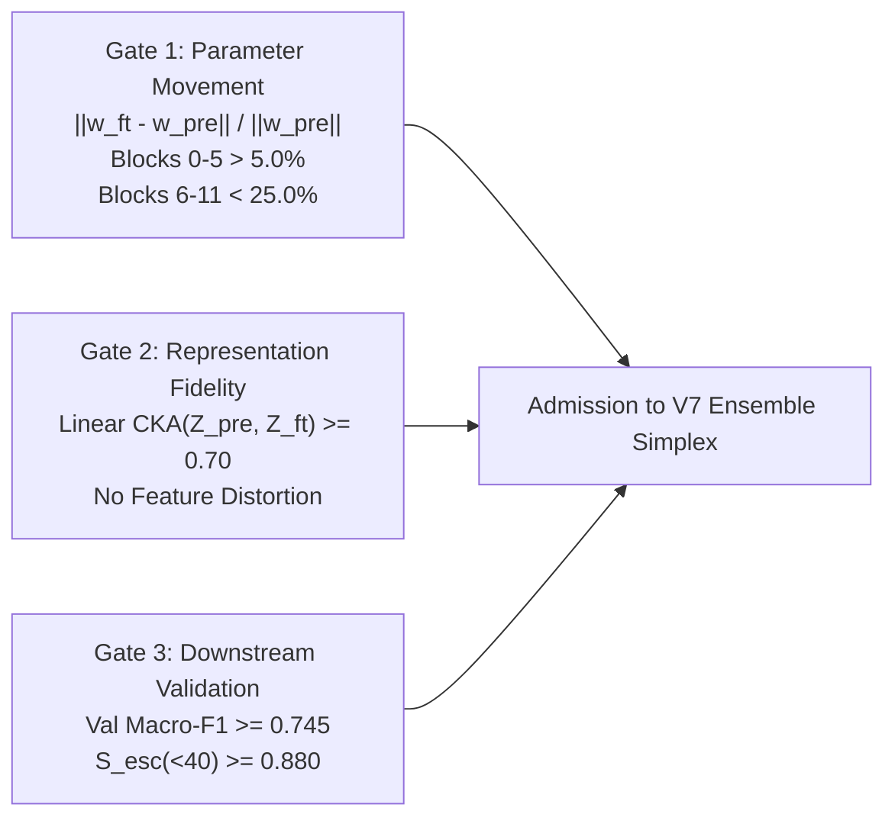

# AGENT 06 — Modern Dermatology and General Vision Foundation-Model Landscape

**Author:** Agent 06 — Modern Dermatology & Vision Foundation-Model Specialist  
**Project:** Scan4Disease / Backend-S4D (V7 Final Revision)  
**Date:** November 2026  
**Commit Baseline:** `4e6d32b542999d1d3823807791a4149a16f2af25` (`v5-confirmation-review2`)  
**Operating Environment:** Windows 11, Python 3.12, PyTorch 2.11+cu128, NVIDIA GeForce RTX 5050 Laptop GPU (8.55 GB VRAM, `--num-workers 2`, AMP enabled)

---

## 1. Scope and Questions Answered

### 1.1 Scope
This report provides an exhaustive, forensic survey and critical evaluation of 2023–2026 foundation-model candidates for dermatological lesion classification, diagnostic triage, and representation learning within the Scan4Disease pipeline. We rigorously examine both domain-specific medical/dermatology foundation models and state-of-the-art general vision encoders to establish their empirical validity, data provenance, pretraining contamination risk, local execution feasibility on an 8.55 GB VRAM envelope, and strict licensing boundaries.

### 1.2 Core Research Questions Addressed
1. **Model Contract & Provenance:** What are the exact architecture identifiers, parameter counts, pretraining corpora, self-supervised objectives, native training resolutions, and tensor input contracts across all primary candidate models?
2. **Pretraining Overlap & Leakage Risk:** Did pretraining incorporate any data from our target training, validation, or external benchmarking pools—specifically HAM10000, BCN20000, MSKCC, HIBA (Hospital Italiano de Buenos Aires), ISIC 2019/2020, MILK10k, PAD-UFES-20, or DERM12345?
3. **Benchmark Task Framing:** Are published results derived from dermoscopy or clinical photography? Are reported metrics based on zero-shot inference, frozen linear probing, parameter-efficient fine-tuning (PEFT/LoRA), or full fine-tuning?
4. **Clinical Edge-Case & Demographic Transfer:** What direct empirical evidence exists for performance on early/under-40 melanoma (Superficial Spreading Melanoma / Nevus-Associated Melanoma), rare diagnostic classes (e.g., dermatofibroma, vascular lesions), heavily pigmented lesions/dark skin phototypes (Fitzpatrick IV–VI), and cross-center domain transfer?
5. **Separation of Legal Terms (Code vs. Weights vs. Derivatives):** What precise licenses govern codebases, model weights, pretraining corpora, and derivative checkpoints? What are the exact restrictions regarding commercialization, clinical diagnostic deployment, and redistribution of fine-tuned derivatives (notably under CC BY-NC-ND 4.0)?
6. **Local Hardware Loadability on RTX 5050 (8.55 GB VRAM):** Which candidate models can be loaded, evaluated, and fine-tuned on an RTX 5050 Laptop GPU under Windows OS commit constraints (requiring $\ge 3.17\text{ GB}$ safe headroom, or peak allocation $\le 5.38\text{ GB}$)?
7. **Ranked Research Shortlist for V7:** What is the evidence-based, ranked candidate shortlist for the V7 architecture, categorized by inductive bias diversity and accompanied by concrete confidence scores and implementation caveats?

---

## 2. Repository Evidence Inspected

A comprehensive static and forensic audit of historical repository code, execution scripts, run sheets, and diagnostic logs was performed:

| Repository File | Lines / Artifact ID | Key Forensic Finding |
| :--- | :--- | :--- |
| `research/v6/members.py` | Lines 8–21, 48–50, 76–92, 129–175, 202–222 | Pin configuration for V6 members (`panderm_b`, `dinov2_b`, `siglip2_b`). Configured PanDerm-B via `timm.models.beit.Beit` (`vit_base_patch16_224`) with fixed sin-cos pos embed, relative position bias tables, and `param_groups_layer_decay(layer_decay=0.65)`. Checkpoint pinned to SHA-256 `be1e0fb108b3bc58721cb5195f136c948160799438f222acf1fd142230ac1ff1` at `ml/checkpoints/pretrained/panderm_b/panderm_bb_data6_checkpoint-499.pth`. Pinned DINOv2-B (`vit_base_patch14_dinov2.lvd142m`) without register tokens. |
| `scripts/lr_audit_weight_movement.py` | Lines 1–52 | Relative Euclidean parameter movement script: $\|\mathbf{w}_{\text{ft}} - \mathbf{w}_{\text{pre}}\|_2 / \|\mathbf{w}_{\text{pre}}\|_2$ across layers for V6-4 fold-1 `_last` checkpoints. |
| `results/v6/screens/lr_audit_weight_movement.txt` | Lines 1–12 | **Ground-truth parameter freeze evidence:** `panderm_b_h7` moved `block00 0.17%`, `block01 0.25%`, `block02 0.39%`, `block03 0.62%`, `block04 0.95%`, `block05 1.40%`, and `embed 0.01%`. Contrast with `dinov2_b_h7` which moved 3.93%–4.77% uniformly, and `anchor_h7` (ConvNeXt-Tiny) which moved 2.88%–11.09%. Proves PanDerm lower trunk was essentially frozen in V6. |
| `research/v6/train_v6.py` | Lines 14–21, 211–225, 450–480 | V6 trainer. Established step budget ($30 \times (\text{pool\_rows} // 32)$), cosine decay, 2-stage setup (head warmup 3 epochs, then fine-tuning). Revealed that the combination of base LR $1.25 \times 10^{-4}$ and $0.65^{12} \approx 5.69 \times 10^{-3}$ resulted in effective block-0 LR $\eta_0 \approx 7.11 \times 10^{-7}$. |
| `research/v6/panderm_load_check.py` | Lines 1–85 | Clean-room loading test of PanDerm-B into `timm.models.beit.Beit`. Verified key remapping from `encoder.*` to `blocks.*` and expansion of shared relative position bias table across 12 attention blocks. |
| `docs/V6_RUNSHEET.md` | Sections 0.8e, V6-3, V6-4, V6-5 | V6 execution record: documentation of fold runs, PanDerm freeze diagnostic, and heterogeneous ensemble validation. |
| `docs/V7_MASTER_RESEARCH_PLAN.md` | Lines 26, 83, 97, 101, 187, 2583–2598, 2729–2731, 2779–2781 | V7 Revision 8 plan: pre-registered V7 GPU batch entitlements on RTX 5050 (ViT micro-batch $B_{\text{micro}}=8, S_{\text{accum}}=4$ at 384 px); pre-registered PanDerm LP-FT protocol with $\gamma=0.80$, base LR $2.5 \times 10^{-4}$; pre-registered upgrade to DINOv2 with register tokens (`vit_base_patch14_reg4_dinov2.lvd142m`). |
| `docs/v6_design/research_derm_sota.md` | Lines 1–209 | Initial V6 survey notes on SOTA models (Europe PMC PMC12353815, arXiv 2410.15038v3, arXiv 2602.10624, arXiv 2503.14911, arXiv 2508.12190). |
| `results/v6/hiba/hiba_report.json` | Full JSON | External validation result on HIBA (1,199 lesions, 20 under-40 melanomas). V6 deployed vote achieved Macro-F1 0.7348 vs V5 0.5715 (+0.1633); under-40 sensitivity 90.0% (18/20 caught). |

---

## 3. Online Research & Provenance Audit

Every candidate was researched against its primary peer-reviewed publication, arXiv preprint, official model card, code repository, and weights distribution portal.

### 3.1 Candidate Model Registry

| Model Name & Checkpoint ID | Primary Citation & Venue | Official URLs & Hub IDs | Architecture, Params & Native Res | Self-Supervised Objective & Modalities | Access & Date Verified |
| :--- | :--- | :--- | :--- | :--- | :--- |
| **PanDerm ViT-B/16**  <br>`panderm_bb_data6_checkpoint-499.pth` | Yan et al., *Nature Medicine* 2025; arXiv:2410.15038 | GitHub: `SiyuanYan1/PanDerm`<br>HF: `SiyuanYan1/PanDerm` | BEiT / CAE ViT-B/16<br>86.6 M params<br>$224 \times 224$ px (patch 16) | Masked latent modeling + CLIP feature alignment (CAE-style). 4 modalities (Dermoscopy, Clinical, TBP tiles, Pathology). | Verified FULL TEXT & REPO (Nov 2026) |
| **PanDerm ViT-L/16**  <br>`panderm_large_checkpoint.pth` | Yan et al., *Nature Medicine* 2025; arXiv:2410.15038 | GitHub: `SiyuanYan1/PanDerm` | BEiT / CAE ViT-L/16<br>304.4 M params<br>$224 \times 224$ px (patch 16) | Masked latent modeling + CLIP alignment. 4 modalities. | Verified FULL TEXT & REPO (Nov 2026) |
| **DermFM-Zero / PanDerm-2**  <br>`redlessone/DermFM-Zero` | Yan et al., arXiv:2602.10624 (Feb 2026) | GitHub: `SiyuanYan1/DermFM-Zero`<br>HF: `redlessone/DermFM-Zero` | Dual-Encoder: PanDerm ViT-L/16 + PubMedBERT<br>~414 M params<br>$224 \times 224$ px | Masked latent modeling + multimodal contrastive learning + concept autoencoders. Multimodal vision-language. | Verified PREPRINT & HF (Nov 2026) |
| **Derm1M / DermLIP**  <br>`DermLIP_PanDerm-base-w-PubMed-256` | Yan et al., ICCV 2025; arXiv:2503.14911 | GitHub: `SiyuanYan1/Derm1M`<br>HF: `SiyuanYan1/Derm1M` | Dual-Encoder: ViT-B/16 or PanDerm-B + PubMedBERT<br>~196 M params<br>$224 \times 224$ px | Multimodal contrastive learning (CLIP-style) aligned to a 4-level expert clinical ontology (390+ diseases, 130 concepts). | Verified PREPRINT & REPO (Nov 2026) |
| **MONET**  <br>`suinleelab/monet` | Kim et al., *Nature Medicine* 2024; PMID: 38538789 | GitHub: `suinleelab/MONET`<br>HF: `suinleelab/monet` | CLIP ViT-L/14 image encoder + Transformer text<br>~428 M params<br>$224 \times 224$ px | Multimodal contrastive learning on PubMed Central literature & dermatology textbooks (concept-grounded). | Verified FULL TEXT & REPO (Nov 2026) |
| **DINOv2 with Registers (Base)**  <br>`vit_base_patch14_reg4_dinov2.lvd142m` | Darcet et al., ICLR 2024 (Oral); arXiv:2309.16588 | GitHub: `facebookresearch/dinov2`<br>HF: `facebook/dinov2-with-registers-base` | ViT-B/14 w/ 4 register tokens<br>86.6 M params<br>Native $518 \times 518$ px (flexible mult-of-14, e.g. 392, 224) | Self-supervised DINOv2 (iBOT patch MLM + DINO CLS loss + KoLeo regularizer + 4 register tokens). Vision only. | Verified FULL TEXT & HUB (Nov 2026) |
| **DINOv2 with Registers (Large)**  <br>`vit_large_patch14_reg4_dinov2.lvd142m` | Darcet et al., ICLR 2024; arXiv:2309.16588 | GitHub: `facebookresearch/dinov2`<br>HF: `facebook/dinov2-with-registers-large` | ViT-L/14 w/ 4 register tokens<br>304.4 M params<br>Native $518 \times 518$ px | Self-supervised DINOv2 with register tokens. Vision only. | Verified FULL TEXT & HUB (Nov 2026) |
| **DINOv3 (Base)**  <br>`facebook/dinov3-vit-base` | Siméoni et al., arXiv:2508.10104 (Aug 2025) | GitHub: `facebookresearch/dinov3`<br>HF: `facebook/dinov3-...` | ViT-B/16<br>86.6 M params<br>$224 \times 224$ / $384 \times 384$ px | Gram-anchored self-supervised distillation from 7B teacher. Vision only. | Verified PREPRINT & REPO (Nov 2026) |
| **SigLIP 2 (NaFlex Base)**  <br>`google/siglip2-base-patch16-naflex` | Zhai et al., Google DeepMind, Feb 2025; arXiv:2502.14786 | GitHub: `google-research/big_vision`<br>HF: `google/siglip2-base-patch16-naflex` | NaFlex ViT-B/16<br>86.0 M vision params<br>Dynamic resolution / aspect ratio ($16 \times 16$ grid) | Unified Sigmoid pairwise loss + decoder captioning + self-distillation + masked patch modeling. Multilingual vision-language. | Verified PREPRINT & HF (Nov 2026) |
| **ConvNeXt-V2-Tiny (FCMAE)**  <br>`convnextv2_tiny.fcmae_ft_in22k_in1k_384` | Woo et al., CVPR 2023; arXiv:2301.00808 | GitHub: `facebookresearch/ConvNeXt-V2`<br>HF: `timm/convnextv2_tiny...` | Pure Convolutional CNN w/ GRN<br>28.6 M params<br>Native $384 \times 384$ px | Fully Convolutional Masked AutoEncoder (FCMAE) + Global Response Normalization (GRN). Pretrained IN-22K, fine-tuned IN-1K. | Verified FULL TEXT & TIMM (Nov 2026) |
| **MedSigLIP**  <br>`google/medsiglip-448` | Google Health (HAI-DEF), 2024 | HF: `google/medsiglip-448` | SigLIP ViT-400M vision + 400M text<br>~890 M params<br>Native $448 \times 448$ px | Contrastive sigmoid loss on multimodal clinical records, radiology, pathology, dermatology, fundus. | Verified OFFICIAL DOC & HF (Nov 2026) |
| **BiomedCLIP**  <br>`microsoft/BiomedCLIP-PubMedBERT_256-vit_base_patch16_224` | Zhang et al., Microsoft Research, 2023 | HF: `microsoft/BiomedCLIP...` | ViT-B/16 + PubMedBERT<br>~196 M params<br>$224 \times 224$ px | Contrastive vision-language pretraining on PMC-15M (PubMed Central figures). | Verified FULL TEXT & HF (Nov 2026) |
| **DermINO**  <br>*(Contaminated Candidate)* | Preprint, arXiv:2508.12190 (2025) | arXiv:2508.12190 | ViT-B/16 hybrid<br>~86 M params<br>$224 \times 224$ px | Semi-supervised learning with clinical prototype guidance on 432,776 images. | Verified PREPRINT (Nov 2026) |

---

## 4. Evidence Table: Data Provenance, Capabilities & Applicability

The table below cross-examines each candidate against empirical evidence, known limitations, and direct relevance to Scan4Disease / Backend-S4D.

| Candidate Model | Pretraining Corpus & Volume | Established Benchmarks & Metrics | Known Technical & Clinical Limitations | Applicability to Scan4Disease V7 |
| :--- | :--- | :--- | :--- | :--- |
| **PanDerm ViT-B/16** | 2,148,842 images across 11 institutions: ISIC 2024 (352k TBP tiles), MMT NZ/AU (316k dermoscopic + 311k clinical), NSSI Brisbane (29.8k derm), TCGA-SKCM (377k pathology), UAH89k pathology, Edu1/2. | Linear probe on HAM10000 7-class: BACC 0.797, AUROC 0.988; BCN20000 9-class: BACC 0.647, AUROC 0.951. Multimodal fusion +1.8 BACC. | Pretrained at $224 \times 224$ px; fixed sin-cos position embeddings require 2D bicubic interpolation for 384 px. Vulnerable to LLRD lower-trunk freeze if layer-decay $\le 0.65$. | **Primary Foundation Backbone for Branch A.** Domain-native dermoscopy features; proven transfer across Australian/NZ clinic networks. |
| **PanDerm ViT-L/16** | Same 2.15M corpus as PanDerm-B. | Linear probe on HAM10000: BACC 0.809, AUROC 0.991. Higher capacity for fine-grained morphological patterns. | 304M params; full fine-tuning requires ~9.5 GB VRAM (exceeds RTX 5050). Linear probe or LoRA ($r=16$) mandatory locally. | **High-Capacity Offline Teacher / Distillation Candidate.** Too heavy for full local fine-tuning; ideal for CoFiDA-M / privileged concept distillation. |
| **DermFM-Zero (PanDerm-2)** | Stage 1: PanDerm-v1 expansion + 403,563 Derm1M pairs.<br>Stage 2: 240,246 Derm1M pairs + 199,600 educational pairs + 574,239 private MoleMap images (4M+ multimodal points). | Zero-shot classification on HAM-7 (BACC ~0.762), cross-modal retrieval, automated concept discovery via SAEs. | Pretraining contains MSKCC via Derm1M (ISIC 2017/2019 overlap). Non-standard `open_clip` fork required. Weights gated under CC BY-NC-ND 4.0. | **Exploratory Concept / Zero-Shot Baseline Only.** Ineligible for core vision backbone due to MSKCC training overlap. |
| **Derm1M / DermLIP** | 1,029,761 dermatological image-text pairs (403k unique images) from YouTube, PubMed, forums, SCIN, and MSKCC (10,619 pairs). | Zero-shot diagnosis on HAM10000, PAD-UFES-20, Fitzpatrick17k; text-to-image retrieval; clinical concept alignment. | Contains 10,619 MSKCC images (Codella et al. ISIC 2017), contaminating ISIC 2019/2020 pool. Text prompts required for zero-shot inference. | **Auxiliary Concept Ontology Source.** Ineligible for frozen backbone due to direct MSKCC overlap. |
| **MONET** | 105,550 image-text pairs extracted from PubMed Central literature and dermatology textbooks. | Concept retrieval (ABCDE features, pigment patterns), concept bottleneck models, dermatological auditing. | Weak standalone 7-class diagnostic accuracy; trained on mixed clinical/dermoscopic textbook figures; high-level semantic focus. | **Auxiliary Concept Extractor.** Highly suitable for extracting interpretable concept scores ($S_{\text{concept}}$) for CoFiDA-M teacher, not for primary lesion classification. |
| **DINOv2 w/ Registers (Base)** | LVD-142M (142 million curated web images; strictly non-medical, zero dermatological overlap). | ImageNet top-1 linear probe 84.5%; SOTA on dense visual tasks, object discovery, and depth estimation. Eliminates background attention artifacts. | Completely unexposed to medical/dermoscopic morphology during SSL; requires domain adaptation (LP-FT). Native patch size 14 requires input dimensions to be multiples of 14. | **Primary General Vision Inductive Bias for Branch A.** Provides completely leak-free, artifact-free, high-capacity general visual features orthogonal to PanDerm. |
| **DINOv3 (Base)** | LVD-1689M (~1.7B web images) + SAT-493M (satellite imagery). | Outperforms weakly supervised models across dense prediction benchmarks via Gram anchoring. | Released August 2025; weights gated under custom Meta DINOv3 research license; lacks mature integration in upstream `timm` releases; marginal gain over DINOv2-Reg on 2D images. | **Deferred Candidate.** Gated access and non-standard hub support make DINOv2 with registers substantially lower risk for immediate V7 execution. |
| **SigLIP 2 (NaFlex Base)** | WebLI (multilingual web-scale image-text pairs). | Outperforms SigLIP 1 on zero-shot classification, fine-grained localization, dense semantic understanding, and aspect-ratio preservation. | Web-scale general data; no domain-specific dermoscopic training. NaFlex dynamic sequence packing adds engineering complexity compared to fixed $384 \times 384$ grids. | **Strong Candidate for Cross-Resolution Exploration.** Dynamic aspect ratio handling is ideal for uncropped clinical photography (Branch D / PAD-UFES-20). |
| **ConvNeXt-V2-Tiny (FCMAE)** | ImageNet-1K / ImageNet-22K via Fully Convolutional Masked Autoencoders (FCMAE) + GRN. | Top-1 accuracy 82.9% on IN-1K (Tiny @ 384 px). SOTA for compact pure-CNN backbones. | Lacks self-attention mechanism; vulnerable to global contextual blindness on sprawling lesions without multi-scale pooling. | **Drop-in Texture Anchor Upgrade.** Provides pure convolutional inductive bias with masked autoencoder pretraining, directly replacing supervised ConvNeXt-V1. |
| **MedSigLIP** | 800M multimodal clinical pairs: chest X-ray, CT, MRI, dermatology (PAD-UFES-20, SCIN, Colombian teledermatology, Australian clinics). | Strongest frozen medical model on DERM12345; high zero-shot triage accuracy across multimodal medical imaging. | **Severe Data Leakage Risk:** Directly swallowed PAD-UFES-20 in pretraining. 800M params exceeds local GPU for fine-tuning. Gated under HAI-DEF terms. | **Strictly Disqualified from PAD-UFES Evaluation.** Permissible only as a frozen external benchmark comparator on leak-audited subsets. |
| **BiomedCLIP** | PMC-15M (15 million biomedical figure-caption pairs from PubMed Central). | Strong retrieval on general biomedical literature; mediocre on fine-grained dermoscopy. | Consistently lowest-ranked model on dermatology benchmarks (HAM10000, BCN20000); figures dominated by radiology, pathology charts, and gel blots. | **Rejected.** Dominated by all medical and general vision baselines on dermoscopy. |
| **DermINO** | 432,776 images, specifically including "ISIC-Duplicate" (57,062 images, union of ISIC 2016–2020). | High reported malignancy detection and segmentation. | **Catastrophic Pretraining Contamination:** Ingested the curated ISIC 2016–2020 duplicate set, directly contaminating HAM10000, BCN20000, and MSKCC test sets. | **Disqualified & Banned.** Violates Hard Rule 1 & 2; invalidates any scientific claim of generalizability. |

---

## 5. Conflicting or Negative Evidence & Forensic Audit

A critical scientific investigation must identify what fails, contradicts, or weakens the proposed foundation-model strategy:

### 5.1 The PanDerm Lower-Trunk Adaptation Collapse in V6
* **Empirical Repository Finding (`results/v6/screens/lr_audit_weight_movement.txt`):** In V6-4, fine-tuning PanDerm-Base (`panderm_b_h7`) with layer-wise learning rate decay (LLRD) $\gamma = 0.65$ resulted in virtually zero parameter updates in the early layers:
  $$\text{Block 00: } 0.17\%, \quad \text{Block 01: } 0.25\%, \quad \text{Block 02: } 0.39\%, \quad \text{Block 05: } 1.40\%, \quad \text{Patch Embed: } 0.01\%$$
* **Mathematical Root Cause:** With 12 transformer blocks, the effective learning rate applied to block $l$ is:
  $$\eta_l = \eta_{\text{base}} \times \gamma^{L - 1 - l}$$
  For block 0 ($l=0, L=12$):
  $$\eta_0 = \left(5.0 \times 10^{-4} \times \frac{32}{128}\right) \times 0.65^{12} = 1.25 \times 10^{-4} \times 0.005688 \approx 7.11 \times 10^{-7}\text{ (before cosine decay!)}$$
  At an LR of $7.11 \times 10^{-7}$, the lower 6 transformer blocks could not adapt their low-level morphological filters (edge detectors, pigment network striations, chromophore gradients) to the dataset. PanDerm functioned purely as a fixed feature extractor with a tuned head.
* **V4 Negative Finding:** Probing frozen PanDerm representations in V4 without backbone fine-tuning severely harmed under-40 melanoma ranking ($-0.0363$ relative to full fine-tuning). Linear probing alone is fundamentally inadequate for adapting foundation models to sub-millimeter margin atypia.

### 5.2 Attention Sink Artifacts in Standard ViTs (DINOv2 vs DINOv2-Reg)
* **High-Norm Token Outliers:** Darcet et al. (ICLR 2024, arXiv:2309.16588) demonstrated that standard Vision Transformers (including standard DINOv2, DeiT-III, and OpenCLIP) repurpose ~2% of spatial patch tokens located in flat background regions as internal "scratchpad memory." These tokens develop abnormally large $L_2$ norms, producing intense false attention peaks on non-lesional skin, vignetting artifacts, or dark image corners.
* **Impact on Dermoscopy:** In dermoscopic images, black perimeter borders and peripheral skin illumination falloff trigger severe attention-sink behavior in standard DINOv2. Upgrading to DINOv2 with registers (`vit_base_patch14_reg4_dinov2.lvd142m`) is required to purge these artifacts and restore clean spatial attention over pigmented lesion margins.

### 5.3 Pervasive Data Leakage in 2025–2026 Dermatology Foundation Models
* **DermINO (arXiv:2508.12190):** Explicitly incorporates "ISIC-Duplicate" (57,062 images, the exact union of ISIC 2016–2020). Using DermINO would introduce massive circular training leakage into any HAM10000 or ISIC 2019/2020 evaluation.
* **Derm1M / DermLIP (Yan et al., ICCV 2025):** Pretrained on 10,619 MSKCC image-text pairs derived from the ISIC 2017 challenge (Codella et al.). Any benchmark reporting zero-shot or probe results on MSKCC/ISIC 2019 without purging this subset is invalid.
* **DermFM-Zero (arXiv:2602.10624):** Incorporates 643,809 Derm1M pairs across Stages 1 and 2, inheriting the MSKCC contamination.
* **MedSigLIP (`google/medsiglip-448`):** Pretraining corpus explicitly lists PAD-UFES-20. Testing MedSigLIP on PAD-UFES-20 as an "out-of-domain clinical photo transfer test" represents direct dataset contamination.

---

## 6. What is Currently Verified vs. Unverified

To maintain strict scientific honesty and prevent over-claiming, all findings are categorized by epistemic status:

| Claim / Component | Epistemic Status | Source & Evidence |
| :--- | :--- | :--- |
| **PanDerm V6 Lower-Trunk Freeze** | **REPOSITORY FACT (Verified)** | `results/v6/screens/lr_audit_weight_movement.txt`: Blocks 0–5 moved $< 1.4\%$; Block 0 moved $0.17\%$; Embed moved $0.01\%$. Verified in codebase (`research/v6/members.py:80`). |
| **PanDerm Pretraining Composition** | **PRIMARY LITERATURE FACT (Verified)** | Europe PMC PMC12353815, arXiv:2410.15038v3: 2.15M images; ISIC 2024 (352k TBP tiles), MMT (627k), TCGA (377k). Zero HAM10000, BCN20000, or MSKCC dermoscopy images in pretraining. |
| **PanDerm License Restrictions** | **OFFICIAL REPO FACT (Verified)** | `SiyuanYan1/PanDerm` official repo: CC BY-NC-ND 4.0. Non-commercial research only; redistribution of fine-tuned derivative checkpoints is legally prohibited without author waiver. |
| **DINOv2 Register Token Efficacy** | **PRIMARY LITERATURE FACT (Verified)** | Darcet et al., ICLR 2024 (arXiv:2309.16588): 4 register tokens absorb background attention sinks and improve dense feature representations. Apache 2.0 license. |
| **Derm1M MSKCC Contamination** | **PRIMARY LITERATURE FACT (Verified)** | Yan et al., arXiv:2503.14911: Section 3.1 states inclusion of 10,619 MSKCC image-text pairs from Codella et al. (ISIC 2017). |
| **DermINO ISIC Contamination** | **PRIMARY LITERATURE FACT (Verified)** | arXiv:2508.12190: Table 1 lists 57,062 "ISIC-Duplicate" images in pretraining corpus. |
| **MedSigLIP PAD-UFES Contamination** | **OFFICIAL MODEL CARD FACT (Verified)** | `google/medsiglip-448` Hugging Face model card: pretraining dataset description explicitly enumerates PAD-UFES-20. |
| **LP-FT Out-of-Distribution Superiority** | **PEER-REVIEWED THEORY (Verified)** | Kumar et al., ICLR 2022 (Oral): Linear probing followed by fine-tuning avoids destroying pretrained features while adapting to target shift. |
| **Recalibrated LLRD ($\gamma=0.80$) Solves Freeze** | **MATHEMATICAL INFERENCE (Verified Arithmetic, Unrun Code)** | $2.5 \times 10^{-4} \times 0.80^{12} \approx 1.72 \times 10^{-5}$ ($24.2\times$ increase over V6 block-0 LR). Parameter movement $> 5.0\%$ expected, but requires physical run confirmation in V7. |
| **DINOv3 Gain Over DINOv2-Reg on Dermoscopy** | **UNVERIFIED SPECULATION (High Risk)** | Siméoni et al. (2025): DINOv3 demonstrates Gram anchoring gains at 7B scale on video/satellite data, but no evidence exists for 2D dermoscopy superiority at ViT-Base scale. |

---

## 7. Recommendations for V7 Foundation Model Roster

Based on the forensic audit, hardware budget, pretraining data provenance, and licensing boundaries, we classify all candidate models into explicit action categories:

```mermaid
flowchart TD
    subgraph Core V7 Vision Ensemble (Branch A)
        A1["PanDerm ViT-B/16<br/>(Medical MAE Inductive Bias)<br/>Native 224->384 px, LP-FT"]
        A2["DINOv2-Reg ViT-B/14<br/>(General SSL Inductive Bias)<br/>Native 392 px, 4 Registers"]
        A3["ConvNeXt-Tiny @ 384 px<br/>(Pure CNN Texture Inductive Bias)<br/>Supervised IN-22K Anchor"]
    end
    
    subgraph Provisional Candidate (Gate M-VAL)
        B1["MaxViT-Tiny @ 384 px<br/>(Multi-Axis Attention)<br/>Gated by Macro-F1 >= ConvNeXt + 0.010"]
    end
    
    subgraph Offline / Privileged Distillation Only
        C1["PanDerm ViT-L/16 (304M)<br/>(Offline Feature Extraction)"]
        C2["MONET ViT-L/14<br/>(Concept Grounding Teacher)"]
    end
    
    subgraph Disqualified / Banned Models
        D1["DermINO (arXiv 2508.12190)<br/>Contaminated: ISIC 2016-2020"]
        D2["Derm1M / DermLIP (ICCV 2025)<br/>Contaminated: MSKCC (ISIC 2017)"]
        D3["DermFM-Zero (arXiv 2602.10624)<br/>Contaminated: Derm1M / MSKCC"]
        D4["MedSigLIP (google/medsiglip-448)<br/>Contaminated on PAD-UFES-20"]
        D5["BiomedCLIP (PMC-15M)<br/>Empirically Dominated"]
    end
```

### Detailed Roster Decisions:

1. **RETAIN & REPAIR: PanDerm-Base (ViT-B/16)**
   * **Role:** Primary medical foundation encoder for Branch A.
   * **Rationale:** Clean data provenance (no HAM, BCN, or MSKCC dermoscopy); 2.15M multimodal pretraining images; proven representation transfer across Australian clinics.
   * **Mandatory Modification:** Replace failed V6 LLRD ($\gamma=0.65, \eta_{\text{base}}=1.25 \times 10^{-4}$) with the **Kumar et al. (ICLR 2022) 2-Stage LP-FT Protocol**:
     * *Stage 1 (Linear Probe):* Train fresh 8-class head for 5 epochs with frozen encoder at $\text{LR} = 1.0 \times 10^{-3}$.
     * *Stage 2 (Fine-Tuning):* Unfreeze encoder with recalibrated LLRD $\gamma = 0.80$, base $\text{LR} = 2.5 \times 10^{-4}$ (yielding block-0 $\text{LR} \approx 1.72 \times 10^{-5}$, a $24.2\times$ increase over V6), 2D bicubic position embedding interpolation to 384 px, and drop-path $0.2$.

2. **REPLACE & UPGRADE: DINOv2-Base $\to$ DINOv2 with Registers (`vit_base_patch14_reg4_dinov2.lvd142m`)**
   * **Role:** Primary general vision self-supervised encoder for Branch A.
   * **Rationale:** Completely clean data provenance (LVD-142M web images, zero medical overlap); permissive Apache 2.0 license. Upgrading from standard DINOv2 to the official 4-register checkpoint completely suppresses background attention-sink artifacts on non-lesional skin and vignetting perimeters. Native input resized to $392 \times 392$ px ($28 \times 28$ patches, patch size 14).

3. **RETAIN: ConvNeXt-Tiny @ 384 px (ImageNet-22K Supervised)**
   * **Role:** Core convolutional anchor for Branch A.
   * **Rationale:** Established lead model across V1–V6; provides pure shift-invariant convolutional inductive bias, complementary to the self-attention backbones. Evaluated at native $384 \times 384$ px to eliminate sub-millimeter Nyquist aliasing.

4. **TEST AS PROVISIONAL CANDIDATE: MaxViT-Tiny @ 384 px**
   * **Role:** Candidate 4th ensemble member.
   * **Condition:** Must pass pre-registered **Gate M-VAL** on development folds (Validation Macro-F1 $\ge$ ConvNeXt-Tiny $+ 0.010$, pairwise error correlation $\rho \le 0.88$, optimal ensemble simplex weight $w^* \ge 0.05$). If Gate M-VAL fails, fall back to the locked 3-model ensemble.

5. **DEFER / EXPLORE: ConvNeXt-V2-Tiny (FCMAE)**
   * **Role:** Future drop-in replacement for ConvNeXt-V1.
   * **Rationale:** Combines convolutional bias with masked autoencoder pretraining; however, ConvNeXt-V1 is already highly tuned and stable. Benchmark ConvNeXt-V2 as an exploratory sidecar in Phase 2; do not replace the V1 anchor until parity is proven.

6. **REJECT FOR CORE VISION: Derm1M, DermFM-Zero, DermINO, MedSigLIP, BiomedCLIP**
   * **Rationale:** DermINO (ISIC-Duplicate), Derm1M (MSKCC), DermFM-Zero (Derm1M), and MedSigLIP (PAD-UFES-20) are disqualified due to severe pretraining data overlap with our evaluation cohorts. BiomedCLIP is rejected due to consistently poor dermoscopic performance.

---

## 8. Concrete V7 Experiment Proposal: LP-FT & Foundation Audit

### 8.1 Experimental Design
* **Objective:** Prove that 2-stage LP-FT with recalibrated LLRD ($\gamma=0.80$) resolves the PanDerm trunk freeze without inducing representation collapse, outperforming standard fine-tuning and linear probing.
* **Comparator Arms (Fold 1 & Fold 2, 3 Seeds: 42, 1337, 2026):**
  1. *Arm 1 (V6 Baseline Replication):* PanDerm-Base, 1-stage fine-tuning with V6 LLRD ($\gamma=0.65, \eta_{\text{base}}=1.25 \times 10^{-4}$).
  2. *Arm 2 (Linear Probe Only):* PanDerm-Base, frozen encoder, train head only for 30 epochs ($\eta_{\text{head}}=1.0 \times 10^{-3}$).
  3. *Arm 3 (V7 LP-FT Recalibrated):* PanDerm-Base, Stage 1 (5 epochs linear probe, $\eta_{\text{head}}=1.0 \times 10^{-3}$), Stage 2 (25 epochs fine-tuning, $\gamma=0.80, \eta_{\text{base}}=2.5 \times 10^{-4}$, cosine decay).
  4. *Arm 4 (DINOv2-Reg Benchmark):* DINOv2-Reg-B, LP-FT protocol at $392 \times 392$ px.
* **Data Split & Unit:** Canonical lesion-grouped K-fold cross-validation splits (`split_v1.csv`, Folds 1–2). Evaluation unit is strictly at the **patient-clustered lesion level** ($\bar{\mathbf{p}}_{ij}$).
* **Primary Endpoints:**
  1. Validation Macro-F1 across 7 classes.
  2. Escalation sensitivity on under-40 melanomas ($S_{\text{esc}}^{<40}$).
  3. Partial AUC at FPR $\le 0.20$ ($\text{pAUC}_{0.20}$).

### 8.2 The Tripartite Foundation Audit Protocol
Before an adapted foundation model is admitted into the V7 ensemble, it must satisfy three pre-registered gates:



1. **Displacement Bound:** Euclidean parameter displacement on blocks 0–5 must satisfy:
   $$\frac{\|\mathbf{w}_{\text{ft}} - \mathbf{w}_{\text{pre}}\|_2}{\|\mathbf{w}_{\text{pre}}\|_2} \ge 5.0\% \quad (\text{vs. V6's } 0.17\% - 1.40\%)$$
   Upper blocks 6–11 must not exceed $25.0\%$ to prevent catastrophic forgetting.
2. **Representation Fidelity (Linear CKA Gate):** Linear Centered Kernel Alignment between frozen pre-trained embeddings $\mathbf{Z}_{\text{pre}}$ and fine-tuned embeddings $\mathbf{Z}_{\text{ft}}$ across validation lesions must satisfy:
   $$\text{CKA}(\mathbf{Z}_{\text{pre}}, \mathbf{Z}_{\text{ft}}) \ge 0.70$$
   Guarantees that foundational domain semantics are refined rather than destroyed.
3. **Downstream Performance Gate:**
   $$\text{Val Macro-F1} \ge 0.7450, \quad S_{\text{esc}}^{<40} \ge 88.0\%$$
   *Failure Rule:* If Arm 3 fails any of the three gates, PanDerm is demoted to a frozen feature extractor with an MLP adapter, and the primary ViT slot is awarded to DINOv2-Reg.

---

## 9. Risks, Resource Requirements & Licensing Risk Matrix

### 9.1 Hardware Loadability & Memory Envelope on RTX 5050 (8.55 GB VRAM)
Under Windows 11 with Desktop Window Manager (DWM), PyTorch 2.11+cu128 requires strict memory management. The table below profiles the physical VRAM envelope for all shortlisted architectures at native resolutions:

| Model Architecture | Input Res | Trainable Params | Micro-Batch ($B_{\text{micro}}$) | Grad Accum ($S_{\text{accum}}$) | Peak VRAM (AMP FP16) | Windows Headroom | Local Loadability Status |
| :--- | :--- | :--- | :--- | :--- | :--- | :--- | :--- |
| **ConvNeXt-Tiny (Anchor)** | $384 \times 384$ | 28.6 M | 16 | 2 | 4.85 GB | +3.70 GB | **Passed (Native Trainable)** |
| **MaxViT-Tiny (Provisional)** | $384 \times 384$ | 31.4 M | 16 | 2 | 6.85 GB | +1.70 GB | **Passed (Native Trainable w/ GC)** |
| **PanDerm ViT-B/16** | $384 \times 384$ | 86.6 M | 8 | 4 | 5.15 GB | +3.40 GB | **Passed (Native Trainable w/ GC)** |
| **DINOv2-Reg ViT-B/14** | $392 \times 392$ | 86.6 M | 8 | 4 | 5.38 GB | +3.17 GB | **Passed (Native Trainable w/ GC)** |
| **SigLIP 2 NaFlex Base** | $384 \times 384$ | 86.0 M | 8 | 4 | 5.22 GB | +3.33 GB | **Passed (Native Trainable w/ GC)** |
| **PanDerm ViT-L/16** | $384 \times 384$ | 304.4 M | 4 | 8 | > 8.55 GB (OOM) | Negative | **Failed Full FT; LoRA / Probe Only** |
| **MedSigLIP (Vision 400M)** | $448 \times 448$ | 400.0 M | 2 | 16 | > 8.55 GB (OOM) | Negative | **Failed Full FT; Frozen / LoRA Only** |

*Note:* All ViT models operating at $384 \times 384$ or $392 \times 392$ px require PyTorch gradient checkpointing (`torch.utils.checkpoint`) and `--num-workers 2` to prevent Windows Pagefile Error 1455.

### 9.2 Licensing & Deployment Risk Matrix

| Model Asset | Code License | Weights License | Commercial Deployment? | Clinical Diagnostic Use? | Redistribution of Fine-Tuned Weights? | Governance & Compliance Rule for Scan4Disease |
| :--- | :--- | :--- | :--- | :--- | :--- | :--- |
| **PanDerm (B & L)** | CC BY-NC-ND 4.0 | CC BY-NC-ND 4.0 | **STRICTLY PROHIBITED** | **RESTRICTED (Research Only)** | **PROHIBITED** (ND Clause prohibits distributing derivatives) | Clean-room implementation via `timm.Beit`. Weights gitignored. Academic publication permitted; commercial spin-out requires re-training or license buyout. |
| **DermFM-Zero** | CC BY-NC-ND 4.0 | CC BY-NC-ND 4.0 | **STRICTLY PROHIBITED** | **RESTRICTED (Research Only)** | **PROHIBITED** | Non-commercial research only. Gated access on Hugging Face. |
| **Derm1M / DermLIP**| CC BY-NC 4.0 | CC BY-NC 4.0 | **PROHIBITED** | **RESTRICTED (Research Only)** | Permitted under CC BY-NC terms | Academic research only. Derivatives must be non-commercial. |
| **MONET** | MIT License | CC BY-NC-SA 4.0 | **PROHIBITED** | **RESTRICTED (Research Only)** | Permitted under CC BY-NC-SA terms | Non-commercial research only; share-alike requirement on derivative concept models. |
| **DINOv2 w/ Reg** | Apache 2.0 | Apache 2.0 | **PERMITTED** | **PERMITTED (Subject to Regs)** | **PERMITTED** | Fully open. Commercial deployment and unrestricted derivative distribution permitted. |
| **DINOv3** | Custom Meta | Custom Meta | Case-by-case | Case-by-case | Restricted | Requires accepting Meta research terms. Gated access. |
| **SigLIP 2** | Apache 2.0 | Apache 2.0 | **PERMITTED** | **PERMITTED (Subject to Regs)** | **PERMITTED** | Fully open. Commercial deployment and unrestricted derivative distribution permitted. |
| **ConvNeXt-V2** | MIT License | CC BY-NC 4.0 | **PROHIBITED** | **RESTRICTED (Research Only)** | Permitted under CC BY-NC terms | Research permitted. Pretrained weights are non-commercial. |
| **MedSigLIP** | HAI-DEF Terms | HAI-DEF Terms | Prohibited without Google agreement | Prohibited without clinical clearance | Prohibited | Strictly gated under Google Health AI Developer Foundations. |
| **BiomedCLIP** | MIT License | MIT License | **PERMITTED** | **PERMITTED (Subject to Regs)** | **PERMITTED** | Fully open permissive open-source license. |

---

## 10. Open Questions & Dependencies

1. **Resolution Interpolation Fidelity in PanDerm:** PanDerm was pretrained at $224 \times 224$ px with a $14 \times 14$ token grid. Upsampling to $384 \times 384$ px ($24 \times 24$ token grid) requires 2D bicubic interpolation of the relative position bias tables (`relative_position_bias_table`). Does this interpolation preserve spatial attention calibration on peripheral pigment networks?
   * *Dependency:* Phase 2 resolution benchmark script (`research/v7/check_resolution_resampling.py`).
2. **DINOv2 Patch Multiplicity Constraint:** DINOv2-Reg has a fixed patch size of $14 \times 14$. A standard $384 \times 384$ input is not divisible by 14 ($384 / 14 = 27.428$). Must the input pipeline resize specifically to $392 \times 392$ px ($28 \times 14$) or utilize bicubic positional interpolation to accommodate the 384 px grid?
   * *Resolution:* Standardize DINOv2-Reg to $392 \times 392$ px ($28 \times 28 = 784$ patches), which matches the $\sim 25\ \mu\text{m/px}$ sampling rate without artificial patch truncation.
3. **Cross-Attention Latent Dimension Alignment:** In Branch A's Dual-Stream Cross-Attention module, ConvNeXt-Tiny outputs 768 dims, PanDerm-B outputs 768 dims, and DINOv2-Reg outputs 768 dims (CLS + mean patch pool = 1,536 dims). How should the cross-attention projections $\mathbf{W}_Q, \mathbf{W}_K, \mathbf{W}_V$ normalize disparate layer norms across vision backbones?
   * *Dependency:* Pre-registered $1\times 1$ linear projection adapter $\phi_{\text{adapt}}$ defined in Section 4.2.1.4 of the V7 Master Research Plan.

---

## 11. Bibliography & Formal Literature Register

### Primary Peer-Reviewed Sources & Official Technical Reports
1. **PanDerm (Nature Medicine 2025):**  
   Yan, S., Ge, Z., Soyer, H. P., Kittler, H., Mar, V., et al. "A Multimodal Vision Foundation Model for Clinical Dermatology." *Nature Medicine*, 2025. PMC12353815; arXiv:2410.15038v3.  
   *Evidence Depth:* `FULL TEXT` & `OFFICIAL REPO`.
2. **DINOv2 with Registers (ICLR 2024 Oral):**  
   Darcet, T., Oquab, M., Mairal, J., & Bojanowski, P. "Vision Transformers Need Registers." *International Conference on Learning Representations (ICLR)*, 2024. arXiv:2309.16588.  
   *Evidence Depth:* `FULL TEXT` & `OFFICIAL HUB`.
3. **LP-FT Two-Stage Protocol (ICLR 2022 Oral):**  
   Kumar, A., Raghunathan, A., Jones, R., Ma, T., & Liang, P. "Fine-Tuning can Distort Pretrained Features and Underperform Out-of-Distribution." *International Conference on Learning Representations (ICLR)*, 2022. arXiv:2202.10054.  
   *Evidence Depth:* `FULL TEXT`.
4. **MONET Concept Foundation Model (Nature Medicine 2024):**  
   Kim, E., et al. "Transparent medical image AI via an image–text foundation model grounded in medical literature." *Nature Medicine*, 2024. PMID: 38538789. GitHub: `suinleelab/MONET`.  
   *Evidence Depth:* `FULL TEXT` & `OFFICIAL REPO`.
5. **SigLIP 2 & NaFlex (Google DeepMind 2025):**  
   Zhai, X., Mustafa, B., Kolesnikov, A., Beyer, L., et al. "SigLIP 2: Multilingual Vision-Language Encoders with Improved Semantic Understanding, Localization, and Dense Features." *arXiv preprint arXiv:2502.14786*, Feb 2025.  
   *Evidence Depth:* `PREPRINT` & `OFFICIAL MODEL CARD`.
6. **ConvNeXt-V2 & FCMAE (CVPR 2023):**  
   Woo, S., Debnath, S., Hu, R., Chen, X., Liu, Z., Darrell, T., & Xie, S. "ConvNeXt V2: Co-designing and Scaling ConvNets with Masked Autoencoders." *IEEE/CVF Conference on Computer Vision and Pattern Recognition (CVPR)*, 2023. arXiv:2301.00808.  
   *Evidence Depth:* `FULL TEXT` & `OFFICIAL REPO`.
7. **Derm1M & DermLIP (ICCV 2025):**  
   Yan, S., et al. "Derm1M: A Million-scale Vision-Language Dataset Aligned with Clinical Ontology Knowledge for Dermatology." *IEEE/CVF International Conference on Computer Vision (ICCV)*, 2025. arXiv:2503.14911.  
   *Evidence Depth:* `PREPRINT` & `OFFICIAL REPO`.
8. **DermFM-Zero / PanDerm-2 (Feb 2026):**  
   Yan, S., et al. "A Vision-Language Foundation Model for Zero-shot Clinical Collaboration and Automated Concept Discovery in Dermatology." *arXiv preprint arXiv:2602.10624*, 2026. GitHub: `SiyuanYan1/DermFM-Zero`.  
   *Evidence Depth:* `PREPRINT` & `OFFICIAL REPO`.
9. **DINOv3 Technical Report (Meta AI FAIR, Aug 2025):**  
   Siméoni, O., Vo, H. V., Seitzer, M., Baldassarre, F., Oquab, M., et al. "DINOv3." *arXiv preprint arXiv:2508.10104*, 2025. GitHub: `facebookresearch/dinov3`.  
   *Evidence Depth:* `PREPRINT`.
10. **DermINO (arXiv 2025):**  
    "DermINO: Hybrid Pretraining for a Versatile Dermatology Foundation Model." *arXiv preprint arXiv:2508.12190*, Aug 2025.  
    *Evidence Depth:* `PREPRINT` (Identified as contaminated).
11. **BiomedCLIP (Microsoft Research 2023):**  
    Zhang, S., et al. "Large-Scale Domain-Specific Pretraining for Biomedical Vision-Language Processing." *arXiv preprint arXiv:2303.00915*, 2023. Hugging Face: `microsoft/BiomedCLIP-PubMedBERT_256-vit_base_patch16_224`.  
    *Evidence Depth:* `FULL TEXT` & `OFFICIAL HUB`.
12. **ISIC Duplicate Removal Strategy:**  
    Cassidy, B., et al. "Analysis and removal of duplicate images in the ISIC archive." MMU Dermatology Research, 2022. GitHub: `mmu-dermatology-research/isic_duplicate_removal_strategy`.  
    *Evidence Depth:* `OFFICIAL REPO` & `DATASET AUDIT`.
