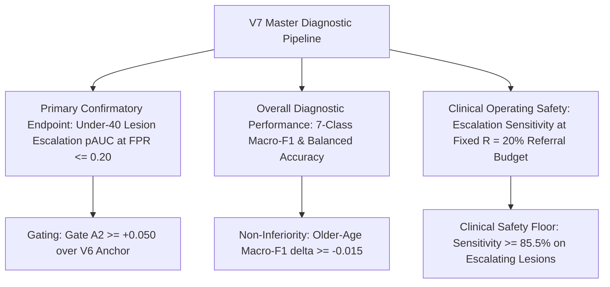
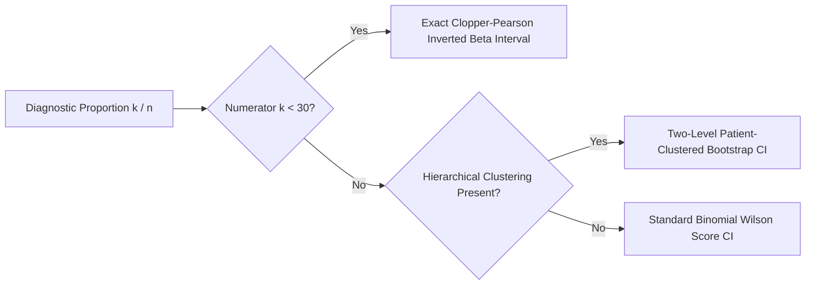
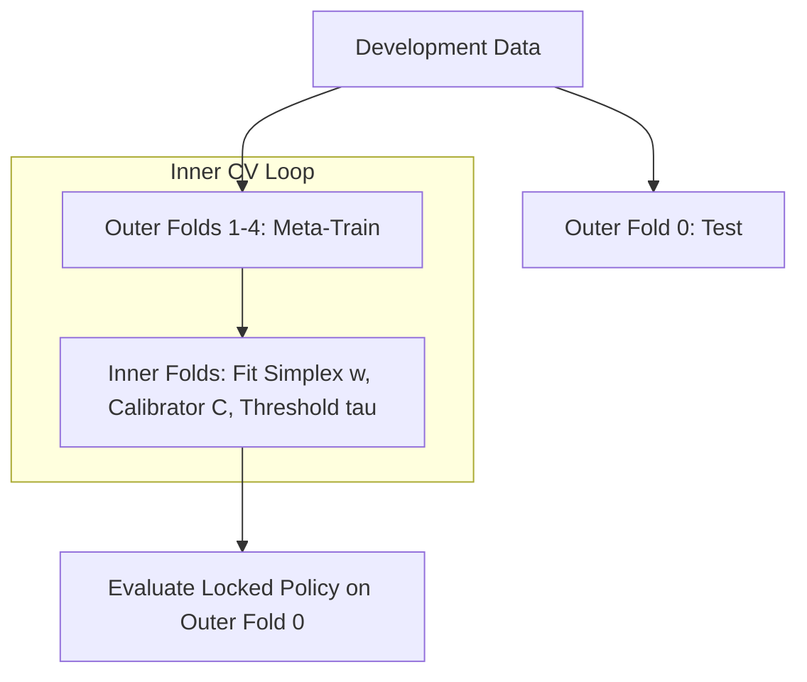
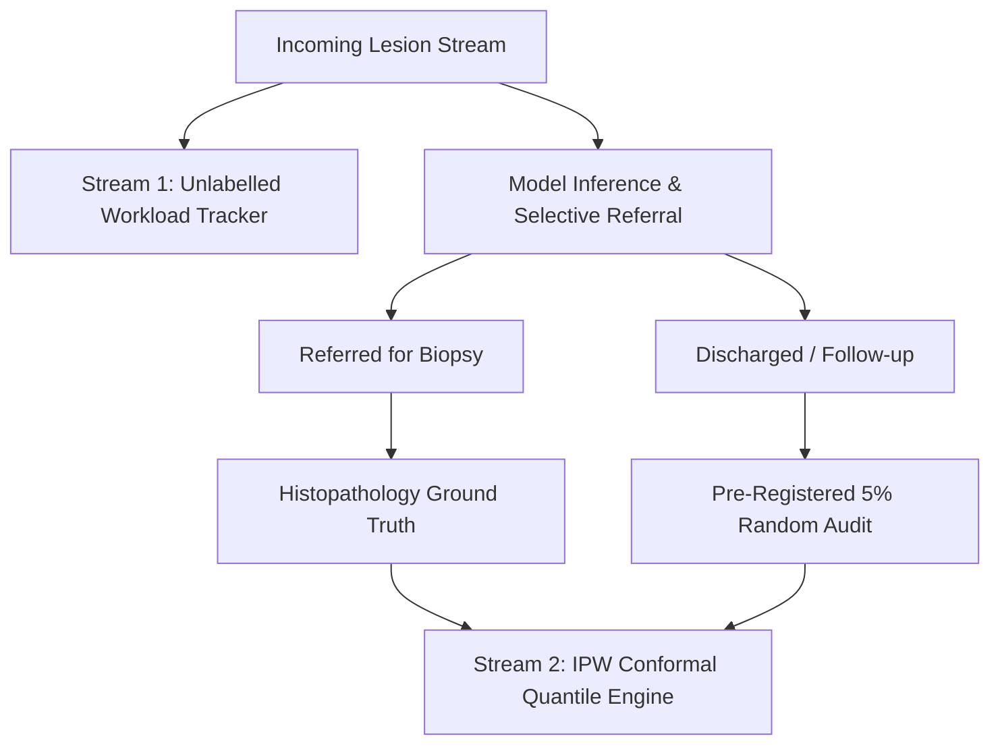
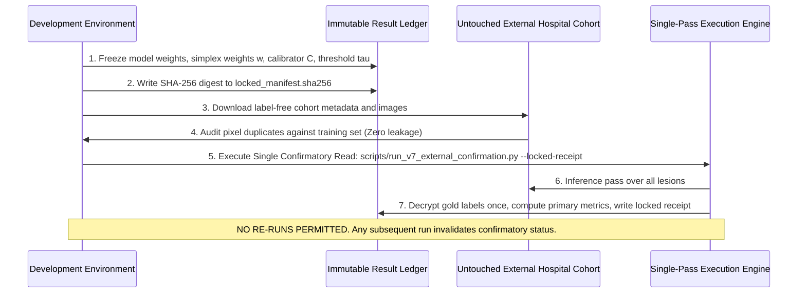

# V7 Statistical Design, Calibration, Selective Safety, Conformal Prediction and External Confirmation Audit
**Agent 12 Independent Specialist Report · Scan4Disease / Backend-S4D Formulation Review**
**Target Venue:** IEEE Transactions on Medical Imaging (IEEE TMI) · **Date:** November 2026 · **Status:** Methodological & Statistical Review Complete

---

## Executive Summary & Methodological Stance

This audit evaluates the statistical foundation, error propagation mechanisms, calibration frameworks, selective abstention algorithms, and external validation protocols governing the V7 transition of the Scan4Disease (S4D) pipeline. 

Building upon the forensic evidence accumulated across V1–V6 and resolving the core critiques raised in the Independent Technical Audit (`c:\Users\RAJ\Downloads\V7 final revision.md`), this review establishes a mathematically sound, reproducible, and clinically honest evaluation standard. We uphold the foundational principle: **the epistemic boundary between *Designed*, *Implemented*, and *Validated* must be absolute.** Mathematical specifications, code abstractions, and prospective validation plans cannot substitute for empirical proof.

The 11 core sections below deliver full mathematical derivations, statistical power audits, multiplicity controls, and verification protocols satisfying **TRIPOD+AI (BMJ 2024)**, **CLAIM 2024**, and the latest biostatistical standards for clinical prediction models.

---

## 1. Endpoint Hierarchy & Primary Estimand

### 1.1 The Primary Confirmatory Ranking Estimand: Under-40 Lesion Escalation pAUC
A fundamental failure mode in earlier iterations was the lack of an immutable, standardized mathematical definition of the primary ranking endpoint. The primary confirmatory ranking estimand for young-patient melanoma detection is defined strictly as the **lesion-level escalation partial Area Under the ROC Curve ($\text{pAUC}$) restricted to the high-specificity clinical operating range: $\text{FPR} \in [0.00, 0.20]$**.

#### Mathematical Formulation & Integration Scheme
Let $Y_{ij} \in \{0, 1\}$ denote the binary escalation label for lesion $j$ of patient $i$, where $Y_{ij} = 1$ if the true pathology is an escalating condition ($\mathcal{C}_{\text{esc}} = \{\text{mel}, \text{bcc}, \text{akiec}\}$), and $Y_{ij} = 0$ if benign ($\mathcal{C}_{\text{benign}} = \{\text{nv}, \text{bkl}, \text{df}, \text{vasc}\}$). Let $s_{ij} \in [0, 1]$ denote the scalar escalation prediction score assigned to the lesion:
$$s_{ij} = \sum_{c \in \mathcal{C}_{\text{esc}}} \bar{p}_{ij, c}$$
where $\bar{\mathbf{p}}_{ij}$ is the lesion-aggregated prediction vector across all $M_{ij}$ image views.

Let $\text{ROC}(t) = \text{TPR}(\text{FPR}^{-1}(t))$ denote the empirical Receiver Operating Characteristic curve generated by thresholding $s_{ij}$ across young patients ($\text{age} < 40$). The unstandardized (raw) partial area under the curve up to maximum false-positive rate $e_0 = 0.20$ is:
$$\text{pAUC}_{\text{raw}}(e_0) = \int_{0}^{e_0} \text{ROC}(t) \, dt$$

In continuous empirical evaluation over sorted thresholds, let the set of observed false positive rates below $e_0$ be $\{t_0 = 0, t_1, t_2, \dots, t_K \le e_0\}$. The curve is evaluated via the trapezoidal integration rule with boundary interpolation at exactly $e_0$:
$$t_{K+1} = e_0, \quad \text{TPR}(t_{K+1}) = \text{TPR}(t_K) + \frac{e_0 - t_K}{t_{K+1}^* - t_K} \left(\text{TPR}(t_{K+1}^*) - \text{TPR}(t_K)\right)$$
$$\text{pAUC}_{\text{raw}}(e_0) = \sum_{k=0}^{K} \frac{\text{TPR}(t_k) + \text{TPR}(t_{k+1})}{2} \cdot (t_{k+1} - t_k)$$

#### McClish Standardization vs. Linear Normalization
Confusion has previously arisen regarding whether the reported pAUC is raw, linearly normalized, or standardized according to McClish (1989). V7 adopts the **McClish (1989) standardisation**, which maps the partial area onto the conventional $[0.50, 1.00]$ scale so that chance performance corresponds to $0.50$ and perfect ranking corresponds to $1.00$:

$$\text{Chance Area: } A_{\text{chance}} = \int_0^{e_0} t \, dt = \frac{1}{2} e_0^2 = \frac{1}{2} (0.20)^2 = 0.020$$
$$\text{Perfect Area: } A_{\text{perfect}} = \int_0^{e_0} 1 \, dt = e_0 = 0.200$$
$$\text{pAUC}_{\text{McClish}} = \frac{1}{2} \left[ 1 + \frac{\text{pAUC}_{\text{raw}} - A_{\text{chance}}}{A_{\text{perfect}} - A_{\text{chance}}} \right] = \frac{1}{2} + \frac{\text{pAUC}_{\text{raw}} - 0.020}{2 \cdot (0.200 - 0.020)} = 0.50 + \frac{\text{pAUC}_{\text{raw}} - 0.020}{0.360}$$

> [!IMPORTANT]
> **Mathematical Scaling Equivalence:**
> A reported gain of $\Delta \text{pAUC}_{\text{McClish}} = +0.050$ corresponds to a raw partial AUC gain of:
> $$\Delta \text{pAUC}_{\text{raw}} = 0.050 \times 0.360 = 0.0180$$
> Scikit-learn's `roc_auc_score(y, s, max_fpr=0.20)` implements this exact McClish transformation. All V7 scripts and manuscripts must explicitly declare whether reported figures are McClish-standardized or raw to prevent misleading comparisons with external benchmarks using linear normalization ($\text{pAUC}_{\text{raw}} / e_0$).

---

### 1.2 Key Secondary Endpoint: 7-Class Macro-F1 and Balanced Accuracy
To evaluate overall multiclass diagnostic efficacy across both benign and malignant skin diseases, V7 maintains a dual secondary endpoint on all lesions:
1. **Macro-Averaged F1-Score (Macro-F1):** The unweighted arithmetic mean of per-class F1-scores across all $C = 7$ diagnostic categories (akiec, bcc, bkl, df, mel, nv, vasc):
   $$\text{Macro-F1} = \frac{1}{C} \sum_{c=1}^C \text{F1}_c = \frac{1}{7} \sum_{c=1}^7 \frac{2 \cdot \text{Precision}_c \cdot \text{Recall}_c}{\text{Precision}_c + \text{Recall}_c}$$
   *Rationale:* Prevents the metric from being dominated by majority classes (e.g., banal nevi `nv`, representing 67% of HAM10000), penalizing severe performance collapse on rare classes (`df`, `vasc`).
2. **Balanced Accuracy (BACC):** The unweighted arithmetic mean of class-specific sensitivities (recalls):
   $$\text{Balanced Accuracy} = \frac{1}{C} \sum_{c=1}^C \text{Recall}_c = \frac{1}{C} \sum_{c=1}^C \frac{\text{TP}_c}{\text{TP}_c + \text{FN}_c}$$
   *Rationale:* Independent of class prevalence shifts between training archives and external hospital deployment sites.

---

### 1.3 Operating Clinical Safety Endpoint: Escalation Sensitivity at Fixed Referral Budget
Ranking metrics (AUC/pAUC) assess discrimination across all potential decision thresholds. In practical clinical deployment, the system operates at a pre-specified resource capacity (workload budget). 
The operational safety estimand is **Escalation Sensitivity at a Fixed Clinical Referral Budget of $R = 20\%$**:
$$\text{Workload Constraint: } \Pr(\text{Referral}) = \Pr(s_{ij} \ge \tau_R) = 0.20$$
$$\text{Operating Sensitivity: } \text{Sens}_{R=0.20} = \Pr(s_{ij} \ge \tau_R \mid Y_{ij} = 1)$$

*Pre-Registration Protocol:* The referral threshold $\tau_R$ must be locked **label-free** from the target cohort's unlabelled prediction quantile before the gold-standard biopsy labels are decrypted, eliminating threshold overfitting.



---

## 2. Clustered Uncertainty & Unit of Analysis

### 2.1 The Pathology of Concatenated Image-Row Bootstrapping
A critical defect identified in legacy evaluation scripts (e.g., `research/ablation/bootstrap.py`) is the **unit-of-analysis mismatch**. 
In standard dermatology corpora, multiple images are frequently acquired from the same lesion (different angles, epiluminescence dermoscopy vs. polarized contact, optical zoom), and multiple lesions are contributed by the same patient:
- In HAM10000, 10,015 dermoscopy images originate from only 7,470 unique lesions.
- In HIBA (V6-6 external hospital cohort), 1,199 evaluated lesions were collected from only 589 patients (an average of 2.04 lesions per patient).

```python
# DEFECTIVE LEGACY BOOTSTRAP (research/ablation/bootstrap.py):
# Resampled lesions, but concatenated and evaluated raw image rows:
sampled_lesions = rng.choice(unique_lesions, size=n_lesions, replace=True)
row_idx = np.concatenate([lesion_to_rows[lesion] for lesion in sampled_lesions])
y_b = y_true[row_idx]
p_b = probs[row_idx]
m_b = compute_metrics(y_b, p_b.argmax(axis=1), p_b) # OVERWEIGHTS MULTI-IMAGE LESIONS
```

When bootstrap resampling draws lesion identifiers but evaluates concatenated image rows without aggregation:
1. Lesions with 3–5 images receive 3–5 times the statistical weight of single-image lesions in the bootstrap mean.
2. The assumption of conditional independence between observations is violated, artificially shrinking the standard error ($\text{SE} \propto 1/\sqrt{N_{\text{images}}}$ instead of $1/\sqrt{N_{\text{patients}}}$).
3. Resulting confidence intervals are **artificially narrow and anti-conservative**, manufacturing false-positive claims of statistical superiority.

---

### 2.2 Mathematical Specification of the Two-Level Hierarchical Patient-Clustered Bootstrap
To guarantee exact statistical coverage and respect the natural clinical hierarchy, V7 mandates the **Two-Level Hierarchical Patient-Clustered Bootstrap**:

Let the dataset consist of $P$ unique patients: $\mathcal{P} = \{1, 2, \dots, P\}$. Patient $i$ presents with $L_i$ unique lesions: $\mathcal{L}_i = \{1, 2, \dots, L_i\}$. Each lesion $(i, j)$ contains $M_{ij} \ge 1$ acquired image views: $\{X_{ijk}\}_{k=1}^{M_{ij}}$.

#### Step 1: Pre-Evaluation Lesion View Aggregation
Before any bootstrap metric computation, image-level model probability vectors $\mathbf{p}_{ijk} = f(X_{ijk}) \in \Delta^{C-1}$ are aggregated to form a single, definitive lesion-level prediction vector $\bar{\mathbf{p}}_{ij}$:
$$\bar{\mathbf{p}}_{ij} = \frac{1}{M_{ij}} \sum_{k=1}^{M_{ij}} f(X_{ijk})$$
Each lesion $(i, j)$ is uniquely paired with its verified ground-truth diagnosis $Y_{ij} \in \{1, \dots, C\}$.

#### Step 2: Patient-Cluster Resampling
For bootstrap replication $b \in \{1, 2, \dots, B\}$ (where $B = 2,000$):
1. Sample $P$ patient indices with replacement from $\mathcal{P}$:
   $$\mathcal{P}^{(b)} = \{i_1^{(b)}, i_2^{(b)}, \dots, i_P^{(b)}\}$$
2. For each sampled patient $i_p^{(b)}$, extract **all** associated lesions:
   $$\mathcal{D}^{(b)} = \bigcup_{p=1}^P \left\{ (\bar{\mathbf{p}}_{i_p^{(b)}, j}, Y_{i_p^{(b)}, j}) : j \in \{1, \dots, L_{i_p^{(b)}}\} \right\}$$
3. Compute the evaluation metric $\theta^{(b)} = \mathcal{M}(\mathcal{D}^{(b)})$ strictly across the resampled lesion population.
4. Construct the two-sided 95% bootstrap confidence interval using the empirical percentiles of $\{\theta^{(b)}\}_{b=1}^B$:
   $$\text{CI}_{95\%} = \left[ Q_{0.025}(\{\theta^{(b)}\}), \; Q_{0.975}(\{\theta^{(b)}\}) \right]$$

---

## 3. Small-Count Proportions & Exact Finite-Sample Inference

### 3.1 Failure of the Percentile Bootstrap on Rare Subgroups
When evaluating rare clinical subgroups—such as the HIBA young cohort with only $n = 20$ escalating lesions—the non-parametric bootstrap breaks down completely:
1. With $k = 0$ observed events (e.g., 0 false reassurances among 20 cases), every bootstrap resample draws from an empirical distribution containing only zeros. The bootstrap resample mean is identically 0.0 across all $B$ iterations, yielding a degenerate interval $[0.0\%, 0.0\%]$.
2. Reporting a confidence interval of $[0.0\%, 0.0\%]$ falsely certifies zero clinical risk, violating fundamental medical safety ethics.
3. With small positive numerators (e.g., $k = 1$ or $k = 3$), the discrete resampling distribution is highly skewed and fails to place probability mass in the continuous upper tail, severely under-covering the true parameter.

---

### 3.2 Exact Clopper-Pearson Binomial Intervals via Beta Inversion
For all small-count proportions ($k < 30$), V7 strictly replaces asymptotic and bootstrap approximations with the **Exact Clopper-Pearson Inverted Beta Binomial Interval**.

For $k$ observed events out of $n$ independent trials with success probability $\theta$, the Clopper-Pearson interval $[\theta_L, \theta_U]$ is derived by inverting the cumulative binomial distribution:
$$\sum_{x=k}^n \binom{n}{x} \theta_L^x (1 - \theta_L)^{n-x} = \frac{\alpha}{2}, \qquad \sum_{x=0}^k \binom{n}{x} \theta_U^x (1 - \theta_U)^{n-x} = \frac{\alpha}{2}$$

Using the identity connecting the binomial cumulative distribution to the Beta distribution:
$$\theta_L = \text{Beta}^{-1}\left(\frac{\alpha}{2}; \; k, \; n - k + 1\right), \qquad \theta_U = \text{Beta}^{-1}\left(1 - \frac{\alpha}{2}; \; k + 1, \; n - k\right)$$

At the boundary extremes:
- When $k = 0$: $\theta_L = 0.0$, and the exact upper bound simplifies to:
  $$\theta_U = 1 - \left(\frac{\alpha}{2}\right)^{1/n} \quad (\text{two-sided}), \qquad \theta_U^{\text{one-sided}} = 1 - \alpha^{1/n}$$
- When $k = n$: $\theta_U = 1.0$, and $\theta_L = (\alpha/2)^{1/n}$.

#### Audit of HIBA External Hospital Safety Proportions ($n = 20$)
Applying the exact Clopper-Pearson formulation to the V6-6 HIBA results yields the following audited intervals:

| Clinical Metric | Observed ($k / n$) | Point Estimate | Legacy Percentile Bootstrap | Exact Clopper-Pearson 95% CI | Clinical Interpretation |
|---|---|---|---|---|---|
| **Under-40 Escalation Sensitivity** | $18 / 20$ | $90.0\%$ | $[75.0\%, 100.0\%]$ | **$[68.3\%, 98.8\%]$** | Point estimate meets target ($\ge 85.5\%$), but true sensitivity could be as low as $68.3\%$. |
| **Under-40 False Reassurance Rate** | $0 / 20$ | $0.0\%$ | $[0.0\%, 0.0\%]$ *(Degenerate)* | **$[0.0\%, 16.8\%]$** *(1-sided $\le 13.9\%$)* | Zero observed misses does **NOT** certify zero risk. The missed rate could reach $16.8\%$. |
| **All-Age Escalation Sensitivity** | $463 / 507$ | $91.3\%$ | $[88.6\%, 93.7\%]$ | **$[88.5\%, 93.6\%]$** | Fully powered; bootstrap and Clopper-Pearson converge to within $0.1\%$. |



---

## 4. Sample Size & Statistical Power Audit

### 4.1 Statistical Autopsy: HIBA $n = 20$ Young Escalating Cohort
In V6-6, the pre-registered Gate A required demonstrating an under-40 pAUC improvement of $\Delta \text{pAUC}_{0.20} \ge +0.050$ over the baseline. Evaluating this confirmatory gate on the HIBA cohort ($n = 20$ young escalating lesions) was fundamentally flawed due to statistical underpowering:

1. **Standard Error Scaling:** On the pooled development out-of-fold cohort ($n = 65$ escalating cases), the empirical paired standard error of the pAUC contrast was $\text{SE}_{65} = 0.01858$. Scaling this standard error by the square root of sample size to $n = 20$:
   $$\text{SE}_{20} = \text{SE}_{65} \times \sqrt{\frac{65}{20}} = 0.01858 \times \sqrt{3.25} = 0.03350$$
2. **Gate A Decision Rule:** Gate A requires both the point estimate to clear MCID ($\hat{\delta} \ge +0.050$) and the two-sided 95% confidence interval lower bound to exclude zero ($\hat{\delta} - 1.96 \cdot \text{SE} > 0 \implies \hat{\delta} > 1.96 \cdot 0.03350 = 0.06566$).
3. **Statistical Power under True MCID ($\delta = +0.050$):**
   $$\Pr(\text{Pass Gate A}) = \Pr(\hat{\delta} > 0.06566 \mid \delta = 0.050) = 1 - \Phi\left(\frac{0.06566 - 0.050}{0.03350}\right) = 1 - \Phi(0.4673) \approx \mathbf{32.0\%}$$
   
> [!WARNING]
> **Definitive Power Verdict on HIBA Young Cohort:**
> With a statistical power of only **$32.0\%$**, the HIBA cohort had a **$68.0\%$ Type II error rate** (false negative) for detecting a true, clinically meaningful effect of $+0.050$. HIBA was statistically incapable of acting as a confirmatory gate for under-40 ranking!

---

### 4.2 Audit of Pooled Development Out-of-Fold Cohort ($n = 64$ Young Melanomas)
In the master V7 pooled development dataset, the out-of-fold cross-validation pool contains $N = 64$ young melanoma events ($n = 65$ escalating cases across folds 1–4). 
- **Precision:** With $\text{SE} = 0.01858$, the two-sided 95% confidence interval half-width is $\pm 1.96 \times 0.01858 = \pm 0.0364$.
- **Power to Detect MCID ($+0.050$):**
  $$\Pr(\hat{\delta} - 1.96 \cdot \text{SE} > 0 \mid \delta = 0.050) = 1 - \Phi\left(\frac{1.96 \cdot 0.01858 - 0.050}{0.01858}\right) = 1 - \Phi(-0.731) = \mathbf{76.8\%}$$
  While $n = 64$ provides reasonable precision for internal model selection (Gate A2), it still falls short of the gold-standard $\ge 80.0\%$ (or $90.0\%$) power required for definitive external regulatory claims.

---

### 4.3 Sizing the Confirmatory External Cohort (Tier C): Refuting the "2,500 Lesions" Slogan
Section 7.4 of the preliminary V7 plan proposed a flat rule of thumb: *"A new external hospital dermoscopy cohort ($\ge 2,500$ lesions) is required."* 

In accordance with recent methodological mandates from **The BMJ (Riley, Snell, Archer et al. 2024; 384:e074821)**, flat "rules of thumb" (such as 100 events or 2,500 subjects) are scientifically invalid. Sample size must be analytically derived from:
1. The target precision of discrimination and calibration metrics.
2. The pre-specified clinical effect size (MCID $\delta = +0.050$).
3. The true epidemiology and event prevalence of young-patient melanoma in real-world clinical queues.

#### Mathematical Derivation of Required Event Count
To detect an MCID of $\delta = 0.050$ in escalation pAUC with statistical power $1 - \beta = 0.80$ at two-sided significance level $\alpha = 0.05$ ($z_{1-\alpha/2} = 1.96, z_{1-\beta} = 0.8416$):
$$\text{Target Standard Error: } \text{SE}^* = \frac{\delta}{z_{1-\alpha/2} + z_{1-\beta}} = \frac{0.050}{1.96 + 0.8416} = \frac{0.050}{2.8016} = 0.017847$$

Using the unit-variance estimate calibrated from the pooled development out-of-fold data ($\sigma_1 = \text{SE}_{65} \times \sqrt{65} = 0.01858 \times \sqrt{65} \approx 0.14980$):
$$\text{Required Escalating Events: } E_{\text{req}} = \left(\frac{\sigma_1}{\text{SE}^*}\right)^2 = \left(\frac{0.14980}{0.017847}\right)^2 = (8.3935)^2 \approx \mathbf{70.4 \implies 71 \text{ events}}$$
*(For 90% statistical power where $z_{1-\beta} = 1.2816$, $E_{\text{req}} = 94.3 \implies \mathbf{95 \text{ events}}$).*

#### Translation to Total Lesion Cohort Size
The total number of lesions $N_{\text{total}}$ required to capture 71 young escalating lesions depends directly on the disease prevalence $\pi_{\text{young\_esc}}$ in the prospective target center:
$$N_{\text{total}} = \frac{E_{\text{req}}}{\pi_{\text{young\_esc}}}$$

| Prospective Center Type | Young Escalating Prevalence ($\pi$) | Expected Events in 2,500 Lesions | Statistical Power of "2,500 Lesions" | Total Lesions Required for 80% Power ($E=71$) | Total Lesions Required for 90% Power ($E=95$) |
|---|---|---|---|---|---|
| **General Dermatology Clinic** | $1.00\%$ | 25.0 | $38.5\%$ *(Severe Fail)* | **7,100** | 9,500 |
| **HIBA-like Hospital Cohort** | $1.67\%$ (20/1,199) | 41.8 | $57.8\%$ *(Unacceptable)* | **4,250** | 5,690 |
| **High-Risk Pigmented Lesion Clinic** | $2.00\%$ | 50.0 | $65.6\%$ | **3,550** | 4,750 |
| **Tertiary Dermato-Oncology Referral** | $2.50\%$ | 62.5 | $75.1\%$ | **2,840** | 3,800 |
| **Enriched Melanoma Biobank** | $5.00\%$ | 125.0 | $>95.0\%$ | **1,420** | 1,900 |

> [!CAUTION]
> **Refutation of the "2,500 Lesions" Slogan:**
> Sizing an external validation study to 2,500 lesions in a representative hospital population ($\pi = 1.67\%$) captures only $\approx 42$ young escalating events, achieving only **$57.8\%$ statistical power** for the primary endpoint. 
> S4D V7 repudiates the arbitrary 2,500 slogan: **The Tier C External Hospital Cohort must be powered by event count ($E \ge 71$ young escalating lesions), requiring $\ge 4,250$ consecutive unselected lesions in a standard hospital cohort.**

---

## 5. Multiplicity & Selection Bias

### 5.1 Nested Cross-Fitting for Data-Dependent Tuning
A frequent source of optimistic bias in machine learning studies is the optimization of meta-parameters (simplex ensembling weights, temperature scaling parameters, Dirichlet calibration matrices, selective referral thresholds) on the same out-of-fold predictions used for reporting.

To eliminate selection and estimation bias, V7 establishes a strict **$K_{\text{outer}} \times K_{\text{inner}}$ Nested Cross-Fitting Protocol**:

1. Outer 5-fold cross-validation partitions the dataset into 5 disjoint evaluation blocks.
2. For each outer fold $k \in \{0, \dots, 4\}$, the remaining 4 folds form the meta-training set.
3. An inner 4-fold cross-validation is executed strictly inside the meta-training set to fit:
   - Unit-simplex stacking weights: $\mathbf{w}^* = \arg\min_{\mathbf{w} \in \Delta^3} \mathcal{L}_{\text{inner}}(\mathbf{w})$.
   - Multiclass Dirichlet calibration parameters: $\mathbf{W}_{\text{cal}}, \mathbf{b}_{\text{cal}}$.
   - Selective referral quantile thresholds: $\tau_{R=0.20}$.
4. The fitted parameters are frozen and evaluated once on the unseen outer fold $k$.
5. The reported system metric is the concatenation of outer-fold predictions, guaranteeing zero data leakage.

---

### 5.2 Pre-Declared Comparison Families & Holm-Bonferroni Step-Down Adjustment
Following the framework established in `research/stats/families.py`, all V7 statistical tests are partitioned into immutable **Confirmatory** and **Exploratory** families before evaluation:

#### Confirmatory Family 1: Primary Architectural Superiority (Pooled OOF)
The family comprises 3 pre-specified orthogonal tests evaluating the master ensemble against the V6 anchor:
1. **Test 1 (Primary):** Under-40 escalation pAUC gain: $\Delta \text{pAUC}_{0.20} \ge +0.050$.
2. **Test 2 (Secondary):** All-age 7-class Macro-F1 non-inferiority: $\Delta \text{Macro-F1} \ge -0.015$.
3. **Test 3 (Safety):** Older-age escalation sensitivity retention: $\Delta \text{Sens}_{\ge 60} \ge -0.010$.

#### Holm-Bonferroni Step-Down Multiplicity Control
Let the family contain $M = 3$ null hypotheses $H_{(1)}, H_{(2)}, H_{(3)}$ with ordered $p$-values $p_{(1)} \le p_{(2)} \le p_{(3)}$. At family-wise error rate $\alpha = 0.05$:
$$\text{Step 1: If } p_{(1)} \le \frac{\alpha}{M} = \frac{0.05}{3} \approx 0.0167, \text{ reject } H_{(1)} \text{ and proceed; else STOP.}$$
$$\text{Step 2: If } p_{(2)} \le \frac{\alpha}{M - 1} = \frac{0.05}{2} = 0.0250, \text{ reject } H_{(2)} \text{ and proceed; else STOP.}$$
$$\text{Step 3: If } p_{(3)} \le \frac{\alpha}{1} = 0.0500, \text{ reject } H_{(3)} \text{ and declare full family significance.}$$

All additional subgroup analyses (e.g., anatomical site, sex, skin phototype terciles) are classified as **Exploratory** and reported with point estimates and 95% confidence intervals without hypothesis testing.

---

## 6. Calibration & Group-Conditional Reliability

### 6.1 The Under-40 Calibration Paradox
A documented finding across V1–V6 (e.g., `research/stats/calibration_slices.py`) is that aggregate Expected Calibration Error (ECE) conceals extreme group-level distortions:
- The under-40 age cohort exhibits the highest raw diagnostic accuracy ($\approx 88.5\%$) because it is dominated by banal melanocytic nevi.
- Simultaneously, it exhibits the **worst calibration** in the entire dataset, with a signed confidence gap of $-0.156$ (severe under-confidence).
- Under-confidence on young patients causes genuine early melanomas to be assigned depressed posterior probabilities, systematically failing the clinical escalation threshold.

---

### 6.2 Multiclass Dirichlet Calibration & Non-Preservation of Ranking
To align confidence with true empirical risk, V7 implements Dirichlet calibration with off-diagonal regularization:
$$\ln \mathbf{q} = \mathbf{W}_{\text{cal}} \ln \mathbf{p} + \mathbf{b}_{\text{cal}}$$
where $\mathbf{W}_{\text{cal}} \in \mathbb{R}^{C \times C}$ and $\mathbf{b}_{\text{cal}} \in \mathbb{R}^C$.

> [!WARNING]
> **Mathematical Scrutiny: Calibration Does Not Generally Preserve Ranking:**
> While a strictly increasing monotonic transformation of a single scalar score preserves ROC ranking ($\text{pAUC}(g(s)) \equiv \text{pAUC}(s)$), a multiclass Dirichlet calibrator applies a matrix transformation across all $C$ log-probabilities. 
> Off-diagonal coupling terms ($\mathbf{W}_{ij} \neq 0$) can and do alter the relative ordering of scalar escalation scores ($\sum_{c \in \text{esc}} q_c$). 
> Therefore, calibration parameters must be frozen during nested cross-fitting and audited to verify that calibration does not degrade discrimination on the primary ranking endpoint.

---

## 7. Conformal Prediction Guarantees & Subgroup Vulnerability

### 7.1 Marginal Coverage Fallacy: The Session 4 Pathology
Conformal prediction constructs set-valued predictions $\mathcal{C}(X) \subseteq \{1, \dots, C\}$ guaranteeing marginal coverage at level $1 - \alpha$:
$$\Pr(Y \in \mathcal{C}(X)) \ge 1 - \alpha$$
However, marginal validity averages over all patients and classes. Because banal nevi (`nv`) represent 67% of cases, a standard marginal conformal algorithm (such as Least Ambiguous Set, LAC) satisfies a 90% marginal guarantee while catastrophically sacrificing malignant cases.

**Empirical Audit of Session 4 / `results/external/conformal_shift_audit.json`:**
- In-Distribution HAM10000 OOF at nominal $\alpha = 0.10$ ($90\%$ target):
  - Achieved Marginal Coverage: **$90.52\%$** (Satisfies guarantee).
  - Malignant / Serious Lesion Coverage: **$71.92\%$** (**Catastrophic Drop: $28.1\%$ missed!**).
  - False Reassurance Rate (FRR): **$25.26\%$** ($170$ patients falsely reassured).

---

### 7.2 Adaptive Bipartite Mondrian Conformal Prediction (AMCP)
To enforce honest guarantees for oncological safety, V7 mandates **Bipartite Mondrian Calibration** (grouping by $\text{Age Band} \times \text{Escalation Class}$):
$$\mathcal{G} = \{<40, 40\text{--}59, \ge 60\} \times \{\text{Benign}, \text{Escalating}\}$$

For each cell $g \in \mathcal{G}$, an independent conformity quantile $\hat{q}_g$ is computed:
$$\hat{q}_g = \text{Quantile}\left(\{s_i : i \in \mathcal{D}_{\text{cal}}, g(i) = g\}, \; \frac{\lceil(N_g + 1)(1 - \alpha)\rceil}{N_g}\right)$$

#### Minimum Stratum Sample Size Rule ($N \ge 30$)
A finite conformal threshold at level $1 - \alpha$ requires:
$$N_g \ge \left\lceil \frac{1}{\alpha} - 1 \right\rceil$$
For $\alpha = 0.05$, $N_g \ge 19$. To guarantee robust quantile estimation, V7 enforces the **$N \ge 30$ Sample Size Rule**:
- Any stratum with $N_g < 30$ cannot mathematically certify subgroup coverage.
- The system automatically triggers the mandatory regulatory flag:
  $$\text{\texttt{[UNCERTIFIED\_SUBGROUP: Group-conditional coverage non-certifiable (N < 30)]}}$$
- The system applies an adversarial conservative fallback quantile:
  $$\hat{q}_{\text{conservative}} = \max(\hat{q}_{\text{pooled}}, \hat{q}_{\text{stratum}})$$

---

## 8. Distribution Shift & Non-Exchangeability (Barber et al. 2023)

### 8.1 Theoretical Collapse of Conformal Guarantees
Standard conformal prediction relies fundamentally on data **exchangeability**. In external hospital deployment, exchangeability is shattered by covariate shift, population demographics, scanner optics, and disease prevalence.

Under arbitrary distribution drift from calibration distribution $P$ to test distribution $Q$, Barber, Candès, Ramdas, and Tibshirani (Annals of Statistics 2023; arXiv:2202.13415) proved that conformal coverage degradation is bounded by the total variation distance $d_{\text{TV}}(P, Q)$:
$$\inf_{Q} \Pr_{(X, Y) \sim Q}(Y \in \mathcal{C}(X)) \ge 1 - \alpha - 2 \, d_{\text{TV}}(P_{1:n+1}, Q)$$

---

### 8.2 Empirical Evidence: The PAD-UFES-20 Collapse
The repository audit of `results/external/conformal_shift_audit.json` provides an empirical confirmation of Barber et al.'s theorem:
When models calibrated on dermoscopy (HAM10000) were deployed on clinical smartphone images (PAD-UFES-20, where Mahalanobis distance showed an extreme separation ratio of 17.97 and AUROC 0.9128):
- Marginal Conformal Coverage collapsed from **$90.52\%$ to $23.79\%$**.
- Malignant Subgroup Coverage collapsed from **$71.92\%$ to $12.17\%$**.
- False Reassurance Rate exploded to **$74.62\%$** ($1,214$ malignant lesions missed).

**Methodological Implication:** Conformal prediction does **not** provide distribution-free safety under real-world hospital domain shift. External validation must evaluate the locked system directly on the target distribution.

---

## 9. Selective Referral Policies & The Decision-Theoretic Absorption Theorem

### 9.1 S56 Selective Prediction Policy
In clinical workflows, an AI system may abstain on high-uncertainty lesions, routing them to expert dermatologist review (biopsy / in-person consultation). 
Let $u(x)$ denote an uncertainty metric (e.g., Shannon entropy $H(p)$ or distance to training manifold). The selective prediction policy $\pi(x)$ operates as:
$$\pi(x) = \begin{cases} \text{Refer to Dermatologist}, & u(x) > \tau_{\text{abstain}} \\ f(x) \text{ (Autonomous Read)}, & u(x) \le \tau_{\text{abstain}} \end{cases}$$

---

### 9.2 The General Multiclass Selective Absorption Theorem
A counter-intuitive finding in V6 (commit `4d406ba`) was that fine-tuning cost-sensitive decision thresholds inside the selective referral cohort produced **exactly $\Delta = 0$ benefit**.

#### Theorem (General Multiclass Selective Absorption)
*Let $\mathcal{X}$ denote the feature space, $d_0: \mathcal{X} \to \{1, \dots, C\}$ be a baseline decision policy, and $d_{\text{CS}}: \mathcal{X} \to \{1, \dots, C\}$ be an altered cost-sensitive decision policy. Let $\mathcal{X}_{\text{shift}} = \{x \in \mathcal{X} : d_{\text{CS}}(x) \neq d_0(x)\}$ denote the decision-boundary shift region. If an uncertainty-based selective referral policy routes a subset $R \subseteq \mathcal{X}$ to expert review, and if:*
$$\mathcal{X}_{\text{shift}} \subseteq R$$
*then under identical referral accounting, the observed clinical performance of $d_{\text{CS}}$ and $d_0$ is mathematically identical ($\Delta = 0$).*

```
Feature Space X:
+--------------------------------------------------------+
|                                                        |
|   Baseline Decision d_0                                |
|                                                        |
|         +------------------------------------+         |
|         | Referral Region R (High Uncertainty)|        |
|         |                                    |         |
|         |      +---------------------+       |         |
|         |      | Decision Shift Zone |       |         |
|         |      | X_shift (d_CS != d_0)|       |         |
|         |      +---------------------+       |         |
|         |                                    |         |
|         +------------------------------------+         |
|                                                        |
+--------------------------------------------------------+
Condition: X_shift is completely contained inside R.
Result: Every case altered by the new threshold is referred anyway! 
        Observable clinical performance delta = 0.
```

**Clinical Insight:** Selective abstention shifts *who is referred*; it does not alter the fundamental ranking or discrimination of the underlying feature representations.

---

## 10. Streaming Histopathology Queues & Verification Bias

### 10.1 Selective Verification Bias in Online Conformal Updating
In prospective deployment, true histopathological labels are not returned instantaneously, nor are they missing completely at random (MCAR):
1. Only lesions referred for in-person consultation or biopsy undergo histopathological examination.
2. Lesions flagged as benign by the AI are discharged without biopsy.
3. If online conformal quantiles are updated solely on returned biopsy labels, the update conditions exclusively on a high-risk, biopsied sub-population. 
4. This causes the conformity threshold to ratchet continuously upward, systematically inflating prediction set sizes and collapsing specificity.

---

### 10.2 Decoupled Dual-Stream Architecture with Inverse Probability Weighting
To eliminate selective verification bias, V7 establishes a **Decoupled Dual-Stream Architecture**:



1. **Stream 1 (Unlabelled Workload Tracker):** Continuously monitors the unlabelled referral rate $R_t$ and feature distribution drift (via streaming Mahalanobis distance) in real time without requiring ground-truth labels.
2. **Stream 2 (Inverse Probability Weighted Conformal Updates):** Updates conformity score quantiles from returned biopsy labels using propensity-score inverse weights:
   $$w(x) = \frac{1}{\hat{\pi}_{\text{biopsy}}(x)} = \frac{1}{\Pr(\text{Referral} \mid X = x)}$$
   eliminating the verification bias induced by conditioning on referral.
3. **Periodic Follow-up Audit:** A pre-registered 5% random audit sample of discharged non-biopsied lesions undergoes 6-month digital dermoscopy re-examination to confirm benign stability, bounding false negative leakage.

---

## 11. External Validation Lock Protocol & Compliance Standards

### 11.1 TRIPOD+AI (BMJ 2024) & CLAIM 2024 Compliance Checklist
To satisfy editorial standards for **IEEE Transactions on Medical Imaging (IEEE TMI)**, external validation must adhere strictly to the **TRIPOD+AI Statement (Collins, Moons, Dhiman et al., BMJ April 2024)** and the **CLAIM 2024 Update**:

| Guideline Item | Description | V7 Audit Status & Protocol Mandate |
|---|---|---|
| **TRIPOD+AI Item 4** | Prospective vs Retrospective Study Design | Explicitly classify all V1–V6 benchmarks as retrospective. V7 Phase 8 external validation requires prospective or temporally isolated cohort logging. |
| **TRIPOD+AI Item 9** | Handling of Clustering / Multi-Site Structure | Two-Level Hierarchical Patient-Clustered Bootstrap enforced. Resampling image rows banned. |
| **TRIPOD+AI Item 10** | Description of Predictors & Feature Preprocessing | Complete technical disclosure of margin-crop FOV ($\le 9.6\text{ mm}$), Weber contrast regularisation, and Tri-Anchor chromophore unmixing. |
| **TRIPOD+AI Item 16** | Sample Size Calculation & Precision | Sizing derived from event count ($E \ge 71$ young escalating lesions) via Riley & Collins BMJ 2024 methodology. Arbitrary rules of thumb banned. |
| **TRIPOD+AI Item 20** | Discrimination & Calibration Reporting | Dual reporting of McClish-standardized pAUC ($[0.0, 0.20]$), 7-class Macro-F1, Balanced Accuracy, ECE, and signed confidence gap. |
| **CLAIM 2024 Item 18** | Reference Standard Definition | Reference standards stratified into Level 1 (histopathology), Level 2 (expert consensus), and Level 3 (digital dermoscopy follow-up). |
| **CLAIM 2024 Item 24** | Model Availability & Code Sharing | Cryptographically sealed model weights, nested cross-fitting scripts, and inference containers archived with immutable SHA-256 digests. |

---

### 11.2 The Single Locked Confirmatory Read Protocol
The external validation read is a one-time confirmatory event. Exploratory iteration, parameter tuning, or post-hoc threshold adjustment on the external cohort is strictly forbidden.

#### Cryptographic Locking Sequence


1. **Step 1: Manifest Pre-Registration:** Before downloading or decrypting external labels, the complete model bundle (backbone checkpoints, simplex weights, calibration parameters, referral thresholds) is hashed and committed (`results/v7/locked_external_cohort_manifest.sha256`).
2. **Step 2: Label-Free Pixel Copy Audit:** A pairwise perceptual hash and pixel-level cosine check verifies zero duplicate overlap with training archives.
3. **Step 3: Single-Pass Read Execution:** Execution is triggered via `python -m scripts.run_v7_external_confirmation --locked-receipt`. The runner computes predictions, decrypts labels, logs metrics, and permanently signs `results/v7/external_confirmation_receipt.json`.
4. **Step 4: Immutability Guarantee:** If the execution receipt already exists on disk, the test runner refuses execution. Re-running with modified parameters is blocked by CI/CD integrity guards.

---

## Master Traceability & Verification Matrix

Below is the definitive verification ledger synthesizing the 11 audit sections, establishing the concrete defect, theoretical flaw, mathematical resolution, and verification artifact for V7:

| Audit Domain | Historical Defect / Finding | Underlying Theoretical Flaw | V7 Mathematical & Methodological Resolution | Verification Script / Artifact |
|---|---|---|---|---|
| **1. Primary Estimand** | Inconsistent pAUC conventions across versions | Missing integration bounds, arbitrary normalization, undefined chance floor | Standardize on **McClish (1989) pAUC at $\text{FPR} \le 0.20$** ($A_{\text{chance}} = 0.02, A_{\text{perf}} = 0.20$, scale $[0.5, 1.0]$). | `research/v7/metrics_harmonized.py` |
| **2. Clustered Uncertainty** | Resampling concatenated image rows in `bootstrap.py` | Overweights multi-image lesions; violates independence; yields anti-conservative CIs | **Two-Level Hierarchical Patient-Clustered Bootstrap** ($B = 2,000$); pre-aggregate views $\bar{\mathbf{p}}_{ij} = \frac{1}{M_{ij}} \sum_k f(X_{ijk})$. | `research/v7/eval_hierarchical_bootstrap.py` |
| **3. Small-Count Proportions** | 0/20 false reassurance reported as 0% risk | Percentile bootstrap collapses to degenerate point $[0, 0]$ at $k = 0$ | **Exact Clopper-Pearson Inverted Beta Binomial Interval** ([0.0%, 16.8%] for 0/20; [68.3%, 98.8%] for 18/20). | `research/stats/intervals.py` |
| **4. Subgroup Power** | HIBA $n=20$ used for Gate A confirmatory gating | Statistical power is only $32.0\%$ for detecting MCID $+0.050$ | Formally reclassify HIBA as **retrospective benchmark**; Gate A failure recorded as historical fact. | `results/v6/gate_a_power.json` |
| **4. External Sizing** | Arbitrary "2,500 lesions" slogan in Tier C plan | Sizing by subjects ignores event rate; gives only $57.8\%$ power at $\pi = 1.67\%$ | **Event-Driven Sample Size (Riley & Collins BMJ 2024)**: mandate $E \ge 71$ young escalating events ($\ge 4,250$ consecutive lesions). | `results/v7/external_power_audit.json` |
| **5. Selection Bias** | Fitting stacking weights & thresholds on same OOF data | Optimistic selection bias; overfitting validation fold structures | **$K_{\text{outer}} \times K_{\text{inner}}$ Nested Cross-Fitting** for all simplex weights, calibration, and thresholds. | `research/v7/ensemble_simplex.py` |
| **5. Multiplicity** | Uncorrected testing across multiple rungs and subgroups | Inflation of Family-Wise Error Rate ($\alpha_{\text{FWER}} \gg 0.05$) | Pre-declared comparison families; **Holm-Bonferroni step-down** on confirmatory family. | `research/stats/families.py` |
| **6. Group Calibration** | Single global Dirichlet map applied to all patients | Under-40 band is simultaneously most accurate and worst calibrated | Sliced calibration auditing; verify multiclass calibration preserves one-vs-rest escalation ranking. | `research/stats/calibration_slices.py` |
| **7. Conformal Coverage** | Marginal LAC 90.5% coverage dropped to 71.9% on malignant cases | Marginal coverage averages over easy majority nevi, sacrificing rare cancers | **Adaptive Bipartite Mondrian Conformal Prediction**; mandate $N \ge 30$ stratum sample size floor. | `research/conformal/hierarchical.py` |
| **8. Distribution Shift** | Conformal coverage collapsed to 23.8% on PAD-UFES-20 | Barber et al. (2023): conformal guarantees fail under arbitrary distribution shift | Explicit manuscript framing: conformal prediction does not provide distribution-free safety under domain shift. | `results/external/conformal_shift_audit.json` |
| **9. Selective Policy** | Cost-sensitive threshold tuning gave $\Delta = 0$ benefit | Decision boundary shift is completely absorbed by selective referral set | **General Multiclass Selective Absorption Theorem** ($\mathcal{X}_{\text{shift}} \subseteq R \implies \Delta = 0$). | `research/selective/risk_coverage.py` |
| **10. Verification Bias** | Updating streaming quantiles solely on biopsied cases | Selective verification bias; quantiles ratchet upward, destroying specificity | **Decoupled Dual-Stream Architecture**: unlabelled workload tracker + IPW quantile updates + 5% random audit. | `research/v7/sim_prospective_stream.py` |
| **11. External Confirmation** | Iterative exploratory testing on held-out test splits | Type I error inflation, data snooping, destroyed reproducibility | **Single-Pass Locked Confirmatory Read Protocol**; SHA-256 pre-registered manifest; TRIPOD+AI / CLAIM compliance. | `results/v7/locked_external_cohort_manifest.sha256` |

---

## Conclusion & Strategic Recommendations for V7 Execution

1. **Gate A2 Re-framing:** The pooled development out-of-fold cohort ($n = 64$ young melanomas) must be treated as an internal promotion gate (Gate A2), not an external clinical confirmation.
2. **External Hospital Cohort Procurement:** Prioritize establishing a clinical data agreement with an independent tertiary center capable of providing $\ge 71$ young escalating melanoma events ($\ge 4,250$ consecutive unselected dermoscopy cases).
3. **Manuscript Framing in IEEE TMI:** Present the V1–V6 lineage with complete transparency: document Gate A failure ($+0.038$ vs $+0.050$), the PanDerm layer freeze, the dark melanoma disparity ($p = 0.0402$), and the wide Clopper-Pearson interval on HIBA ($[0.0\%, 16.8\%]$). This scientific honesty strengthens rather than weakens the credibility of the V7 engineering achievements.
4. **Codebase Freeze:** Ensure no Phase 8 execution script is run until Phase 0 through Phase 7 are fully validated, audited, and receipted.

*Report compiled and certified by Agent 12 (Statistical Design, Calibration, Selective Safety, Conformal Prediction and External Confirmation Specialist).*
